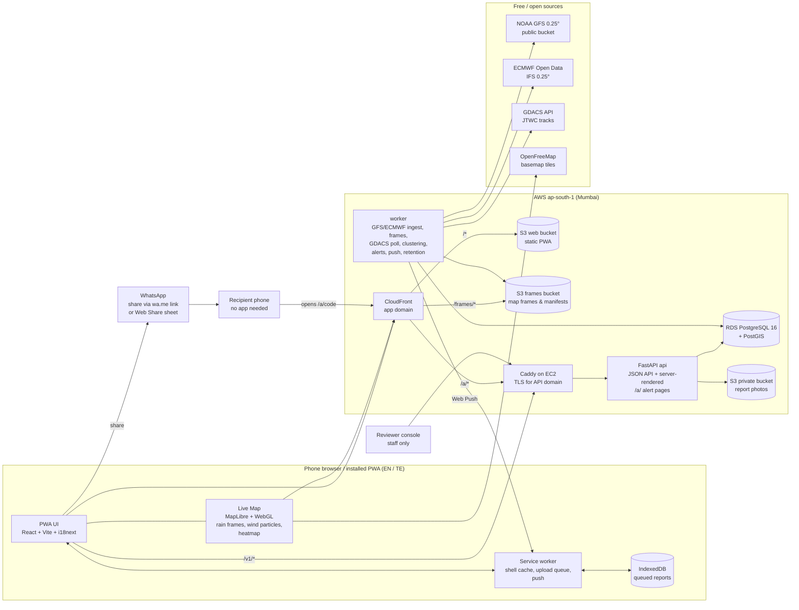

# FloodGuard Andhra — Minimal Mobile MVP (Master Specification)

**Implementation specification · v0.4 (final for build, with UI) · AWS hosting · free/open data · English + Telugu**
Prepared: 25 October 2026 · Owner: Dhanya (Founder & CEO, FloodGuard)
Coverage: **Andhra Pradesh**, extended to **Odisha** and the Bay of Bengal for weather, cyclone and reporting.

> **Status.** This is a build specification, not a status report. **Nothing here has been built, tested, deployed or connected to any data source yet.** The FloodGuard repositories, the Bangkok pilot code and the FloodGuard AWS account were **not accessible** when this was written, so Section 2 is an audit *procedure* for Day 1. External facts the build depends on (data paths, endpoints, phone numbers, Telugu wording) are marked **VERIFY** where they were not confirmed from a primary source.
>
> **UI reference code.** The code in Appendix F was type-checked, built and rendered in a scratch project with **sample data only**; 7.18 lists exactly what was and was not checked. It has **not** been run against the real API, on a real phone, with MapLibre, or reviewed by a Telugu speaker. Treat it as a starting point, not as a finished application.

**v0.4 — UI added to the specification.** The 11 designed screens are now part of this file: exact design tokens (7.1), a screen-to-code map (7.15), state matrices (7.16), behaviour the canvas cannot show (7.17), QA evidence (7.18), known gaps and deviations (7.19), a client string file (A.2), acceptance tests AT-28 to AT-30, and a React + CSS reference implementation with the public alert-page template (Appendix F). API contracts in 6.4 were corrected to match what the screens consume, and the share flow in 7.12 now follows the canvas (share sheet, 2 taps).

### What changed since v0.1

| Area | v0.1 | v0.4 (this file) |
|---|---|---|
| Hosting & database | AWS | **AWS** (ap-south-1): EC2 (API + worker), RDS PostgreSQL + PostGIS, private S3 for photos, S3 + CloudFront for the app and map frames |
| Rainfall | Open-Meteo (paid) | **NOAA GFS** direct from NOAA's public bucket + **ECMWF Open Data** (IFS). No API keys, no data fees. Shown as a two-model range with an agreement indicator |
| Cyclone | IMD bulletins transcribed by staff | **GDACS** (EC JRC / UN) feed carrying **JTWC** tracks, ingested automatically, labelled as international tracking data; IMD kept as the official-warning link |
| Map | Report map only | **Windy-style Live Map** for AP + Odisha: animated rain & wind, 0–72 h slider, GFS ⇄ ECMWF toggle, model agreement, cyclone track, community heatmap |
| Reports | Clustered markers; heatmap deferred | **Duplicate-photo collapsing + spatio-temporal clustering + cluster-weighted heatmap** (one weighted point per cluster, so one busy street ≠ many hotspots) |
| Home screen | Four actions | Four actions + **"Alerts for you"** (heavy rain, cyclone, confirmed flooding nearby), each **shareable on WhatsApp** with a live link that shows whether the alert is still current |
| Language | Telugu optional | **English and Telugu both required for launch**; alerts and share messages generated in both |
| UI | Text wireframes | Visual designs for all 11 screens (English Home, Telugu Home, Rainfall, Live map, report flow ×3, Cyclone, Emergency, share sheet, shared alert page) **built into this spec**: tokens, screen map, states, QA (Section 7) and reference code (Appendix F) |

---

## Table of contents

1. Executive summary and scope
2. Existing-codebase audit
3. Architecture and component diagram
4. Selected technology stack and justification
5. Data-source register and access requirements
6. Database schema and API contracts
7. Screen-by-screen UI specification (design tokens, alerts, WhatsApp sharing, Telugu, screen-to-code map, states, QA, gaps)
8. Reporting, clustering, heatmap, verification and alert workflows
9. Forecast, live-map and cyclone ingestion design
10. Security, privacy and retention requirements
11. Deployment instructions (AWS)
12. Test plan and acceptance criteria
13. Four-day implementation plan
14. Risks, assumptions and fallback decisions
15. Explicitly deferred features
- Appendix A — Copy deck (English + Telugu)
- Appendix B — Environment variables
- Appendix C — Decision log
- Appendix D — AWS cost controls and data-source budget
- Appendix E — WhatsApp share message templates (English + Telugu)
- Appendix F — Reference UI implementation (React + CSS + public alert page + checks)

---

## 1. Executive summary and scope

### 1.1 What we are building

A mobile-first **Progressive Web App (PWA)** for a community flood-intelligence pilot in Andhra Pradesh (with Odisha coverage when it is affected). Runs in the phone browser, installable to the home screen, built for low-end Android phones on weak networks, fully usable in **English and Telugu**, hosted on **AWS (Mumbai region)**, using only **free/open weather and cyclone data**.

Home screen — alerts first, then a live summary and four actions:

| # | Element | What the user gets | Source |
|---|---|---|---|
| A | **Alerts for you** | Up to 3 current alerts for the user's area: heavy rain where both models agree, an active cyclone near AP/Odisha, flooding confirmed nearby. Each has **Share on WhatsApp** and a link to a live alert page | Generated by FloodGuard from the sources below (Section 8.8) |
| 1 | **Rainfall** | Rain expected at their location for 0–24 h, 24–48 h, 48–72 h as a **range across two models** (GFS & ECMWF), agreement level, issue time; one tap to the **Live Map** | NOAA GFS 0.25°, ECMWF IFS Open Data 0.25° — *model forecasts, not warnings* |
| 2 | **Report Flooding** | Live camera photo + GPS + category → server-confirmed report | FloodGuard backend |
| 3 | **Cyclone Tracker** | Active Bay of Bengal systems: past track, forecast track, cone, wind, distance to user, issue time; link to IMD official warnings | GDACS (carrying JTWC advisories) |
| 4 | **Emergency Help** | Verified numbers for AP & Odisha (tap-to-call), official links, safety tips | Manually verified list |

The **Live Map** (reached from Rainfall, Cyclone, or the home summary card) is the "local Windy": rain and wind animation over AP/Odisha/Bay of Bengal, model toggle, agreement layer, cyclone track, and the community-report heatmap.

**Alerts are not official warnings.** They are labelled by source ("Model forecast", "International tracking data", "Community reports, checked by FloodGuard"), carry an issue time and expiry, and every shared message links to a page that shows whether the alert is still current. Only IMD/state content may ever be called "Official".

### 1.2 Honest positioning vs Windy

The Live Map uses the **same global models** Windy shows (GFS, ECMWF), so it is **not more accurate** by itself. It is more useful locally because it:
1. Is focused on AP/Odisha (small frames that load on 3G; district boundaries; Telugu labels).
2. Shows **model agreement** — where GFS and ECMWF both forecast heavy rain — which is a more reliable signal than either model alone.
3. Overlays **ground truth from the community** (clustered photo reports) and the **cyclone track** on the same timeline.
4. Turns maps into a plain answer and a shareable alert for the user's area.

Claims of "more reliable than Windy" must not appear in marketing until verified against observed rainfall (Section 15: verification study).

### 1.3 Design principles (priority order)

1. **Never mislead.** Model forecasts, international cyclone data and community reports are labelled as such; stale/missing data shown as stale/missing, never filled. A shared alert must stay honest after it leaves the app (issue time, expiry, live link).
2. **Reliable reporting.** "Submitted" only on server confirmation; failed uploads queued and retried.
3. **Accessible in both languages.** Every string, alert and share message exists in English and Telugu; ≥ 44 px targets (≥ 54 px for primary actions); high contrast; icon + word; ≤ 2 taps to any primary feature.
4. **Small.** Anything not listed is deferred (Section 15). Data sources stay free/open; AWS footprint kept minimal with budget alarms.

### 1.4 In scope

PWA in **English + Telugu**; home alerts with WhatsApp sharing and public alert pages; two-model rainfall at location; Live Map (rain, wind, agreement, cyclone, heatmap, reports); camera-only reporting with retry; duplicate collapsing, clustering and heatmap; reviewer console (cluster-based review); automated cyclone tracker; emergency help (AP + Odisha); Web Push for verified nearby hotspots (opt-in, first to cut); privacy, consent, retention.

### 1.5 Out of scope (MVP)

Native apps, gallery upload, public photo display, accounts, SMS/IVR, automated WhatsApp broadcasting (WhatsApp Business API), inundation/flood prediction, offline maps, Odia language, ML photo classification. Full list: Section 15.

### 1.6 Launch success criteria

- All acceptance tests (Section 12) pass on ≥ 3 low-end Android devices, in both English and Telugu.
- A shared alert opens a readable page on a phone without the app installed, in the sharer's language, within 3 s on 4G.
- Live Map first frame visible ≤ 6 s on 4G and usable (≥ 20 fps or graceful static fallback) on a 2–3 GB RAM phone.
- No public screen or shared page shows forecast, cyclone or alert data beyond its validity.
- AWS spend stays within the budget set in Appendix D, with alarms configured.

---

## 2. Existing-codebase audit

### 2.1 What was inspected

| Item | Inspected? | Notes |
|---|---|---|
| FloodGuard GitHub repositories | **No** | No GitHub account linked; repo names not provided |
| Bangkok urban-flooding pilot | **No** | Known to be in development; drainage datasets pending |
| Existing cloud/hosting | **No** | Unknown |

The default stack (Section 4) is self-sufficient. The tech lead runs 2.2 on Day 1 (≤ 3 h) and applies 2.3.

### 2.2 Day-1 audit procedure

```bash
git clone <REPO_URL> && cd <REPO>
git log --oneline -n 20
cat README* package.json pyproject.toml requirements*.txt 2>/dev/null | head -200
ls -R | grep -Ei 'docker|compose|terraform|\.github/workflows|grib|cfgrib|xarray|maplibre|leaflet' | head -50
pip install detect-secrets && detect-secrets scan > .secrets.baseline   # must be clean or rotated
```

| # | Question | Reuse signal |
|---|---|---|
| 1 | Running backend API? Framework? | Python/FastAPI with tests → extend |
| 2 | Any GRIB/NetCDF processing code (xarray, cfgrib) from Bangkok? | Reuse readers & colour maps |
| 3 | Photo upload / review pipeline in Bangkok? | Reuse if it validates server-side |
| 4 | Map components (MapLibre/Leaflet)? | Reuse |
| 5 | Existing FloodGuard AWS resources (VPC, RDS, buckets, CI)? | Reuse conventions and VPC; keep the pilot in its own tagged resources |
| 6 | Who holds AWS admin access and domain DNS? | Needed by Day 1 noon — **blocking** |

### 2.3 Reuse rules

1. Reuse only if it runs today, has no live secrets in history, can be deployed by the current team, and does not force a framework change or a recurring cost.
2. Do not add a second backend framework beside a working Python API.
3. Do not reuse Bangkok-specific flood logic; only generic plumbing.
4. If the audit cannot finish in 3 hours → default stack. Record decisions in Appendix C.

---

## 3. Architecture and component diagram

### 3.1 Overview



### 3.2 Component responsibilities

| Component | Does | Must never |
|---|---|---|
| PWA | UI in EN/TE, camera, geolocation, resize, queue, alerts list, share, Live Map rendering | Hold any secret; call model data sources directly |
| Live Map | Draw raster rain frames, WebGL wind particles from encoded U/V PNGs, heatmap from cluster points, cyclone GeoJSON | Animate when tab hidden; exceed particle budget on low-end devices |
| `api` | Reports; point forecasts from in-memory latest grids; frame manifest; cyclone; clusters/heatmap; **alerts JSON and server-rendered public alert pages with Open Graph tags**; review; push subscriptions | Download model data on the request path; expose photos, devices or exact report coordinates |
| `worker` | Model ingestion & frame rendering (uploads frames to S3), GDACS polling, cluster weights, **alert generation & expiry**, push fan-out, retention, health metrics | Run twice concurrently (Postgres advisory locks per job) |
| RDS PostGIS | Reports, clusters, alerts, cyclone, runs, push, audit | Be publicly accessible |
| S3 photos | Private report photos (SSE, Block Public Access) | Be public; issue anonymous URLs |
| S3 frames + CloudFront | Immutable, run-stamped map frames, cached at edge | Hold anything personal |
| CloudFront | App shell, frames, and `/a/*` share pages (short cache) | Cache `/v1/reports*`, `/v1/admin*` (those go straight to the API domain) |

### 3.3 Performance budget (Slow 3G / low-end Android)

| Path | Budget |
|---|---|
| App shell (cached after first visit) | Initial JS ≤ 170 KB gz (map chunk excluded) |
| `GET /v1/home` | ≤ 5 KB JSON |
| Live Map chunk (MapLibre + wind layer) | ≤ 300 KB gz, lazy-loaded |
| One rain frame (PNG, domain 8–24 N, 76–92 E) | ≤ 40 KB |
| One wind frame (encoded U/V PNG) | ≤ 15 KB |
| Default animation preload | 8 frames (next 24 h, 3-hourly) ≈ 0.4 MB; remaining frames on demand |
| Report photo upload | 150–400 KB after on-device resize |

---

## 4. Selected technology stack and justification

| Layer | Choice | Why | Alternatives considered |
|---|---|---|---|
| Frontend | React 18 + TypeScript + Vite + `vite-plugin-pwa` | Widely known, good PWA tooling, code-splitting | Native (store delays), Flutter web (heavy) |
| i18n | `i18next` + `react-i18next`; `en.json`, `te.json`; ICU plurals; language auto-detected from `navigator.language` (`te*` → Telugu), switchable in header, remembered per device | Telugu is a launch requirement | — |
| Fonts | **Manrope** (Latin, variable, 24 KB woff2 subset) + **Noto Sans Telugu** (variable, 124 KB subset) + a 2.6 KB toggle-glyph subset; all self-hosted, `font-display: swap`, licences SIL OFL (**VERIFY** in the packages before bundling) | Reliable Telugu rendering on older Android; English pages never download the Telugu font | System UI only; Google Fonts CDN (extra connection) |
| Map engine | **MapLibre GL JS 4.x** (lazy) | Vector basemap, image sources, native clustering & heatmap | Leaflet (fallback if WebGL fails) |
| Wind animation | Custom WebGL particle layer (MapLibre custom layer) using U/V encoded in PNG (the open `webgl-wind` technique, MIT) | Windy-like motion, tiny data | Static arrows (fallback) |
| Basemap | **OpenFreeMap** (Dark for maps; Positron where light) | Free incl. commercial, no key; Telugu place labels where OSM has `name:te` (VERIFY coverage) | Self-hosted PMTiles on S3 |
| Sharing | **Web Share API** (`navigator.share`) where available, else **`https://wa.me/?text=`** deep link (no WhatsApp API, no account, no cost); server-rendered `/a/{code}` pages with Open Graph tags for link previews | Works on every Android browser; recipients need no app | WhatsApp Business API (paid, needs approval — deferred) |
| Backend | Python 3.12, FastAPI, Uvicorn, SQLAlchemy 2 + GeoAlchemy2, Alembic, Pydantic v2, Jinja2 (alert pages) | One language for API, pages and GRIB stack | — |
| GRIB processing | `eccodes` + `cfgrib` + `xarray` + `numpy`; `ecmwf-opendata`; `Pillow` | Standard meteorological stack | wgrib2 CLI |
| Images | Pillow (verify, re-encode, strip metadata) + `imagehash` | Safety & dedupe | — |
| Database | **Amazon RDS PostgreSQL 16 + PostGIS 3.x** (db.t4g.micro/small, gp3, automated backups + PITR) | Managed backups, spatial queries | Postgres on EC2 |
| Photo storage | **S3 private bucket**, SSE-S3, Block Public Access, lifecycle expiry | Brief requirement | — |
| Frames storage | **S3 frames bucket** behind **CloudFront** (OAC) | Cheap, cached at edge | Serving from EC2 |
| Compute | **One EC2 Graviton instance (t4g.medium)** running Docker Compose: Caddy + `api` + `worker` | GRIB decoding needs ~2–3 GB RAM headroom; one box to operate in 4 days | ECS Fargate (post-pilot) |
| App hosting | **S3 + CloudFront**, ACM certificate (us-east-1), Route 53 or existing DNS | Standard, fast | — |
| Secrets | **SSM Parameter Store (SecureString)**, read by EC2 instance role | No static keys | Secrets Manager |
| Logs / metrics / alarms | CloudWatch Logs (awslogs driver), CloudWatch alarms + SNS, **AWS Budgets** alarms | Native | — |
| Push | Web Push (VAPID) via `pywebpush` | No vendor account | FCM |
| Errors | Sentry free developer plan (optional, PII scrubbing) | Fast diagnosis | CloudWatch only |
| CI/CD | GitHub Actions → ECR (images), S3 sync + CloudFront invalidation (app) | Simple | CodePipeline |

**Bundle budget:** initial JS ≤ 170 KB gz (map chunk excluded) — the reference screens measure ≈ 82 KB gz with router, i18n and both languages, leaving ≈ 88 KB for the API client, queue, PWA code and shell. Fonts: English pages ≤ 30 KB, Telugu pages ≤ 160 KB (measured 26.9 KB and 150.9 KB, 7.18).

---

## 5. Data-source register and access requirements

| ID | Source | Used for | Access | Licence / terms | Resolution & cadence | Status |
|---|---|---|---|---|---|---|
| **DS-1** | **NOAA GFS 0.25°** — AWS Open Data bucket `noaa-gfs-bdp-pds` (us-east-1), public, **no account**, `--no-sign-request` / plain HTTPS; NOMADS as secondary | Rain (APCP), 10 m wind (UGRD/VGRD), MSLP (PRMSL); point forecasts & Live Map | Free, no key | NOAA open data; attribution requested; must not imply NOAA endorsement; modified data must not be presented as original NOAA data | ~0.25° (~27 km at AP latitudes); 4 runs/day (00/06/12/18 UTC); hourly steps in early range, we use 3-hourly to 72 h | **VERIFY Day 1:** path pattern (expected `gfs.YYYYMMDD/HH/atmos/gfs.tHHz.pgrb2.0p25.fFFF` + `.idx`) by listing the bucket |
| **DS-2** | **ECMWF Open Data — IFS** (data.ecmwf.int/forecasts; AWS / Azure / Google mirrors) via `ecmwf-opendata` Python client | Rain (`tp`), 10 m wind (`10u`,`10v`), MSL (`msl`) | Free, no key required via portal/mirrors (VERIFY on Day 1 with the client) | **CC BY 4.0** + ECMWF Terms of Use; redistribution & commercial use allowed **with attribution** | 0.25° (0.1° also offered from 20 Oct 2026 — deferred); 4 runs/day; 3-hourly steps to 144 h; only last ~12 runs retained | Use AWS mirror via `source="aws"`; fall back to `source="ecmwf"` |
| **DS-3** | **GDACS API** (`https://www.gdacs.org/gdacsapi/api`, Swagger at `/gdacsapi/swagger/index.html`) | Active tropical cyclones: past & forecast positions, wind, cone/wind buffers, alert level | Free, **no authentication** | GDACS is a cooperation framework of the UN and European Commission; **VERIFY terms & attribution wording on gdacs.org before launch** | Updates per advisory (typically 6-hourly; JTWC is the source agency for the North Indian Ocean per GDACS documentation) | Endpoints listed in 9.4; geometry endpoint **VERIFY** in Swagger on Day 1 |
| **DS-4** | **IMD / RSMC New Delhi** websites | Link-out only: "Official warnings for India" | Public web | Attribution | — | No ingestion in MVP (API needs IP whitelisting; can be requested free later — Section 15) |
| **DS-5** | **OpenFreeMap** | Basemap | No key | Commercial use allowed; attribution "OpenFreeMap © OpenMapTiles Data from OpenStreetMap" | Vector tiles | Ready |
| **DS-6** | **District boundaries (AP & Odisha)** | Live Map overlay, district names in point forecasts | Open dataset (e.g. geoBoundaries ADM2 or Survey of India open data) | **VERIFY licence**, store source in `data/README.md` | Static | Simplify to ≤ 300 KB GeoJSON |
| **DS-7** | **Emergency numbers (AP & Odisha)** | Emergency Help | Manual | Verified by phone + official website | Re-verify monthly | **Action: Ops lead Day 3, Dhanya sign-off** |
| **DS-8** | **GeoNames** populated places for India (`IN.zip` / cities dumps) | Place names in hotspot alerts ("near ‹place›") | Free download | CC BY 4.0 (VERIFY), attribution | Static; import once | Load into `places` |
| **DS-9** | **Telugu names for districts & places** | Alert text, headers | Compiled from official AP government lists + OSM `name:te` where present, reviewed by the Telugu reviewer | Check source licences | Static | **Action: TR reviews Day 2** |

### 5.1 Labelling rules (all screens)

- DS-1/DS-2 → "Model forecast · GFS (NOAA)" / "Model forecast · ECMWF". Never "official", never "flood forecast".
- DS-3 → "International tracking data · JTWC via GDACS. Official warnings for India are issued by IMD." with link.
- Community reports → "Community reports". Verified → "Checked by FloodGuard" (never "official").
- Only DS-4 content may be called "Official".

### 5.2 JTWC vs IMD — things the UI must handle

- JTWC uses **1-minute** sustained winds; IMD uses **3-minute**. Wind values and categories will differ from IMD's. Show wind in km/h with the label "JTWC estimate"; do **not** map to IMD category names (Depression, Cyclonic Storm, SCS…).
- Storm names: show the name as given in the GDACS record; if absent, the GDACS event name/number.
- Forecast tracks may differ from IMD's. The cyclone screen always shows the IMD link prominently.

---

## 6. Database schema and API contracts

### 6.1 Conventions

Schema `andhra`; UTC `timestamptz`, displayed in IST; `geography(Point,4326)` for distances; clustering in **EPSG:32644 (UTM 44N)** — covers most of AP & Odisha; distortion at the domain edges is negligible for 300 m clustering. UUID PKs; Alembic migrations.

**Domains:**
- **Weather domain** (frames, grids): lat 8.0–24.0 N, lon 76.0–92.0 E (AP, Odisha, Bay of Bengal). At 0.25° = 65 × 65 grid.
- **Reporting area**: union of AP and Odisha state polygons buffered by 20 km (`config/reporting_area.geojson`).

### 6.2 DDL

```sql
CREATE EXTENSION IF NOT EXISTS postgis;
CREATE EXTENSION IF NOT EXISTS pgcrypto;
CREATE EXTENSION IF NOT EXISTS citext;
CREATE SCHEMA IF NOT EXISTS andhra;
SET search_path = andhra, public;

CREATE TYPE report_category  AS ENUM ('waterlogging','road_flooding','rising_water','other');
CREATE TYPE report_status    AS ENUM ('received','under_review','verified','rejected');
CREATE TYPE capture_method   AS ENUM ('getusermedia','input_capture');
CREATE TYPE track_point_kind AS ENUM ('observed','forecast');
CREATE TYPE notif_kind       AS ENUM ('verified_hotspot','official_warning');
CREATE TYPE model_name       AS ENUM ('gfs','ecmwf_ifs');

-- ---------- Devices (anonymous) ----------
CREATE TABLE devices (
  id                uuid PRIMARY KEY DEFAULT gen_random_uuid(),
  device_hash       bytea NOT NULL UNIQUE,     -- HMAC-SHA256(device_uuid, DEVICE_HASH_KEY)
  first_seen_at     timestamptz NOT NULL DEFAULT now(),
  last_seen_at      timestamptz NOT NULL DEFAULT now(),
  locale            text CHECK (locale IN ('en','te')),
  consent_version   text NOT NULL,
  consent_model_use boolean NOT NULL DEFAULT false,
  blocked           boolean NOT NULL DEFAULT false
);

-- ---------- Clusters ----------
CREATE TABLE report_clusters (
  id                  uuid PRIMARY KEY DEFAULT gen_random_uuid(),
  centroid            geography(Point,4326) NOT NULL,
  radius_m            real NOT NULL DEFAULT 0,   -- max distance member→centroid
  first_report_at     timestamptz NOT NULL,
  last_report_at      timestamptz NOT NULL,
  report_count        integer NOT NULL DEFAULT 0, -- non-rejected, non-duplicate
  unique_device_count integer NOT NULL DEFAULT 0,
  verified_count      integer NOT NULL DEFAULT 0,
  dominant_category   report_category,
  heat_weight         real NOT NULL DEFAULT 0,   -- 0..1, see 8.5 (recomputed every 5 min)
  is_hotspot          boolean NOT NULL DEFAULT false,
  status              text NOT NULL DEFAULT 'active' CHECK (status IN ('active','closed')),
  updated_at          timestamptz NOT NULL DEFAULT now()
);
CREATE INDEX ix_clusters_centroid ON report_clusters USING gist (centroid);
CREATE INDEX ix_clusters_active ON report_clusters (status, last_report_at DESC);

-- ---------- Flood reports ----------
CREATE TABLE flood_reports (
  id                    uuid PRIMARY KEY DEFAULT gen_random_uuid(),
  client_report_id      uuid NOT NULL,
  device_id             uuid NOT NULL REFERENCES devices(id),
  category              report_category NOT NULL,
  note                  text CHECK (char_length(note) <= 280),
  location              geography(Point,4326) NOT NULL,
  location_accuracy_m   real NOT NULL CHECK (location_accuracy_m > 0 AND location_accuracy_m <= 1000),
  location_flag         text NOT NULL CHECK (location_flag IN ('precise','approximate')),
  state_code            text CHECK (state_code IN ('AP','OD','OTHER')),
  district_name         text,
  captured_at_client    timestamptz,
  client_clock_skew_s   integer,
  received_at           timestamptz NOT NULL DEFAULT now(),
  capture_method        capture_method NOT NULL,
  image_key             text NOT NULL,            -- object key; never a URL
  image_sha256          bytea NOT NULL,
  image_phash           bigint NOT NULL,
  image_width           integer NOT NULL,
  image_height          integer NOT NULL,
  image_bytes           integer NOT NULL,
  duplicate_of          uuid REFERENCES flood_reports(id),  -- near-identical photo (8.3)
  cluster_id            uuid REFERENCES report_clusters(id),
  status                report_status NOT NULL DEFAULT 'received',
  status_changed_at     timestamptz NOT NULL DEFAULT now(),
  contains_personal_data boolean NOT NULL DEFAULT false,
  user_agent_family     text,
  app_version           text NOT NULL,
  photo_deleted_at      timestamptz,
  CONSTRAINT uq_client_report UNIQUE (device_id, client_report_id)
);
CREATE INDEX ix_reports_location ON flood_reports USING gist (location);
CREATE INDEX ix_reports_status_time ON flood_reports (status, received_at DESC);
CREATE INDEX ix_reports_cluster ON flood_reports (cluster_id);
CREATE INDEX ix_reports_phash ON flood_reports (image_phash);
CREATE INDEX ix_reports_device_time ON flood_reports (device_id, received_at DESC);

-- ---------- Staff, review, misuse ----------
CREATE TABLE staff_users (
  id            uuid PRIMARY KEY DEFAULT gen_random_uuid(),
  email         citext UNIQUE NOT NULL,
  display_name  text NOT NULL,
  password_hash text NOT NULL,                 -- argon2id
  role          text NOT NULL CHECK (role IN ('reviewer','admin')),
  active        boolean NOT NULL DEFAULT true,
  created_at    timestamptz NOT NULL DEFAULT now()
);

CREATE TABLE report_reviews (
  id          bigserial PRIMARY KEY,
  report_id   uuid REFERENCES flood_reports(id),
  cluster_id  uuid REFERENCES report_clusters(id),  -- set when action applied to a whole cluster
  reviewer_id uuid NOT NULL REFERENCES staff_users(id),
  from_status report_status,
  to_status   report_status NOT NULL,
  reason_code text CHECK (reason_code IN (
               'consistent_with_other_reports','consistent_with_rainfall','reviewer_local_knowledge',
               'not_flooding','unclear_photo','inappropriate_content','duplicate',
               'location_implausible','other')),
  comment     text CHECK (char_length(comment) <= 500),
  created_at  timestamptz NOT NULL DEFAULT now(),
  CHECK (report_id IS NOT NULL OR cluster_id IS NOT NULL)
);

CREATE TABLE misuse_reports (
  id          bigserial PRIMARY KEY,
  cluster_id  uuid REFERENCES report_clusters(id),
  report_id   uuid REFERENCES flood_reports(id),
  device_id   uuid REFERENCES devices(id),
  reason      text NOT NULL CHECK (reason IN ('not_flooding','privacy','offensive','other')),
  comment     text CHECK (char_length(comment) <= 500),
  created_at  timestamptz NOT NULL DEFAULT now(),
  resolved_at timestamptz
);

CREATE TABLE deletion_requests (
  id          bigserial PRIMARY KEY,
  device_id   uuid NOT NULL REFERENCES devices(id),
  created_at  timestamptz NOT NULL DEFAULT now(),
  completed_at timestamptz
);

-- ---------- Forecast runs (grids & frames live on disk; DB holds metadata) ----------
CREATE TABLE forecast_runs (
  id            bigserial PRIMARY KEY,
  model         model_name NOT NULL,
  run_at        timestamptz NOT NULL,          -- model initialisation time (e.g. 2026-10-25 00Z)
  started_at    timestamptz NOT NULL DEFAULT now(),
  completed_at  timestamptz,
  status        text NOT NULL CHECK (status IN ('running','ok','partial','failed')),
  steps_ok      smallint NOT NULL DEFAULT 0,   -- of 25 (0..72 h every 3 h)
  error         text,
  grid_path     text,                          -- /srv/data/grids/<model>/<run>.npz
  frames_path   text,                          -- s3://<FRAMES_BUCKET>/frames/<model>/<run>/
  UNIQUE (model, run_at)
);

-- ---------- Cyclones (from GDACS) ----------
CREATE TABLE cyclone_events (
  id              uuid PRIMARY KEY DEFAULT gen_random_uuid(),
  gdacs_event_id  integer NOT NULL UNIQUE,
  name            text,
  alert_level     text,                        -- Green | Orange | Red (GDACS)
  basin_note      text,                        -- e.g. 'Bay of Bengal'
  active          boolean NOT NULL DEFAULT true,
  first_seen_at   timestamptz NOT NULL DEFAULT now(),
  last_polled_at  timestamptz NOT NULL DEFAULT now()
);

CREATE TABLE cyclone_episodes (
  id               uuid PRIMARY KEY DEFAULT gen_random_uuid(),
  event_id         uuid NOT NULL REFERENCES cyclone_events(id) ON DELETE CASCADE,
  gdacs_episode_id integer NOT NULL,
  issued_at        timestamptz NOT NULL,       -- advisory time as stated by source
  source_agency    text NOT NULL,              -- e.g. 'JTWC' as given in the record
  max_wind_kmh     real,
  raw_payload      jsonb NOT NULL,             -- unmodified GDACS response for audit
  cone             geography(MultiPolygon,4326), -- only if supplied
  fetched_at       timestamptz NOT NULL DEFAULT now(),
  UNIQUE (event_id, gdacs_episode_id)
);

CREATE TABLE cyclone_track_points (
  id          bigserial PRIMARY KEY,
  episode_id  uuid NOT NULL REFERENCES cyclone_episodes(id) ON DELETE CASCADE,
  kind        track_point_kind NOT NULL,
  valid_at    timestamptz NOT NULL,
  position    geography(Point,4326) NOT NULL,
  wind_kmh    real,
  category_label text,                         -- source's own label, shown as-is
  seq         smallint NOT NULL,
  UNIQUE (episode_id, seq)
);

-- ---------- Push ----------
CREATE TABLE push_subscriptions (
  id              uuid PRIMARY KEY DEFAULT gen_random_uuid(),
  device_id       uuid NOT NULL REFERENCES devices(id),
  endpoint        text NOT NULL UNIQUE,
  p256dh          text NOT NULL,
  auth            text NOT NULL,
  area            geography(Point,4326) NOT NULL,   -- rounded to 0.01°
  radius_m        integer NOT NULL DEFAULT 5000 CHECK (radius_m BETWEEN 1000 AND 10000),
  wants_community boolean NOT NULL DEFAULT true,
  created_at      timestamptz NOT NULL DEFAULT now(),
  disabled_at     timestamptz
);
CREATE INDEX ix_push_area ON push_subscriptions USING gist (area) WHERE disabled_at IS NULL;

CREATE TABLE notification_events (
  id          bigserial PRIMARY KEY,
  kind        notif_kind NOT NULL,
  dedupe_key  text NOT NULL,                   -- 'hotspot:<cluster_id>'
  cluster_id  uuid REFERENCES report_clusters(id),
  title_en    text NOT NULL,
  body_en     text NOT NULL,
  created_at  timestamptz NOT NULL DEFAULT now()
);
CREATE UNIQUE INDEX uq_notif_dedupe_6h ON notification_events (dedupe_key, date_trunc('hour', created_at));

CREATE TABLE notification_deliveries (
  event_id        bigint NOT NULL REFERENCES notification_events(id),
  subscription_id uuid NOT NULL REFERENCES push_subscriptions(id),
  sent_at         timestamptz NOT NULL DEFAULT now(),
  result          text NOT NULL,
  PRIMARY KEY (event_id, subscription_id)
);

-- ---------- Places & districts (for names in alerts, EN + TE) ----------
CREATE TABLE districts (
  code        text PRIMARY KEY,                -- e.g. 'AP-NTR'
  state_code  text NOT NULL CHECK (state_code IN ('AP','OD')),
  name_en     text NOT NULL,
  name_te     text NOT NULL,                   -- reviewed Telugu name (DS-9)
  geom        geography(MultiPolygon,4326) NOT NULL
);
CREATE INDEX ix_districts_geom ON districts USING gist (geom);

CREATE TABLE places (
  id          integer PRIMARY KEY,             -- GeoNames id
  name_en     text NOT NULL,
  name_te     text,                            -- from reviewed list or GeoNames alternate names; NULL → show name_en
  population  integer,
  district_code text REFERENCES districts(code),
  location    geography(Point,4326) NOT NULL
);
CREATE INDEX ix_places_location ON places USING gist (location);

-- ---------- Alerts ----------
CREATE TYPE alert_kind     AS ENUM ('rain_heavy','rain_very_heavy','cyclone','hotspot','official');
CREATE TYPE alert_severity AS ENUM ('info','watch','high','official');
CREATE TYPE alert_status   AS ENUM ('active','superseded','expired','withdrawn');

CREATE TABLE alerts (
  id               uuid PRIMARY KEY DEFAULT gen_random_uuid(),
  code             text NOT NULL UNIQUE CHECK (code ~ '^[A-Z2-7]{8}$'),
  kind             alert_kind NOT NULL,
  severity         alert_severity NOT NULL,
  status           alert_status NOT NULL DEFAULT 'active',
  district_code    text REFERENCES districts(code),
  cluster_id       uuid REFERENCES report_clusters(id),
  cyclone_event_id uuid REFERENCES cyclone_events(id),
  area             geography(Geometry,4326),   -- district polygon, cluster point, or cyclone track buffer
  area_name_en     text NOT NULL,
  area_name_te     text NOT NULL,
  title_en         text NOT NULL,  title_te   text NOT NULL,
  detail_en        text NOT NULL,  detail_te  text NOT NULL,
  share_text_en    text NOT NULL,  share_text_te text NOT NULL,
  source_label_en  text NOT NULL,  source_label_te text NOT NULL,
  key_values       jsonb NOT NULL,             -- e.g. {"min_mm":31,"max_mm":55,"agreement":"agree"}
  source_refs      jsonb NOT NULL,             -- run ids / GDACS episode / cluster id
  template_version text NOT NULL,
  issued_at        timestamptz NOT NULL DEFAULT now(),
  updated_at       timestamptz NOT NULL DEFAULT now(),
  valid_until      timestamptz NOT NULL,
  superseded_by    uuid REFERENCES alerts(id),
  withdrawn_reason text,
  share_count      integer NOT NULL DEFAULT 0,
  og_image_key     text                        -- static per-kind image or rendered cyclone map
);
CREATE INDEX ix_alerts_active ON alerts (status, kind, valid_until) WHERE status = 'active';
CREATE INDEX ix_alerts_area ON alerts USING gist (area);

-- ---------- Rate limiting ----------
CREATE TABLE rate_counters (
  bucket       text NOT NULL,
  window_start timestamptz NOT NULL,
  count        integer NOT NULL,
  PRIMARY KEY (bucket, window_start)
);
```

### 6.3 Key spatial queries

```sql
-- Assign a new (non-duplicate) report to an active cluster within 300 m, active in last 6 h
SELECT id FROM andhra.report_clusters
WHERE status = 'active'
  AND last_report_at > now() - interval '6 hours'
  AND ST_DWithin(centroid, :loc, 300)
ORDER BY centroid <-> :loc
LIMIT 1;

-- Near-duplicate photo: perceptual hash within Hamming 6, 1 km, 24 h (any device)
SELECT id FROM andhra.flood_reports
WHERE received_at > now() - interval '24 hours'
  AND duplicate_of IS NULL
  AND ST_DWithin(location, :loc, 1000)
  AND bit_count((image_phash # :phash)::bit(64)) <= 6
ORDER BY received_at LIMIT 1;

-- Heatmap feed: one point per active cluster
SELECT id, ST_Y(centroid::geometry) lat, ST_X(centroid::geometry) lon,
       heat_weight, unique_device_count, verified_count, is_hotspot, last_report_at
FROM andhra.report_clusters
WHERE status = 'active' AND heat_weight > 0.05
  AND ST_Intersects(centroid, ST_MakeEnvelope(:w,:s,:e,:n,4326)::geography);

-- Nightly cluster merge check (diagnostic; merging itself deferred): overlapping active clusters
SELECT a.id, b.id FROM andhra.report_clusters a JOIN andhra.report_clusters b
  ON a.id < b.id AND a.status='active' AND b.status='active'
 AND ST_DWithin(a.centroid, b.centroid, 300);
```

### 6.4 API contracts (v1)

Base: `https://api.<DOMAIN>/v1`. JSON over HTTPS. Every response includes `server_time`. Error envelope:
```json
{ "error": { "code": "IMAGE_TOO_LARGE", "message": "Photo is larger than 6 MB.", "retryable": false } }
```
Client headers: `X-Device-Id: <uuid>`, `X-App-Version`.

| Method & path | Auth | Cache (CloudFront) | Purpose |
|---|---|---|---|
| `POST /devices/register` | device | no | Register & consent |
| `GET /home?lat&lon` | device | no | All home-screen data in one call |
| `GET /forecast/point?lat&lon` | device | no | Two-model rain at a point |
| `GET /maps/manifest` | none | 60 s | Latest run per model, available layers & frame URLs |
| `https://<APP_DOMAIN>/frames/{model}/{run}/{file}` (CloudFront → S3, not the API) | none | 1 year, immutable | Rain/wind/agreement PNGs + metadata JSON |
| `GET /cyclone/active` | none | 120 s | Active systems near domain, latest episode, track & cone |
| `POST /reports` | device | no | Submit report |
| `GET /reports/{id}/status` | device (owner) | no | My report's status |
| `GET /reports/mine` | device | no | My last 10 reports |
| `GET /clusters/heat?bbox` | device | 60 s | Heatmap points (one per cluster) |
| `GET /clusters/nearby?lat&lon&radius_m` | device | no | Nearby clusters for Home & map list |
| `GET /clusters/geojson?bbox` | device | 60 s | Cluster markers for map (zoom ≥ 12) |
| `POST /clusters/{id}/flag` | device | no | Misuse report |
| `POST/DELETE /push/subscribe` | device | no | Web Push |
| `GET /emergency` | none | 1 h | Emergency contacts JSON (EN/TE) |
| `GET /alerts?lat&lon&district&lang` | device | no | Active alerts for the user, localised |
| `GET /alerts/{code}?lang` | none | 60 s | One alert (status check before sharing) |
| `POST /alerts/{code}/shared` | none | no | Share counter |
| `GET /a/{code}?lang` (HTML, via CloudFront `/a/*`) | none | 60 s | Public alert page with Open Graph tags |
| `/admin/*` | staff session | never | Reviewer console APIs |

#### `GET /home?lat=16.51&lon=80.65`
```json
{
  "server_time": "2026-10-25T08:00:00Z",
  "place": { "district": "NTR district", "district_te": "ఎన్టీఆర్ జిల్లా", "place": "Vijayawada", "place_te": "విజయవాడ", "state": "AP" },   // names from DS-8 / DS-9 (reviewed Telugu)
  "rain": {
    "state": "ok",                           // ok | partial | stale | unavailable (same rules as /forecast/point)
    "next_24h": { "label": "next_24h", "from": "…", "to": "…", "min_mm": 31.0, "max_mm": 55.2, "intensity": "heavy", "agreement": "agree" },
    "updated": { "gfs_run": "2026-10-25T00:00:00Z", "ecmwf_run": "2026-10-25T00:00:00Z" },
    "bars": { "valid_times": [ /* 8 × 3 h */ ], "gfs": [ /* mm per 3 h, null = missing */ ], "ecmwf": [ /* same */ ] }   // hero mini chart
  },
  "cyclone": { "active": true, "name": "…", "distance_km": 420, "issued_at": "2026-10-25T06:00:00Z", "state": "current" },
  "nearby": { "clusters_12h": 3, "hotspots": 1, "items": [ /* up to 3 from /clusters/nearby */ ] },
  "alerts": { "items": [ /* up to 3, same shape as GET /alerts */ ], "more": 1 }
}
```

#### `GET /forecast/point?lat&lon`
```json
{
  "server_time": "…",
  "state": "ok",                                 // ok | partial | stale | unavailable
  "point": { "lat": 16.51, "lon": 80.65, "district": "NTR", "state": "AP" },
  "models": [
    { "model": "gfs", "label": "GFS (NOAA)", "run_at": "2026-10-25T00:00:00Z", "fetched_at": "2026-10-25T05:02:00Z",
      "state": "ok", "cell_distance_km": 6.1,
      "periods": [ {"label":"next_24h","mm":31.0}, {"label":"24_48h","mm":72.4}, {"label":"48_72h","mm":null,"missing":true} ] },
    { "model": "ecmwf_ifs", "label": "ECMWF", "run_at": "2026-10-25T00:00:00Z", "fetched_at": "2026-10-25T07:41:00Z",
      "state": "ok", "cell_distance_km": 6.1,
      "periods": [ {"label":"next_24h","mm":55.2}, {"label":"24_48h","mm":88.0}, {"label":"48_72h","mm":20.5} ] }
  ],
  "summary": [
    { "label":"next_24h", "from":"…", "to":"…", "min_mm":31.0, "max_mm":55.2, "intensity":"heavy", "agreement":"agree" },
    { "label":"24_48h",   "from":"…", "to":"…", "min_mm":72.4, "max_mm":88.0, "intensity":"heavy", "agreement":"agree" },
    { "label":"48_72h",   "from":"…", "to":"…", "min_mm":20.5, "max_mm":20.5, "intensity":"moderate", "agreement":"single_model" }
  ],
  "hourly_3h": { "valid_times": ["…"], "gfs_mm": [ … ], "ecmwf_mm": [ … ] },   // for the small chart
  "attribution": [
    "GFS: NOAA/NCEP. Modified (cropped, aggregated) by FloodGuard.",
    "ECMWF Open Data (CC BY 4.0). Modified (cropped, aggregated) by FloodGuard."
  ],
  "disclaimer_key": "forecast_not_flood_prediction"
}
```
Rules:
- `intensity` is computed from **`max_mm`** (cautious) using IMD 24-h rainfall terminology (9.2.5) — descriptive only.
- `agreement` ∈ `agree` (both models in same or adjacent intensity class), `disagree` (classes differ by ≥ 2), `single_model` (one model missing/stale), `none` (no data).
- A model whose run is beyond its staleness limit contributes nothing (never silently mixed).

#### `GET /maps/manifest`
```json
{
  "server_time": "…",
  "domain": { "west": 76.0, "south": 8.0, "east": 92.0, "north": 24.0 },
  "models": {
    "gfs": {
      "run_at": "2026-10-25T00:00:00Z", "state": "ok", "base_url": "https://andhra.<DOMAIN>/frames/gfs/2026102500/",
      "steps": [ { "valid_at": "2026-10-25T03:00:00Z", "lead_h": 3,
                   "rain": "rain_f003.png", "wind": "wind_f003.png" } /* … to f072 */ ],
      "totals": { "rain_24h": "rain_total_24.png", "rain_72h": "rain_total_72.png" },
      "wind_meta": { "u_min": -40, "u_max": 40, "v_min": -40, "v_max": 40, "unit": "m/s" }
    },
    "ecmwf_ifs": { /* same shape */ }
  },
  "agreement": { "run_pair": ["2026102500","2026102500"], "heavy_24h": "agree_heavy_24.png", "state": "ok" },
  "legend": {                                // single source of ramp colours and tick labels; CI asserts `colors` equal --fg-rain-1…6 in tokens.css
    "rain_mm_3h":  { "ticks": [1, 5, 10, 20, 40], "colors": ["#A6E3F2","#5CC8E8","#3FA3E0","#6B5CF0","#9B57E0","#C254D8"] },
    "rain_mm_24h": { "ticks": [ /* from the IMD class limits in 9.2.5 */ ], "colors": [ /* same ramp */ ] }
  },
  "attribution": "Model data: NOAA GFS; ECMWF Open Data (CC BY 4.0). Map: OpenFreeMap © OpenMapTiles, OpenStreetMap."
}
```

#### `GET /cyclone/active`
```json
{
  "server_time": "…",
  "state": "active",                         // active | none | stale | unavailable
  "source_label": "International tracking data · JTWC via GDACS",
  "official_link": { "label": "Official warnings for India (IMD)", "url": "https://mausam.imd.gov.in/" },
  "systems": [
    {
      "name": "…", "gdacs_event_id": 1001234, "alert_level": "Orange",
      "issued_at": "2026-10-25T06:00:00Z", "source_agency": "JTWC",
      "current": { "lat": 14.9, "lon": 86.2, "wind_kmh": 110, "category_label": "…", "moving_dir": "NW", "moving_kmh": 14 },
      "distance_km_from_user": 420,          // only if lat/lon passed
      "bearing_from_user": "SE",             // 8-point compass, only if lat/lon passed
      "forecast": [ { "valid_at": "…", "kind": "forecast", "wind_kmh": 120, "distance_km_from_user": 310, "bearing_from_user": "SE", "near_coast": false } ],   // ≤ 4 rows for the list; [] when state is stale; near_coast = within a DE-set distance of the AP/Odisha coastline (default 30 km, PostGIS ST_DWithin)
      "track": { "type": "FeatureCollection", "features": [ /* Points with kind observed|forecast, valid_at, wind_kmh */ ] },
      "cone": { /* GeoJSON MultiPolygon or null */ },
      "gdacs_url": "https://www.gdacs.org/report.aspx?eventtype=TC&eventid=1001234"
    }
  ]
}
```
`stale`: latest episode for an active system older than **12 h**; UI hides forecast track, shows last position with warning and links. `none`: "No active cyclones tracked in the Bay of Bengal right now" + IMD link (never "no cyclone threat").

#### `POST /reports` (multipart)
Headers: `X-Device-Id`, `X-App-Version`, `Idempotency-Key: <client_report_id>`.

| Field | Rules |
|---|---|
| `photo` | `image/jpeg` or `image/webp`; ≤ 6 MB; decoded 320–4096 px per side |
| `category` | `waterlogging` / `road_flooding` / `rising_water` / `other` |
| `note` | optional ≤ 280 chars, only with `other` |
| `lat`, `lon` | inside reporting area (AP ∪ Odisha + 20 km) |
| `accuracy_m` | > 0 and ≤ 1000 |
| `captured_at`, `sent_at` | client ISO 8601 |
| `capture_method` | `getusermedia` / `input_capture` |

Responses: `201` `{report_id, status:"received", received_at, cluster:{id, report_count}, duplicate:false}` · `200` idempotent replay (same body) · `422` (`INVALID_CATEGORY`, `LOCATION_OUTSIDE_AREA`, `LOCATION_TOO_INACCURATE`, `IMAGE_INVALID`, `IMAGE_TOO_SMALL`, `NOTE_NOT_ALLOWED`) · `413 IMAGE_TOO_LARGE` · `429 RATE_LIMITED` + `Retry-After` · `403 DEVICE_BLOCKED` · `5xx` retryable.

#### `GET /clusters/nearby?lat&lon&radius_m=5000`
```json
{ "items": [ { "id":"…", "lat":16.507, "lon":80.648, "distance_m":1200,
               "report_count":6, "unique_devices":4, "verified":true, "is_hotspot":true,
               "status":"verified",                       // received | under_review | verified | rejected (rejected never returned)
               "dominant_category":"road_flooding", "last_report_minutes_ago":12 } ] }
```
Coordinates rounded to 0.001° (~110 m). No photos, no device data.

#### `GET /emergency`
```json
{ "states": { "AP": [ { "id": "ap-sdma", "label_en": "State disaster control room", "label_te": "రాష్ట్ర విపత్తు నియంత్రణ కేంద్రం", "number": "…", "verified_on": "2026-10-27" } ],
              "OD": [ /* same shape */ ] } }
```
Built from `config/emergency_contacts.json` (9.5). `number` and `verified_on` are `null` until call-verified; the UI does not render a line without both in production builds.

#### `GET /alerts?lat&lon&district&lang=te`
`lat`/`lon` or `district` (code) optional. Returns active alerts for the user (8.8.4), localised.
```json
{
  "server_time": "2026-10-25T08:05:00Z",
  "items": [
    {
      "code": "K7Q2M9XD", "kind": "rain_heavy", "severity": "watch", "status": "active",
      "title": "ఎన్టీఆర్ జిల్లాలో భారీ వర్షం పడే అవకాశం",
      "detail": "రాబోయే 24 గంటల్లో 31–55 మి.మీ. · రెండు మోడల్స్ ఒకేలా చెబుతున్నాయి",
      "source_label": "మోడల్ అంచనా (GFS, ECMWF)",
      "issued_at": "2026-10-25T08:05:00Z", "valid_until": "2026-10-26T08:00:00Z",
      "share_text": "…",                       // Appendix E template, filled
      "share_url": "https://andhra.<DOMAIN>/a/K7Q2M9XD?lang=te",
      "links": { "screen": "rainfall" }       // rainfall | cyclone | map
    }
  ],
  "more": 0
}
```

#### `GET /alerts/{code}?lang=`
Same item shape plus `superseded_by_code` and `withdrawn_reason`. Used by the app just before sharing (7.12) and by the public page. `404` for unknown codes.

#### `POST /alerts/{code}/shared`
`202` — increments `share_count`. No body, no device data stored. Rate-limited per IP hash.

#### `GET /a/{code}?lang=en|te` (HTML, served via CloudFront → API)
Server-rendered public alert page (7.13) with Open Graph tags. `200` for any known code (active, updated, expired, withdrawn — each rendered with the right banner); `404` page (bilingual) for unknown codes. `Cache-Control: public, max-age=60`; `X-Robots-Tag: noindex`.

#### Admin API (session cookie + CSRF + role)

| Method & path | Purpose |
|---|---|
| `POST /admin/login` / `logout` | argon2id; 12 h session; lockout 10 fails/15 min |
| `GET /admin/clusters?state=needs_review` | Review queue by **cluster** (oldest unreviewed first) |
| `GET /admin/clusters/{id}` | Members, photo thumbnails (streamed via `/admin/photos/{report_id}` after auth), map, rainfall context |
| `GET /admin/photos/{report_id}` | Streams photo from private bucket; `Cache-Control: no-store` |
| `POST /admin/reports/{id}/transition` | Single report status change with reason |
| `POST /admin/clusters/{id}/transition` | Apply verify/reject to all pending members (excluding ones individually rejected) |
| `POST /admin/reports/{id}/personal-data` | Mark contains personal data (early photo deletion) |
| `POST /admin/devices/{id}/block` | Block abusive device |
| `GET /admin/alerts?status=active` | Active alerts with inputs and share counts |
| `POST /admin/alerts/{code}/withdraw` | Withdraw an alert with a reason (EN + TE); public page updates within 60 s |
| `GET /admin/health` | Ingestion runs, GDACS poll age, queue depth/age, push failures, disk usage |

Transitions: `received → under_review | verified | rejected`; `under_review → verified | rejected`; `verified → rejected` (comment required); `rejected → under_review` (admin). All logged in `report_reviews`.

---

## 7. Screen-by-screen UI specification

The visual design of every screen below exists as an 11-artboard **Design canvas** (390 × 844 px; English Home, Rainfall, Live map, Report camera, Report category, Report received, Cyclone, Emergency, Telugu Home, Share an alert, Shared alert page). This section turns the canvas into build rules: design tokens (7.1), global rules (7.2), behaviour per screen (7.3–7.14), a screen-to-code map (7.15), state matrices (7.16), details a static canvas cannot show (7.17), visual QA evidence (7.18) and known gaps and deviations (7.19). **Appendix F contains a React + CSS reference implementation of the nine app screens and the public alert-page template.**

**Precedence.** Where this text and the canvas differ, this text wins for behaviour, labels and safety wording, and the canvas wins for look. Every number, place name and distance on the canvas is **sample data for layout only**.

### 7.1 Visual language and design tokens

**Mood:** calm, trustworthy, weather-native. Deep navy surfaces for the hero card, Live Map and map sheets (data reads best on dark); light cool-grey surfaces for lists and forms; one strong teal-blue for the primary action. **Red is reserved for official warnings and emergency calls** — never for FloodGuard's own alert severity.

**Tokens** (canonical copy: `src/styles/tokens.css`, Appendix F). Use the token, never the hex, in components.

| Group | Token | Value | Used for |
|---|---|---|---|
| Surface | `--fg-bg` | `#F4F6F7` | App background |
| | `--fg-surface` | `#FFFFFF` | Cards, sheets |
| | `--fg-border` / `--fg-border-strong` | `#E2E7EA` / `#C3CDD3` | Card border / secondary-button border |
| | `--fg-dark` / `--fg-dark-map` | `#0A1822` / `#07121B` | Hero card, map chrome / map water |
| Text | `--fg-text` / `--fg-text-2` / `--fg-text-muted` | `#0F1B24` / `#24333E` / `#4F5F6B` | Body / alert detail / meta |
| | `--fg-text-on-dark` (+ `-2`, `-muted`, `-faint`) | `#FFFFFF`, `#C9D8E0`, `#A9C3D1`, `#8FA6B6` | Text on dark surfaces |
| Brand | `--fg-primary` / `-hover` / `-soft` | `#0B5F7A` / `#084A5F` / `#E3F4FA` | Primary buttons, Report tile, links / info surfaces |
| | `--fg-share` | `#1E7F45` | **Share on WhatsApp** button (green, generic share icon — no WhatsApp logo) |
| Status | `--fg-ok` / `--fg-ok-strong` / `--fg-ok-soft` | `#0E7C6B` / `#0B5B4D` / `#E1F3EE` | Checked, "both models agree" |
| | `--fg-review` / `--fg-unverified` | `#C77A0A` / `#7A8791` | Being checked ring / unverified dot |
| Severity | `--fg-sev-high-bg/fg` | `#FDE6D6` / `#A23A06` | High (cyclone approaching, very heavy rain) |
| | `--fg-sev-watch-bg/fg` | `#FFF1DC` / `#8A5300` | Watch (heavy rain, confirmed flooding) |
| | `--fg-sev-info-bg/fg` | `#E3F4FA` / `#0B5F7A` | Info |
| Official | `--fg-official` / `-deep` / `-soft` | `#B42318` / `#8E1B12` / `#FBE4E4` | IMD warnings, emergency calls **only** |
| Caution | `--fg-note-bg/border/fg` | `#FFF7E8` / `#F3D9A6` / `#5C3A00` | "Not a warning" notes |
| Camera | `--fg-safety` / `-fg` | `#FFD400` / `#111111` | Safety strip |
| Data | `--fg-gfs` / `--fg-ecmwf` | `#5CC8E8` / `#7B86F5` | Model series (also letters "GFS" / "ECMWF" in the legend) |
| | `--fg-rain-1…6` | `#A6E3F2 #5CC8E8 #3FA3E0 #6B5CF0 #9B57E0 #C254D8` | Rain ramp (map, legend) |
| | `--fg-cyclone` / `--fg-heat` | `#F2A33A` / `#F28A2E` | Cyclone track / community heat |

> **Rain ramp is not yet validated for colour-blind users.** Earlier drafts claimed it was; that claim was removed. Measured relative luminance by class is 0.70, 0.49, 0.33, 0.17, 0.19, 0.23, so the top three classes are **not** monotonic. Legend numbers are always shown, but the ramp must be tested with a colour-blindness simulator on Day 3 and re-picked if classes 4–6 cannot be told apart (risk R-19).

**Type.** **Manrope** for Latin text and numerals (tabular figures for all measurements), **Noto Sans Telugu** for Telugu, both self-hosted woff2 (Appendix F.3). Telugu uses line-height 1.55 and the small sizes are one step larger (13 px minimum). Weights 400–800 (variable).

| Role | Size / weight | Where |
|---|---|---|
| Hero numeral | 52 / 800 (clamps to 36 px on narrow screens) | "31–55" on Home |
| Period numeral | 28 / 800 | Rainfall cards |
| Page title | 24 / 800 | Cyclone name, shared-page title |
| Top-bar title, sheet title | 20 / 800 | |
| Section heading, tile label, category label | 17 / 800 | |
| Alert title, button | 16 / 800 | |
| Detail, secondary button | 14 / 700–800 | |
| Meta, chip, axis | 12–13 / 600 | |
| Attribution, legend title, map footnote | 11 / 500–700 | Latin only; Telugu 13 |

**Shape and spacing.** Radius 22 (hero, sheets), 18 (cards, tiles), 16 (buttons, rows), 12 (small buttons, chips-in-cards), pill for toggles and chips. Gutter 16, gap 14 between blocks and 10 within. Layout is a single column, `max-width: 480px`, centred.

**Icons.** 24-px grid, 2–2.4 stroke, round caps; the set is `Icon.tsx` (drop, rain, cyclone, flood, road, rising, other, camera, phone, share, back, close, arrow, check, warn, info, pin, map, send, shield, play). Decorative icons are `aria-hidden`; no brand logos.

**Motion.** Subtle: wind particles, 250 ms frame cross-fade. `prefers-reduced-motion` → static arrows, no auto-play, no transitions.

**Viewport.** Designed at **390 × 844**; must not break at **320 px** width, nor at **200 % text size** (7.18 records the simulated test).

### 7.2 Global rules

- **Touch targets** ≥ **44 × 44 px** for every control; primary action buttons ≥ **54 px** high; ≥ 8 px between adjacent targets. (v0.3 said 56 px; the designs use 44 for icon buttons, 46 for in-card buttons and 54–56 for primary buttons — decision D-13.)
- **Status is never colour alone.** Severity = word + icon chip; verification = shape + word (square = checked, ring = being checked, dot = unverified); agreement = check icon + word; stale = text note.
- **Times:** relative **and** absolute IST ("12 min ago", "Updated 1:35 PM"); Latin AM/PM in both languages.
- **Offline banner** "You're offline · showing saved info from 1:20 PM" on every data screen (the reference code renders it on Home only; the app shell must render it globally).
- **Language:** toggle **EN | తె** in the Home header, on the consent screen and on the public alert page; all other screens follow the stored choice; `<html lang>` always reflects it.
- **Source line** on every data block (rain: model names + run times; cyclone: "JTWC via GDACS"; community: "checked by FloodGuard").
- **Focus:** 3 px outline in `--fg-primary`, 2 px offset. One `<h1>` per screen (Camera has a visually hidden one).
- **Contrast:** all text/background token pairs ≥ 4.5:1 (checked by `scripts/contrast.py`, 7.18).

### 7.3 S0 — Consent (first launch & on consent-version change)

Language choice at top; three plain bullets (what we collect, who sees photos, how long kept); required checkbox; optional model-use checkbox (unticked); **Continue**; link to full notice.

### 7.4 S1 — Home

Home scrolls vertically; the first screenful (360 × 640) must show the header, the top alert and the start of the hero card. Structure top to bottom:

1. **Header:** "FloodGuard" wordmark, place in the active language ("Vijayawada · NTR district" / "విజయవాడ · ఎన్టీఆర్ జిల్లా"), language toggle **EN | తె**.
2. **Official banner slot** (red) — hidden in MVP unless an IMD feed exists.
3. **Alerts for you** (only when there is at least one active alert; otherwise a slim line "No alerts for your area right now · Updated 1:35 PM"):
   - Up to **3 alert cards**, ordered by priority (8.8.4). "See all (n)" when more exist.
   - Each card: severity icon chip (rain / cyclone / flood), **title** (one line, e.g. "Heavy rain likely in NTR district"), **detail** (one line: "31–55 mm in next 24 h · both models agree"), **source + time** ("Model forecast · 1:35 PM · until Mon 1:35 PM"), and two buttons:
     - **Share on WhatsApp** (primary, green, generic share icon + text — no WhatsApp logo); opens the share sheet (7.12).
     - **Details** (opens the related screen — Rainfall, Cyclone or Live map; a separate detail sheet is deferred, 7.19).
   - Severity colours: *High* (cyclone approaching, very heavy rain) = deep orange chip; *Watch* (heavy rain, confirmed flooding nearby) = amber chip; *Info* = teal. **Red is reserved for official warnings.**
   - Expired alerts disappear automatically; a superseded alert is replaced in place.
4. **Hero "Next 24 hours" card** (dark): big range "31–55 mm", intensity word, agreement chip, 3-hourly mini chart (GFS & ECMWF), cyclone strip if active, **Open live map ›**, footer "Updated 1:35 PM · model forecasts, not warnings".
5. **Four action tiles (2×2):** Rainfall · **Report flooding** (primary colour, largest visual weight) · Cyclone · Emergency.
6. **Near you · last 12 h:** up to 3 cluster rows (category, distance, people count, status, age), "See map ›".
7. **Pending uploads badge** if the queue is non-empty.

States: no location → alerts use the district the user picks once from a list (stored on device) or show cyclone alerts only, hero shows "Turn on location for rain where you are"; forecast stale → hero greyed with amber note; offline → alerts shown from cache with "Saved at 1:20 PM — may have changed", **share disabled while offline** (prevents sharing stale alerts).

### 7.5 S2 — Rainfall (your location)

- Three period cards: label ("Today 1:30 PM → Tomorrow 1:30 PM"), range "31–55 mm", intensity word, agreement chip; missing → "No data" (never 0).
- **Model detail** (expandable): GFS value · ECMWF value, each with run time ("GFS run 5:30 AM IST").
- **3-hourly chart:** next 72 h, two series (GFS, ECMWF) as stepped bars/lines with a legend; tap shows exact values.
- Fixed disclaimer: "These are computer model forecasts of rain. They are not flood warnings. Official warnings: IMD." + **IMD warnings** button.
- **Open live map** button (primary).
- Attribution line (Appendix A).
- **States:** stale → amber note with hours since the last model run; one model only → "no agreement check" note; unavailable → card "Rain forecast is unavailable right now" + IMD button; a period with no value shows "No data" (7.16).

### 7.6 S3 — Live Map ("local Windy")

Full-screen dark map, AP + Odisha + Bay of Bengal.

- **Top bar:** back, title "Live map", model segmented control **GFS | ECMWF**, info (i).
- **Layer chips** (horizontal, single-select for weather + toggles for overlays):
  - Weather (pick one): **Rain** (default, 3-hourly) · **Wind** (particles + speed shading) · **Rain total 24 h** · **Agreement** (where both models forecast heavy rain in 24 h).
  - Overlays: **Reports heatmap** (toggle chip, on by default) · **Cyclone** (automatic when a system is active; no chip) · **Districts** (deferred, 7.19).
- **Time slider (bottom sheet):** 0–72 h in 3 h steps, labelled in local time ("Sun 4 PM"), play/pause, "Now" marker; current frame valid time shown large ("Sun 25 Oct · 7:30 PM IST · +6 h").
- **Legend** pinned bottom-left, compact, matching active layer (mm/3 h, km/h, or agreement classes).
- **Tap anywhere** → bottom card: "At this point · Sun 7:30 PM: Rain 4.2 mm/3 h (GFS) · Wind 32 km/h NE" + "Rain next 24 h: 31–55 mm" + nearest district.
- **Heatmap** visible at zoom ≤ 11; at zoom ≥ 12 switches to cluster markers (count bubble + status ring); tap → cluster sheet (category, people count, status, last report age, "Report a problem").
- **Cyclone overlay:** past track solid line with filled dots; forecast dashed line with hollow dots and time labels; translucent cone if supplied; current position pulsing marker with wind; label "JTWC via GDACS".
- **Persistent footnote:** "Model forecasts and community reports · not official warnings".
- **Performance rules:** pause animation when not visible; particle count 1,200 on low-end (detected via `navigator.hardwareConcurrency ≤ 4` or `deviceMemory ≤ 3`), 4,000 otherwise; if WebGL init fails or FPS < 15 for 3 s → static wind arrows & no animation; if map fails to load in 10 s → list view.

### 7.7 S4 — Report flooding (camera flow)

Unchanged rules from v0.1, restated:
- **S4a Camera:** full-screen live preview (`getUserMedia`, rear camera). Safety strip always visible: "Stay out of floodwater. Take the photo from a safe, dry place." Big shutter. Location acquisition starts in parallel. **No gallery button anywhere.**
- **S4b Confirm:** Use photo / Retake.
- **S4c Location:** ≤ 100 m auto-continue; 100–1000 m "approximate" with Continue/Try again; > 1000 m or no fix after 20 s → Try again; denied → permission help. No submission without location.
- **S4d Category:** four large icon buttons; "Other" reveals optional note; **Send report**.
- **S4e Result:** server-confirmed success ("Report received · 4 people have reported near here" when joined to a cluster; status "Unverified — our team will check it"); or queued ("Not sent yet. Saved on your phone; we'll retry automatically"); or validation error with fix.
- **My reports:** last 10 with live status; queued items with Try now.

### 7.8 S5 — Cyclone tracker

- **Active:** map (same engine, cyclone-focused zoom) + card: name, "JTWC estimate · 110 km/h", movement, "420 km from you", "Advisory 11:30 AM IST", forecast landfall region/time **only if present in source data**, buttons **Official IMD warnings** (prominent) and **GDACS report**. Timeline list of forecast points (time, position description, wind).
- Explainer chip: "Why might IMD show different numbers?" → JTWC 1-min vs IMD 3-min winds, different forecasting centres.
- **None:** "No active cyclones tracked in the Bay of Bengal right now." + IMD link.
- **Stale / unavailable:** as in 6.4, forecast track hidden.

### 7.9 S6 — Emergency help

Tabs **Andhra Pradesh | Odisha** (auto-selected by location). Large red tap-to-call tiles, each "Verified on <date>". Candidates — all **VERIFY** before release: 112 (national emergency), state disaster control rooms (APSDMA, OSDMA toll-free numbers), district control rooms (1077 commonly used — verify), ambulance 108, fire 101. Links: IMD, RSMC New Delhi, APSDMA, OSDMA, NDMA (URLs **VERIFY**). Four safety tips. Bundled offline.

### 7.10 S7 — Privacy & about · S8 — Permission help

As v0.1 (plain notice, optional-consent toggle, delete-my-reports, attributions, version). Permission help with simple steps for Chrome and Samsung Internet.

### 7.11 Push opt-in card

After first successful report or second visit: "Get alerts when flooding is confirmed near you?" Yes / Not now. Pre-prompt before browser dialog. Hidden on iOS unless installed.

### 7.12 Sharing an alert on WhatsApp

**Flow (2 taps from Home; canvas board 10):**
1. User taps **Share on WhatsApp** on an alert card → the **share sheet** opens (language switch **English | తెలుగు**, defaulting to the app language; message preview; the note "The link always shows whether this alert is still current…").
2. On open and on every language change, the app calls `GET /v1/alerts/{code}?lang=<selected>` (≤ 2 s timeout). If the alert is expired, superseded or withdrawn → the sheet closes, a toast says "This alert has been updated" and the card refreshes; nothing is shared. While checking, the preview reads "Checking this alert is still current…" and the send buttons are disabled.
3. The preview and the shared text are the server-provided `share_text` for the selected language (Appendix E) — never composed on the client. It always contains: source type, area, key number, issue time, validity, "not an official warning" (for non-official alerts) and the live link `https://<APP_DOMAIN>/a/<code>`.
4. **Share on WhatsApp** (green) re-checks freshness, then opens `https://wa.me/?text=<urlencoded text>` in a new tab (WhatsApp on Android, WhatsApp Web on desktop; if WhatsApp is not installed WhatsApp's own page explains). **Other apps** — shown only where `navigator.share` exists — opens the system share sheet with `{ text }`. **Copy text** copies the same text.
5. After a successful share or copy, fire-and-forget `POST /v1/alerts/{code}/shared` (counts shares per alert; no user data).

**Language of the shared message:** the active app language. The language switch on the sheet lets a Telugu user send English to someone else and vice versa.

**Rules**
- Never share while offline or when the alert's freshness cannot be confirmed.
- Never include photos, exact report coordinates, device data or names in shared text.
- No WhatsApp logo or brand imagery in the UI; the button says "Share on WhatsApp" with a generic share icon.

### 7.13 S9 — Public alert page (`/a/{code}`)

What a WhatsApp recipient sees when they tap the link — **no install, no login, works without JavaScript**.

- Server-rendered HTML (≤ 30 KB including inline CSS, Telugu font subset loaded only for Telugu pages), language from `?lang=` (set in the shared link) with an EN | తె switch.
- **Open Graph tags** so WhatsApp shows a rich preview: `og:title` (alert title), `og:description` (detail + issue time), `og:image` (static per-kind preview image, 1200 × 630, e.g. `/og/rain-heavy-te.png`), `og:url`. Keep `og:description` ≤ 150 characters.
- Big status banner: **Active** (until time), **Updated** (with link to the newer alert), or **Expired** ("This alert ended at 1:35 PM. It may no longer apply.") — expired pages keep the old details greyed, never deleted silently.
- Content: title, detail, source label, issue time, validity, the same "not an official warning" line, link **Official IMD warnings**, button **Open FloodGuard** (PWA link) and **Get alerts for your area** (opens app → consent → Home).
- For cyclone alerts: a small static map image of the track (rendered by worker from GDACS data at alert creation, PNG ≤ 60 KB).
- Cache: CloudFront TTL 60 s; `Cache-Control: public, max-age=60`. Page reads current status from DB each origin request.
- `noindex` (alerts are time-bound; avoid search engines surfacing stale pages).

### 7.14 Telugu (required)

- **Coverage:** every UI string, error message, permission help, privacy notice, alert title/detail, share message, alert page and emergency label exists in English and Telugu (CI fails on a missing key).
- **Default:** Telugu when the device language starts with `te`; otherwise English, with a clear **EN | తె** toggle on the consent screen and in every header. Choice stored on the device and sent as `lang` to the API.
- **Typography:** Noto Sans Telugu; line-height 1.55 (taller glyph stacks); sizes per 7.1 with small text one step larger (13 px minimum); buttons wrap rather than clip the longer Telugu strings (tested with text doubled at 320 px, 7.18; device test still required).
- **Numbers & units:** Western digits (as commonly used in Telugu media); units localised: "మి.మీ." (mm), "కి.మీ." (km), "కి.మీ./గం." (km/h); times "1:35 PM" kept in Latin AM/PM for clarity (VERIFY with reviewers).
- **Names:** district and place names from a reviewed Telugu list (DS-9); model names (GFS, ECMWF), "IMD", "FloodGuard" stay in Latin script.
- **Translation process:** Appendix A/E contain **draft** Telugu prepared with this spec — a native Telugu speaker with disaster-communication experience must review and sign off all strings, especially safety and disclaimer text, before launch (owner: Dhanya). No machine translation at runtime; alerts are filled from reviewed templates.
- **Terminology rule:** use "అలర్ట్" for FloodGuard alerts and reserve "హెచ్చరిక" (warning) for official IMD/government warnings, so users can tell them apart.

### 7.15 Screen inventory and design-to-code map

| Canvas board | Screen (spec §) | Route | Component (Appendix F) | Data in |
|---|---|---|---|---|
| 1 Home (English) · 9 Home (Telugu) | S1 Home (7.4) | `/` | `screens/Home.tsx` — one component; Telugu is the same screen with `lang=te` | `GET /home` (alerts, rain, nearby) |
| 2 Rainfall | S2 (7.5) | `/rainfall` | `screens/Rainfall.tsx` | `GET /forecast/point` |
| 3 Live map | S3 (7.6) | `/map` | `screens/LiveMap.tsx` (chrome: bars, chips, legend, tap card, time sheet) around `MapView` (MapLibre, lazy chunk — **not** in Appendix F) | `GET /maps/manifest`, frames, `GET /clusters/heat`, `GET /cyclone/active` |
| 4 Report: camera | S4a (7.7) | `/report` | `screens/ReportCamera.tsx` | `getUserMedia`, Geolocation |
| — | S4b confirm · S4c location (7.7) | `/report/confirm` | **not designed** — compose from `TopBar`, photo card, `Btn` (7.19) | — |
| 5 Report: category | S4d (7.7) | `/report/category` | `screens/ReportCategory.tsx` | local state |
| 6 Report: received | S4e (7.7, 7.11) | `/report/done` | `screens/ReportResult.tsx` (received and queued variants) | `POST /reports` response / queue |
| 7 Cyclone tracker | S5 (7.8) | `/cyclone` | `screens/Cyclone.tsx` (+ `MapView`) | `GET /cyclone/active` |
| 8 Emergency help | S6 (7.9) | `/emergency` | `screens/Emergency.tsx` | `GET /emergency` (bundled copy offline) |
| 10 Share an alert | 7.12 | overlay on Home (no route) | `screens/ShareSheet.tsx` | `GET /alerts/{code}?lang`, `POST /alerts/{code}/shared` |
| 11 Shared alert page | S9 (7.13) | `/a/{code}` (server) | `server/templates/alert_page.html` + `server/strings/alert_page.{en,te}.json` | alert row from the database |

**Shared components** (`ui/components.tsx`, `ui/Icon.tsx`): `TopBar`, `OverlayBar` (dark map header), `LangToggle`, `AlertCard`, `ActionTile`, `NearbyRow`, `AgreementPill`, `TwoModelBars` + `ModelLegend` (paired GFS/ECMWF bars; a `null` value draws a hatched bar, never zero), `CautionNote`, `SourceLine`, `Icon`.

**Screens take data as props** and call no network code themselves, so each can be rendered from a fixture. Props ← API:

| Component | Props (types in `api/types.ts`) | Filled from |
|---|---|---|
| `Home` | `data: HomeData`, `online`, `savedAt?`, `onShare(alert)` | `GET /home` (+ cached copy when offline) |
| `Rainfall` | `data: ForecastPoint` | `GET /forecast/point` |
| `LiveMap` | `map` (node), `ui`/`setUi`, `steps[]`, `runAt`, `cycloneActive`, `tapped`, `legendTicks[]` | manifest `models.*.steps`, `legend` |
| `ReportCamera` | `loc: LocState`, `onCapture(blob, capturedAt)`, `onCameraError(reason)` | Geolocation watcher; parent decides fallback |
| `ReportCategory` | `photoUrl`, `accuracy_m`, `capturedAt`, `sending`, `onSend(category, note?)` | capture step |
| `ReportResult` | `outcome` (`received` \| `queued`), `showPushOptIn`, `onPush` | `201/200` body or queue |
| `Cyclone` | `data: CycloneData`, `map` (node) | `GET /cyclone/active` |
| `Emergency` | `data: EmergencyData`, `defaultState` | `/emergency` |
| `ShareSheet` | `alert`, `api: { fresh, count }`, `online`, `onClose`, `onUpdated` | `/alerts/{code}` |

### 7.16 State matrix

✔ = rendered by the reference code and visible in `/dev/screens/*`. ✘ = specified here, **not** in the reference code (build it).

| Screen | Loading | Empty / none | Stale or partial | Unavailable / error | Offline |
|---|---|---|---|---|---|
| Home | ✘ skeleton: two alert cards + hero in place | ✔ "No alerts for your area right now · Updated 1:35 PM"; ✔ "Turn on location…" when no range | ✔ hero greyed + "May be out of date" pill | ✔ hero shows "No data" | ✔ banner + share button disabled; alerts from cache (cache label ✘) |
| Rainfall | ✘ skeleton | ✔ a period without data shows "No data" (never 0); missing 3-h values are hatched bars | ✔ stale note with hours since last run; ✔ "only one model" note | ✔ "Rain forecast is unavailable… Check IMD" + IMD button | ✘ (shell banner) |
| Live map | ✘ spinner on dark; list view after 10 s | ✘ legend/popup show "No data" | ✘ "model run N h old" badge on the time sheet | ✘ WebGL failure → static arrows; frames failing → list view | ✘ cached frames only |
| Camera | ✘ "Starting camera…" | — | — | ✘ permission help (S8); `onCameraError` hands off to the parent for the `input_capture` fallback (8.1) | ✔ works (queue handles upload) |
| Location chip | ✔ "Finding your location…" | — | ✔ approximate (100–1000 m, amber) | ✔ "Location is off" | ✔ |
| Category | — | — | — | ✘ inline send error | ✔ (queue) |
| Result | — | — | ✔ queued variant: "Not sent yet" + retry note | ✘ validation error with fix | ✔ queued variant |
| Cyclone | ✘ | ✔ "No active cyclones tracked… " + IMD link | ✔ stale: last position with date, forecast list hidden | ✔ "Cyclone tracking is unavailable…" + IMD link | ✘ |
| Emergency | — | ✔ only 112 when a state has no verified lines | — | — | ✔ bundled |
| Share sheet | ✔ "Checking this alert is still current…" | — | ✔ superseded/expired → `onUpdated()` + close | ✔ fetch error → preview shows the checking text, send buttons stay disabled | ✔ explanatory note, send buttons disabled |
| Public alert page | n/a (server-rendered) | ✘ bilingual 404 page for unknown codes | ✔ Updated banner + link to the newer alert | ✔ Expired / Withdrawn banners, page greyed | n/a |

### 7.17 Behaviour the static canvas cannot show

- **Home — alerts.** At most 3 cards; **See all (n)** shows `n = shown + more` and appears only when `more > 0` (the "all alerts" list screen is not designed — 7.19). **Details** opens the related screen (Rainfall / Cyclone / Live map, from `links.screen`); a separate alert-detail sheet is deferred.
- **Home — share button offline.** The button is styled disabled (`aria-disabled`, tooltip) and ignores pointer taps; keyboard activation opens the sheet, which explains why sending is off.
- **Language toggle.** Switching re-renders in place, stores `fg.lang` on the device, sets `<html lang>`; there is no reload and no flash of the other language.
- **Hero chart axis.** "Now" then clock labels every 6 h from the server time, computed in IST (`hourTicks`).
- **Live map.** Layer chips are single-select for the weather layer and a separate toggle for **Reports** (default on); the **cyclone overlay turns on automatically** whenever `cyclone.state` is `active` or `stale` (no chip). The tap card closes on the next tap elsewhere. The slider has one stop per 3-h frame (24 stops for 72 h); dragging pauses playback; playing advances one stop every 700 ms and loops, pauses when the tab is hidden, and with reduced motion the play button steps once per 1.5 s with no cross-fade (defaults — adjust after device testing).
- **Camera.** Shutter is disabled until the video is playing; capture is down-scaled to ≤ 2048 px on the long side and encoded JPEG q 0.85 before upload; no gallery control exists. The location chip reflects accuracy (≤ 100 m green, 100–1000 m amber "approximate", otherwise waiting/denied).
- **Category.** **Send report** stays disabled until a category is chosen; **Other** reveals an optional note (≤ 280 characters); the sending state replaces the label and disables the button to prevent double submits (the idempotency key in 8.2 is the backstop).
- **Result.** The cluster card appears only when `unique_devices > 1`; the push opt-in appears only after the first confirmed report and is hidden on iOS unless installed (7.11).
- **Cyclone.** Shows up to 4 forecast points; wind and distance come pre-computed from the API (`bearing_from_user`, `near_coast`) — the client never does geometry or invents positions.
- **Emergency.** Tiles are `tel:` links; in production builds a line without a `verified_on` date is **not rendered** (AT-20); dev builds show it tagged "UNVERIFIED".
- **Share sheet.** Opens with the app language selected; every language change and the final tap re-fetch `GET /alerts/{code}` — if the alert is no longer `active` the sheet closes and the card refreshes. **Share on WhatsApp** opens `https://wa.me/?text=…` (WhatsApp on Android, WhatsApp Web on desktop); **Other apps** appears only where `navigator.share` exists; **Copy text** uses the clipboard. A share is counted only after the share or copy succeeded.
- **Public alert page.** Works without JavaScript; language from `?lang=`, switch EN | తె at top; Updated / Expired / Withdrawn pages keep the old content greyed (opacity 0.55) and never delete it.

### 7.18 Visual QA and what has been verified

**Gallery.** In dev builds, `/dev/screens/<name>?lang=en|te` renders each screen from API-shaped sample fixtures (`dev/fixtures.ts`): `home`, `rainfall`, `rainfall-stale`, `rainfall-partial`, `rainfall-unavailable`, `map`, `camera`, `category`, `received`, `queued`, `cyclone`, `cyclone-none`, `emergency`, `share`. The route is registered only when `import.meta.env.DEV`; a production build was checked and contains none of the fixtures or gallery code.

**What was checked** (scratch project, Chromium via Playwright, English and Telugu, sample data only; commands in F.6):

| Check | Result |
|---|---|
| TypeScript `strict` + `noUnusedLocals` | 0 errors |
| `vite build` | completes; all nine screens + router + i18n + both languages ≈ **82 KB gzip JS + 6 KB gzip CSS** (MapLibre, API client, PWA code and the upload queue are **not** included) |
| 25 screen/state renders at 390 px | 0 console errors; no element extends past the viewport |
| 320 px width, and text doubled in every declared size | no horizontal page scroll on any screen, EN or TE |
| axe-core 4.10 (WCAG 2.0/2.1/2.2 A + AA + best-practice), 13 screens × 2 languages | 0 violations (after fixing a live-region role on the result heading and adding missing `<h1>`s) |
| Contrast of 27 text/background token pairs | all ≥ 4.5:1 (lowest 5.03: white on the share green) |
| Fonts requested | English page: 26.9 KB (Manrope 24.4 + toggle glyph 2.6); Telugu page: 150.9 KB (adds the 124 KB Telugu font) |
| Public alert page, 24 renders (EN/TE × rain/cyclone/hotspot × active/superseded/expired/withdrawn) | no `<script>`; `noindex`, Open Graph tags, IMD link and the "not an official warning" line present in every one; about 6 KB each (limit 30 KB); inactive pages greyed |
| Screens compared by eye with the canvas | layout, copy and colours match; the differences are listed in 7.19 |

**Not checked — do these before launch:** any real phone (TalkBack, low-end Android, Samsung Internet, iOS); Lighthouse; MapLibre / frames / wind particles; any real API response; camera and geolocation permission flows; clipboard and `navigator.share` on devices; WhatsApp's link preview; the Chrome/Android "font size" setting (the CSS uses `px`; if that setting does not scale it, convert sizes to `rem` — a mechanical change); and — most important — **Telugu wording and rendering by a native reader**.

### 7.19 Known gaps and deviations from the canvas

**Not designed yet** (text specs above stand; build them from the existing components and send for review): S0 Consent; S7 Privacy & about; S8 Permission help; S4b Confirm photo and S4c Location screens; "All alerts" list; alert-detail sheet; district picker for users without location; My reports list; reviewer/admin console; loading skeletons and error toasts; the bilingual 404 page.

| # | Item | Canvas / reference code | Earlier spec | Decision |
|---|---|---|---|---|
| 1 | Touch targets | 44 px icon buttons, 46 px card buttons, 54–56 px primary | ≥ 56 px | **44 / 54** (D-13) |
| 2 | Body sizes | 14–16 px, meta 11–13 px | 17–18 px | Keep for density; **usability-test outdoors** (R-17); sizes are tokens to raise |
| 3 | Viewport | 390 × 844 | 360 × 780 | Design at 390, test 320 |
| 4 | Share flow | Card button → share sheet (preview + language) → WhatsApp: **2 taps** | 1 tap, system share | Follow canvas (7.12 updated) |
| 5 | Alert **Details** | Goes to the related screen | A detail sheet | Screen for MVP; sheet deferred |
| 6 | Map overlays | One **Reports** chip; cyclone automatic | Reports + Cyclone + Districts toggles | Districts layer deferred |
| 7 | Time slider | Custom ticks and a ring thumb on the canvas | — | Reference code uses a native range input (accessible, no ticks); restyle if wanted |
| 8 | "Other apps · Copy text" | One button on the canvas | — | Reference code splits it: **Other apps** (only where supported) and **Copy text** |
| 9 | Rain ramp | See 7.1 | "Validated for deuteranopia" | **Claim removed**; to be tested |
| 10 | Fonts | Manrope + Noto Sans Telugu | `system-ui` | Self-hosted; see D-12 |
| 11 | Map artwork on the canvas | Hand-drawn SVG | — | Illustration only: real basemap, labels and heat styling will differ; label collisions (e.g. forecast times over district names) must be handled by MapLibre label rules |
| 12 | One-off colours | A few hexes live in `app.css`, not tokens (caution text, selected-tab text, camera step text, info-note text, cyclone status) | — | Move into tokens when convenient; they pass contrast (`scripts/contrast.py`) |
| 13 | Telugu strings | Draft | — | **Native review required** (7.14, AT-27) |
| 14 | Period-card date ranges | Fit on one line on the canvas | — | The reference code wraps long ranges ("Today 1:30 PM → Tomorrow 1:30 PM") onto two lines at 390 px; acceptable, or shorten to the day names |

---

## 8. Reporting, clustering, heatmap, verification and alert workflows

### 8.1 Capture rules

| Situation | Behaviour |
|---|---|
| `getUserMedia` OK | Primary; `capture_method=getusermedia` |
| `getUserMedia` fails | Fallback `<input type=file accept="image/*" capture="environment">`; tagged `input_capture`; reviewers see badge. Kill switch `FEATURE_INPUT_CAPTURE_FALLBACK` |
| Camera denied | Permission help only |
| Location denied | Permission help; cannot submit (pin-drop deferred) |
| Accuracy 100–1000 m | Allowed, `approximate` |
| Clock skew > 600 s | Reviewer sees "device time unreliable"; public age uses `received_at` |

Photo freshness cannot be guaranteed technically; UI never claims photos are authenticated.

### 8.2 Client upload queue

IndexedDB entry written **before** the request with `client_report_id = crypto.randomUUID()`; `Idempotency-Key` on every attempt; backoff 15 s → 60 s → 5 min → 15 min → every 30 min while open; Background Sync where supported; 4xx (non-429) → user-fixable error; items > 24 h old require confirmation; max 5 queued.

### 8.3 Server pipeline (`POST /reports`)

```
1  Rate limit: device 5/15 min & 20/day; IP-hash 60/15 min (carrier NAT tolerant)
2  Device check (exists, not blocked)
3  Idempotency lookup (device_id, client_report_id) → replay stored response
4  Field validation; point-in-polygon reporting area; set state_code, district_name
5  Stream upload with 6 MB hard cap → 413
6  Magic bytes + Pillow verify + dims (MAX_IMAGE_PIXELS = 25,000,000)
7  Re-encode: EXIF orientation, RGB, longest edge ≤ 1600, JPEG q80, no metadata
8  sha256 + 64-bit pHash
9  Near-duplicate check (6.3): if match → duplicate_of = original; cluster_id = original's cluster
10 Put object → S3 photos bucket: reports/YYYY/MM/DD/<uuid>.jpg (private, SSE-S3)
11 INSERT report; if not duplicate → cluster assignment (8.4) in same transaction
12 On DB failure after upload → delete object (compensation)
13 201 with report_id, received_at, cluster summary
```

### 8.4 Clustering (incremental, stable IDs)

Purpose: group reports of the same flooding so the map, reviewers and alerts see **one place**, not many pins.

1. **Duplicate collapse:** near-identical photos (pHash Hamming ≤ 6 within 1 km / 24 h, any device) and exact `sha256` matches are marked `duplicate_of`. Duplicates never increase `report_count` or heat.
2. **Assignment:** a non-duplicate report joins the nearest **active** cluster whose centroid is within **300 m** and whose `last_report_at` is within **6 h**; otherwise a new cluster is created at the report location.
3. **Update on join:** `centroid` = mean of member locations weighted by `1 / max(accuracy_m, 25)`; `radius_m`; `report_count`; `unique_device_count` (distinct `device_id`); `dominant_category`; `last_report_at`.
4. **Close:** worker marks clusters `closed` when `last_report_at` > 12 h ago. Closed clusters leave the map and heatmap; data kept per retention.
5. **Rejected reports** are removed from counts; a cluster with zero remaining members is closed.
6. **Merge** of two clusters that drift within 300 m: detected nightly (6.3) and shown to reviewers; automatic merge deferred.

### 8.5 Heat weight and hotspots

Recomputed every 5 minutes (and immediately on a review action) for active clusters:

```
base     = 0.25 + 0.25 · log2(1 + unique_device_count)     # people, not photos
verified = 0.30 if verified_count > 0 else 0
decay    = exp( −hours_since(last_report_at) / 6 )
heat_weight = min(1.0, base + verified) · decay
is_hotspot  = (unique_device_count ≥ 3) or (verified_count ≥ 1)
```

Examples: 50 photos from 1 phone → weight 0.50 (decaying) — the same as 1 photo from 1 phone; 4 different phones → 0.83; 4 phones + verified → 1.0.

**Rendering:** one heatmap point per cluster (MapLibre `heatmap` layer: `heatmap-weight = heat_weight`, radius 18 px at zoom 6 → 60 px at zoom 11, intensity ramps by zoom; layer hidden at zoom ≥ 12 where cluster markers take over). Heatmap colour ramp is **distinct from the rain ramp** (warm amber → orange) and labelled **"Where people are reporting flooding · last 12 h · not a flood map"**.

### 8.6 Verification (cluster-based review)

- Queue shows **clusters** needing review (any member `received`), oldest first, with all member photos side-by-side (streamed via authenticated admin route), map with accuracy circles, unique-phone count, duplicate badges, capture-method badges, and model rain at that point for last/next 6 h.
- Actions: **Verify cluster** (applies to pending members), **Reject cluster**, or per-photo verify/reject; reason codes as schema; "Contains personal data" toggle per photo.
- "Verified" = *checked as plausible by FloodGuard*, never "official".
- Target: first action ≤ 30 min during staffed hours (07:00–23:00 IST; 2 reviewers during cyclone events). Queue age alarm at 45 min.

### 8.7 Notifications

- Trigger: cluster becomes `is_hotspot` **and** has `verified_count ≥ 1` (verified hotspots only).
- Dedupe: one event per cluster per 6 h (`dedupe_key = 'hotspot:'||cluster_id`).
- Recipients: subscriptions with `wants_community`, within their radius (default 5 km), excluding devices that reported in that cluster.
- Caps: ≤ 3 per device per 24 h; quiet hours 23:00–06:00 IST.
- Payload: "Flooding confirmed near you · Road flooding ~2 km away · 4 people reported, checked by FloodGuard."
- Official warnings channel exists but is **off** (`FEATURE_OFFICIAL_PUSH=false`) until an authorised official feed is available.

### 8.8 Alerts: generation, expiry and sharing

Alerts are **server-generated** by the worker job `generate_alerts` (runs after each model ingest, after each GDACS poll, after cluster/review changes, and every 10 min). They are in-app and shareable; they do **not** trigger push by themselves (push rules in 8.7 are unchanged).

**8.8.1 Alert kinds and triggers**

| Kind | Trigger (all conditions) | Area | Severity | Valid until | Source label |
|---|---|---|---|---|---|
| `rain_heavy` | For a district, both GFS and ECMWF runs are `ok`, and the **75th percentile** of district cells' next-24 h rain is ≥ 64.5 mm in **both** models | District | Watch | End of the 24 h window, or earlier if superseded | Model forecast (GFS & ECMWF) |
| `rain_very_heavy` | As above with ≥ 115.6 mm in both models | District | High | Same | Model forecast (GFS & ECMWF) |
| `cyclone` | GDACS system active and (current position within 1,000 km of the AP/Odisha coast **or** any forecast point within 300 km of it); latest episode ≤ 12 h old | System (shown to all users in AP/Odisha) | High if forecast within 300 km of coast, else Watch | Next expected advisory + 6 h (default issued_at + 12 h); superseded by each new episode | International tracking data (JTWC via GDACS) |
| `hotspot` | Cluster `is_hotspot` **and** `verified_count ≥ 1` | Cluster area name ("near ‹place›, ‹district›") | Watch | last_report_at + 6 h, or when cluster closes / is rejected | Community reports, checked by FloodGuard |
| `official` | Reserved for IMD/state feeds when authorised (DS-4) | District | Official | As issued | Official (IMD) — **disabled in MVP** |

Single-model heavy rain never creates an alert (it is still visible in the hero card and Rainfall screen as "one model only").

**8.8.2 Lifecycle**
- `active` → `superseded` (new alert of same kind & area with different class or numbers; old row points to new via `superseded_by`) → shown as "Updated" on the public page.
- `active` → `expired` at `valid_until` or when its trigger is no longer true at the next evaluation.
- `active` → `withdrawn` by an admin (e.g. data error) — public page says "Withdrawn by FloodGuard" with reason.
- Codes are 8-character random base32 (`/a/K7Q2M9XD`); never reused.
- Minor numeric changes (< 10 mm or same intensity class) update the active alert in place (`updated_at`) instead of superseding, to avoid churn.

**8.8.3 Text generation (both languages)**
- Titles, details and share texts are filled from reviewed templates (Appendix E) with district/place names from the reviewed Telugu name list (DS-9). Templates are versioned (`template_version` stored on the alert).
- Place name for hotspots: nearest populated place within 5 km from the GeoNames-derived `places` table (DS-8) + district; if none, district only.
- Numbers shown are the **range across models** (min–max of the district 75th-percentile values) for rain; JTWC wind in km/h for cyclones; unique-people count for hotspots.

**8.8.4 Which alerts a user sees (`GET /alerts`)**
- Location known: alerts whose area contains the user's point or whose district is the user's district; hotspot alerts within 10 km; cyclone alerts for anyone in AP/Odisha.
- Location unknown: the district picked once from a list (stored on device) — else cyclone alerts only.
- Priority: official > High cyclone > rain_very_heavy > High-but-other > hotspot (nearest first) > rain_heavy > Watch cyclone. Max 3 on Home.

**8.8.5 Guardrails**
- No alert is generated from stale data (model run > 12 h, GDACS episode > 12 h).
- Alert rate cap: ≤ 1 new rain alert per district per model-run pair; ≤ 1 hotspot alert per cluster per 6 h.
- Admin can withdraw any alert from the reviewer console; withdrawal propagates to the public page within 60 s (CloudFront TTL).
- Every alert stores its inputs (`source_refs` JSON: run ids, GDACS episode id, cluster id) for audit.

---

## 9. Forecast, live-map and cyclone ingestion design

### 9.1 Jobs overview (worker, APScheduler, one advisory lock per job)

| Job | Schedule | What |
|---|---|---|
| `ingest_gfs` | every 30 min | Detect newest complete GFS run; process if new |
| `ingest_ecmwf` | every 30 min | Detect newest ECMWF IFS run via client; process if new |
| `render_agreement` | after either ingest completes | Recompute agreement frame from latest usable pair |
| `poll_gdacs` | every 20 min | Update active cyclones |
| `cluster_maintenance` | every 5 min | Heat weights, hotspots, close stale clusters |
| `generate_alerts` | after ingests / GDACS polls / reviews + every 10 min | Create, update, supersede and expire alerts (8.8); render cyclone OG map image |
| `push_fanout` | on event + every 1 min | Send pending notifications |
| `retention` | nightly 02:00 IST | Photo deletions, data minimisation, old runs cleanup |
| `health_beat` | every 5 min | Emit CloudWatch heartbeat & custom metrics |

### 9.2 Model ingestion

**9.2.1 Domain & steps.** Crop to lat 8–24 N, lon 76–92 E. Steps: lead 0–72 h every 3 h (25 steps; rain uses 24 intervals).

**9.2.2 GFS (DS-1).**
1. Discover runs: list `s3://noaa-gfs-bdp-pds/gfs.YYYYMMDD/HH/atmos/` (anonymous). A run is complete when files for f000…f072 (3-hourly) and their `.idx` exist. GFS typically completes several hours after the cycle time.
2. For each step, read the `.idx` and **HTTP Range-request only the needed messages**: `APCP:surface`, `UGRD:10 m above ground`, `VGRD:10 m above ground`, `PRMSL:mean sea level`. (~1–2 MB per step instead of ~500 MB full file.)
3. Decode with `cfgrib`/`eccodes`, crop to domain.
4. **Accumulation handling:** GFS APCP is published as accumulations over windows that reset periodically (e.g. "0–3 h acc", "0–6 h acc", "6–9 h acc"…). Read each message's actual start/end step from GRIB metadata (`stepRange`) and derive per-3-h amounts by differencing within each window. **Unit test against a known run on Day 2.** Never assume a fixed pattern.
5. Clip negatives from rounding to 0 only when ≥ −0.05 mm; larger negatives → mark step missing.

```bash
# Day-1 verification commands (no AWS account needed)
aws s3 ls --no-sign-request s3://noaa-gfs-bdp-pds/gfs.20261025/00/atmos/ | grep 'pgrb2.0p25.f00[0-6]' | head
curl -s https://noaa-gfs-bdp-pds.s3.amazonaws.com/gfs.20261025/00/atmos/gfs.t00z.pgrb2.0p25.f006.idx | grep -E 'APCP|UGRD:10 m|VGRD:10 m|PRMSL'
```

**9.2.3 ECMWF IFS (DS-2).**
```python
from ecmwf.opendata import Client
c = Client(source="aws")            # fallback: source="ecmwf"
res = c.latest(type="fc", param="tp", step=72)   # discover latest run with step 72 available
c.retrieve(date=res.date, time=res.hour, type="fc", stream="oper",
           step=list(range(0, 73, 3)), param=["tp", "10u", "10v", "msl"],
           target=f"/srv/data/raw/ecmwf_{res:%Y%m%d%H}.grib2")
```
(**VERIFY** exact client arguments, including `stream`/`resol` defaults, on Day 1.) `tp` is accumulated from forecast start in **metres** → ×1000 for mm, difference consecutive steps. Crop after download; delete raw file after processing.

**9.2.4 Outputs per run.**
- **Grid file** `/srv/data/grids/<model>/<YYYYMMDDHH>.npz`: `rain_3h[24,65,65]` (mm, NaN = missing), `u10[25,65,65]`, `v10[25,65,65]`, `msl[25,65,65]`, lats, lons, valid times. Loaded into API memory when a newer `ok` run appears (≈ 2 MB per model).
- **Frames** rendered to `/srv/data/frames-tmp/` then uploaded to `s3://<FRAMES_BUCKET>/frames/<model>/<YYYYMMDDHH>/` with `Cache-Control: public, max-age=31536000, immutable`, served at `https://<APP_DOMAIN>/frames/…`; `frames/latest.json` (pointer to newest manifests) uploaded with `max-age=60`:
  - `rain_fXXX.png` — rain in the 3 h ending at lead XXX; bilinear-upsampled ×6 to ~390 px square, colourised with the rain ramp, transparent below 0.2 mm; PNG quantised (≤ 40 KB).
  - `wind_fXXX.png` — 65 × 65 RGBA: R = (u − u_min)/(u_max − u_min)·255, G likewise for v, B = 0, A = 255 (valid) / 0 (missing); plus `wind_meta.json`.
  - `rain_total_24.png`, `rain_total_72.png`.
  - `manifest.json` (per run).
- **Agreement frame** `s3://<FRAMES_BUCKET>/frames/agreement/<gfsrun>_<ecrun>/agree_heavy_24.png`: per cell, classes: *both heavy* (both ≥ 64.5 mm/24 h), *one model heavy*, *neither*; drawn as two-tone hatch/solid on transparent.
- Record in `forecast_runs`; keep last 4 runs per model on disk; older deleted.

**9.2.5 Intensity labels** (IMD 24-h terminology, descriptive only): < 2.5 mm "Little or no rain"; 2.5–15.5 Light; 15.6–64.4 Moderate; 64.5–115.5 Heavy; 115.6–204.4 Very heavy; ≥ 204.5 Extremely heavy. For partial periods (< 24 h) no intensity word is shown.

**9.2.6 Freshness** (per model, evaluated at request time against `server_time`):

| Run age (now − run_at) | State | Behaviour |
|---|---|---|
| ≤ 12 h | `ok` | Normal |
| 12–24 h | `stale` | Shown with amber "may be out of date"; excluded from agreement |
| > 24 h or no run | `unavailable` | Not shown |

Periods already partly in the past are re-based to "from now" using the 3-hourly grid; if fewer than 8 future intervals remain in a 24-h period, that period is `missing`.

**9.2.7 Client caching.** `/forecast/point` and `/home` network-first (4 s timeout) then cache; client recomputes staleness from stored `run_at` so cached data is never shown as current. Frames are immutable (run-stamped paths) and cached by CloudFront and the service worker (max 2 runs per model on device).

### 9.3 Live Map rendering (client)

- MapLibre style = OpenFreeMap Dark (for map) with labels layer kept **above** weather layers for readability.
- Rain/total/agreement: `image` source with domain corners; `raster-resampling: linear`; `raster-opacity` 0.75; frame switch = swap source URL with 250 ms opacity cross-fade (two stacked sources).
- Wind: custom WebGL layer: load `wind_fXXX.png` as texture, particles advected with bilinear sampling, fading trails; interpolate between consecutive 3-h frames by blending textures during playback. Speed shading (optional) as a separate colour raster under particles.
- Heatmap/cluster layers from `/clusters/heat` and `/clusters/geojson` (refetch every 60 s while open).
- Cyclone layer from `/cyclone/active` (GeoJSON lines/points/polygons).
- Point inspection: client-side lookup in the decoded wind PNG for wind; `GET /forecast/point` for rain.

### 9.4 Cyclone ingestion (GDACS, DS-3)

1. **Event list:** `GET https://www.gdacs.org/gdacsapi/api/events/geteventlist/SEARCH?eventlist=TC&alertlevel=<Green|Orange|Red>&fromDate=<today−10d>&pageSize=100` (one request per alert level). Keep events whose coordinates fall in **lat 0–25 N, lon 75–100 E** (Bay of Bengal / North Indian Ocean side relevant to AP & Odisha), or whose forecast track enters the weather domain.
2. **Latest episode:** `GET …/events/geteventdata?eventtype=TC&eventid=<id>` → take the latest episode id from the episode links; `GET …/events/getepisodedata?eventtype=TC&eventid=<id>&episodeid=<ep>`.
3. **Track & cone geometry:** GDACS exposes track/forecast/cone geometry for TC episodes (**VERIFY exact endpoint in the Swagger docs on Day 1**; candidates include a polygons/geometry endpoint taking `eventtype`, `eventid`, `episodeid`). Parse points into `observed` vs `forecast` using the record's own past/forecast markers and times; parse cone/wind-buffer polygons only if present.
4. Store raw payloads unmodified (`raw_payload`) for audit; upsert normalised rows.
5. Mark events inactive when GDACS no longer lists them as current or last episode > 48 h old.
6. Never hard-code positions, tracks or landfall. Test fixtures only in the test DB, named `TEST-ONLY`.
7. If GDACS fails 3 consecutive polls → `/admin/health` alarm; UI shows `unavailable` with IMD + GDACS links.

**Odisha extension:** because the domain and filter include the whole Bay of Bengal coast from 8–24 N, systems threatening Odisha appear automatically; distance-to-user and the Emergency tab switch to Odisha when the user is located there.

### 9.5 Emergency contacts

`config/emergency_contacts.json` (versioned): entries `{state, label_en, label_te, number, scope, source_url, verified_on, verified_by}`. CI fails if any `verified_on` > 45 days old. Verification: call each number + confirm on official website. Dhanya signs off.

---

## 10. Security, privacy and retention requirements

### 10.1 Secrets

- Never in git; `detect-secrets` pre-commit + CI.
- Runtime secrets in **AWS SSM Parameter Store (SecureString)** under `/floodguard/andhra/prod/*`; the EC2 **instance role** reads them at container start into `/opt/floodguard/.env.runtime` (mode 600). **No static AWS access keys** anywhere.
- Frontend holds only public values (API base, VAPID public key, Sentry DSN).
- DB roles: `fg_app` (DML on `andhra`), `fg_migrator` (DDL); RDS master credentials managed by RDS in Secrets Manager, never on the instance.

### 10.2 Server controls

| Control | Implementation |
|---|---|
| Network | RDS in private subnets, SG allows 5432 only from the EC2 SG; EC2 SG allows 443/80 from the internet (Caddy) and **no SSH** (SSM Session Manager only); IMDSv2 required |
| TLS | Caddy auto-TLS (Let's Encrypt) for `api.<APP_DOMAIN>`; CloudFront + ACM for `<APP_DOMAIN>`; HSTS on both |
| Edge protection | CloudFront for app, frames and `/a/*`; optional AWS WAF on CloudFront (paid per rule — decide in Appendix D); Caddy per-IP rate limit on `/v1/reports` and `/v1/alerts/*/shared` |
| Validation | Pydantic, enums, polygon check |
| Upload limits | Caddy `request_body max_size 7MB`; app 6 MB stream cap; decompression-bomb guard |
| Rate limiting | DB counters (8.3) + Caddy |
| Access control | Public endpoints never return photos, device ids or exact report coordinates; owner check on report status; admin session + role + CSRF; alert pages read-only |
| S3 | Photos bucket: Block Public Access (all four), deny non-TLS, SSE-S3, access only via instance role; frames bucket: private, readable only by CloudFront OAC |
| Headers | CSP (self + OpenFreeMap + API + Sentry), HSTS, nosniff, `Permissions-Policy: camera=(self), geolocation=(self)`; alert pages: no third-party scripts |
| Errors | Generic client messages; details in CloudWatch/Sentry with `X-Request-Id` |
| Logging | No photos, raw IPs (HMAC only), device ids, or exact coordinates in logs |
| OS & images | Amazon Linux 2023 with automatic security updates (`dnf-automatic`); images pinned by digest; ECR scan on push |

### 10.3 Data minimisation

No names/phones/emails for the public; device id hashed; photos re-encoded and visible only to staff; public coordinates rounded to ~110 m and shown as clusters; push areas rounded to ~1 km.

### 10.4 Privacy notice & consent

States controller & contact; what is collected; purposes (community flood info, review, optional alerts; optional model-use consent); processors (Amazon Web Services – Mumbai region, Sentry if used); that shared alerts are public pages without personal data; retention; withdrawal & deletion; misuse reporting; that model forecasts, international cyclone data and community reports are not official warnings. **Counsel review** against India's Digital Personal Data Protection Act, 2023 and its Rules before public launch (this spec sets engineering defaults only).

### 10.5 Retention

| Data | Retention | Mechanism |
|---|---|---|
| Photos (no model-use consent) | 90 days | Nightly job deletes objects; S3 lifecycle rule as backstop |
| Photos with model-use consent | 2 years | Moved to `research/` prefix at review |
| Photos marked personal data / rejected | 7 days after decision | Nightly job |
| Report metadata | 2 years; then device link removed, coordinates rounded to 0.01° | Nightly job |
| Clusters | 2 years (aggregate) | — |
| Devices | 12 months inactivity | Nightly job |
| Push subscriptions | On 410 or 6 months inactivity | Job |
| Raw GRIB | Deleted after processing | Ingest job |
| Grids/frames | Last 4 runs per model | Ingest job |
| GDACS raw payloads | 1 year | Job |
| Alerts (incl. public pages) | 1 year, then deleted; share counts kept as aggregates | Nightly job |
| Logs | 30 days | `logrotate` / Docker log limits |
| Deletion requests | ≤ 30 days | Admin task |

### 10.6 Misuse

Public "Report a problem" per cluster; device blocking; inappropriate photos rejected & deleted within 24 h; suspected illegal content escalated to Dhanya with legal advice.

---

## 11. Deployment instructions (AWS)

> Placeholders in `<…>`. **Run the Day-1 audit first**; if FloodGuard already has a VPC, RDS conventions or buckets, follow those and record differences in Appendix C. Region: **ap-south-1 (Mumbai)** for everything except the CloudFront ACM certificate (us-east-1).

### 11.1 Prerequisites

AWS account with admin access; a domain (`<DOMAIN>`) with DNS you control (Route 53 or external); tools: `aws` CLI v2, `docker`, `node 20`, `python 3.12`, `gh`.

```bash
export AWS_REGION=ap-south-1
export ACCOUNT_ID=$(aws sts get-caller-identity --query Account --output text)
export APP_DOMAIN=andhra.<DOMAIN>
export API_DOMAIN=api.andhra.<DOMAIN>
export PHOTO_BUCKET=fg-andhra-photos-prod-$ACCOUNT_ID
export FRAMES_BUCKET=fg-andhra-frames-prod-$ACCOUNT_ID
export WEB_BUCKET=fg-andhra-web-prod-$ACCOUNT_ID
```

### 11.2 Cost guardrails first

```bash
aws budgets create-budget --account-id $ACCOUNT_ID --budget '{
  "BudgetName":"fg-andhra-monthly","BudgetLimit":{"Amount":"<MONTHLY_LIMIT_USD>","Unit":"USD"},
  "TimeUnit":"MONTHLY","BudgetType":"COST"}' \
  --notifications-with-subscribers '[{"Notification":{"NotificationType":"ACTUAL","ComparisonOperator":"GREATER_THAN","Threshold":80},
  "Subscribers":[{"SubscriptionType":"EMAIL","Address":"<OPS_EMAIL>"}]},
  {"Notification":{"NotificationType":"FORECASTED","ComparisonOperator":"GREATER_THAN","Threshold":100},
  "Subscribers":[{"SubscriptionType":"EMAIL","Address":"<OPS_EMAIL>"}]}]'
```
Also tag every resource `Project=floodguard-andhra` and enable Cost Explorer.

### 11.3 Network & security groups

Use an existing approved VPC if one exists; otherwise a VPC with 2 public subnets (EC2) and 2 private subnets (RDS) across two AZs.

```bash
aws ec2 create-security-group --group-name fg-andhra-api --description "API host" --vpc-id <VPC_ID>
aws ec2 authorize-security-group-ingress --group-id <SG_API> --protocol tcp --port 443 --cidr 0.0.0.0/0
aws ec2 authorize-security-group-ingress --group-id <SG_API> --protocol tcp --port 80  --cidr 0.0.0.0/0   # ACME + redirect
aws ec2 create-security-group --group-name fg-andhra-db --description "RDS" --vpc-id <VPC_ID>
aws ec2 authorize-security-group-ingress --group-id <SG_DB> --protocol tcp --port 5432 --source-group <SG_API>
```

### 11.4 RDS PostgreSQL + PostGIS

```bash
aws rds create-db-subnet-group --db-subnet-group-name fg-andhra-db \
  --db-subnet-group-description "private" --subnet-ids <PRIV_SUBNET_A> <PRIV_SUBNET_B>
aws rds describe-db-engine-versions --engine postgres --query 'DBEngineVersions[?starts_with(EngineVersion,`16`)].EngineVersion'
aws rds create-db-instance \
  --db-instance-identifier fg-andhra-prod --engine postgres --engine-version <LATEST_16_X> \
  --db-instance-class db.t4g.micro --allocated-storage 20 --storage-type gp3 \
  --master-username fg_master --manage-master-user-password \
  --db-subnet-group-name fg-andhra-db --vpc-security-group-ids <SG_DB> \
  --no-publicly-accessible --storage-encrypted --backup-retention-period 7 \
  --preferred-backup-window 20:30-21:00 --deletion-protection --copy-tags-to-snapshot \
  --tags Key=Project,Value=floodguard-andhra
```
(`20:30 UTC` = 02:00 IST. Move to `db.t4g.small` if CPU > 70% sustained.)

From the EC2 host (11.6), using the master secret from Secrets Manager:
```sql
CREATE EXTENSION postgis; CREATE EXTENSION pgcrypto; CREATE EXTENSION citext;
CREATE ROLE fg_migrator LOGIN PASSWORD '<FROM_SSM>';
CREATE ROLE fg_app      LOGIN PASSWORD '<FROM_SSM>';
CREATE SCHEMA andhra AUTHORIZATION fg_migrator;
GRANT USAGE ON SCHEMA andhra TO fg_app;
ALTER DEFAULT PRIVILEGES FOR ROLE fg_migrator IN SCHEMA andhra GRANT SELECT,INSERT,UPDATE,DELETE ON TABLES TO fg_app;
ALTER DEFAULT PRIVILEGES FOR ROLE fg_migrator IN SCHEMA andhra GRANT USAGE,SELECT ON SEQUENCES TO fg_app;
```

### 11.5 S3 buckets

```bash
for B in $PHOTO_BUCKET $FRAMES_BUCKET $WEB_BUCKET; do
  aws s3api create-bucket --bucket $B --region $AWS_REGION --create-bucket-configuration LocationConstraint=$AWS_REGION
  aws s3api put-public-access-block --bucket $B --public-access-block-configuration \
    BlockPublicAcls=true,IgnorePublicAcls=true,BlockPublicPolicy=true,RestrictPublicBuckets=true
  aws s3api put-bucket-encryption --bucket $B --server-side-encryption-configuration \
    '{"Rules":[{"ApplyServerSideEncryptionByDefault":{"SSEAlgorithm":"AES256"}}]}'
  aws s3api put-bucket-ownership-controls --bucket $B --ownership-controls '{"Rules":[{"ObjectOwnership":"BucketOwnerEnforced"}]}'
done
# Photos: deny non-TLS; lifecycle (90 d reports/, 730 d research/); versioning OFF so deletions are real
aws s3api put-bucket-policy --bucket $PHOTO_BUCKET --policy '{"Version":"2012-10-17","Statement":[{"Sid":"DenyInsecureTransport","Effect":"Deny","Principal":"*","Action":"s3:*","Resource":["arn:aws:s3:::'$PHOTO_BUCKET'","arn:aws:s3:::'$PHOTO_BUCKET'/*"],"Condition":{"Bool":{"aws:SecureTransport":"false"}}}]}'
aws s3api put-bucket-lifecycle-configuration --bucket $PHOTO_BUCKET --lifecycle-configuration '{"Rules":[
  {"ID":"reports-90d","Status":"Enabled","Filter":{"Prefix":"reports/"},"Expiration":{"Days":90}},
  {"ID":"research-730d","Status":"Enabled","Filter":{"Prefix":"research/"},"Expiration":{"Days":730}},
  {"ID":"abort-mpu","Status":"Enabled","Filter":{},"AbortIncompleteMultipartUpload":{"DaysAfterInitiation":1}}]}'
# Frames: keep 7 days (only the last runs are referenced by manifests)
aws s3api put-bucket-lifecycle-configuration --bucket $FRAMES_BUCKET --lifecycle-configuration '{"Rules":[
  {"ID":"frames-7d","Status":"Enabled","Filter":{"Prefix":"frames/"},"Expiration":{"Days":7}}]}'
```
CloudFront OAC bucket policies for `$WEB_BUCKET` and `$FRAMES_BUCKET` are added after the distribution exists (11.9).

### 11.6 EC2 host (API + worker)

Instance role `fg-andhra-api` policy (least privilege):
```json
{
  "Version": "2012-10-17",
  "Statement": [
    { "Effect": "Allow", "Action": ["s3:PutObject","s3:GetObject","s3:DeleteObject"], "Resource": "arn:aws:s3:::<PHOTO_BUCKET>/*" },
    { "Effect": "Allow", "Action": ["s3:PutObject","s3:DeleteObject"], "Resource": "arn:aws:s3:::<FRAMES_BUCKET>/frames/*" },
    { "Effect": "Allow", "Action": ["ssm:GetParametersByPath","ssm:GetParameter"], "Resource": "arn:aws:ssm:ap-south-1:<ACCOUNT_ID>:parameter/floodguard/andhra/prod/*" },
    { "Effect": "Allow", "Action": ["kms:Decrypt"], "Resource": "<SSM_KMS_KEY_ARN>" },
    { "Effect": "Allow", "Action": ["secretsmanager:GetSecretValue"], "Resource": "<RDS_MASTER_SECRET_ARN>" },
    { "Effect": "Allow", "Action": ["logs:CreateLogGroup","logs:CreateLogStream","logs:PutLogEvents"], "Resource": "arn:aws:logs:ap-south-1:<ACCOUNT_ID>:log-group:/floodguard/andhra/*" },
    { "Effect": "Allow", "Action": ["cloudwatch:PutMetricData"], "Resource": "*" },
    { "Effect": "Allow", "Action": ["cloudfront:CreateInvalidation"], "Resource": "arn:aws:cloudfront::<ACCOUNT_ID>:distribution/<DIST_ID>" },
    { "Effect": "Allow", "Action": ["ecr:GetAuthorizationToken","ecr:BatchGetImage","ecr:GetDownloadUrlForLayer"], "Resource": "*" }
  ]
}
```
Attach `AmazonSSMManagedInstanceCore` (Session Manager; no SSH).

```bash
aws ec2 run-instances --image-id <AL2023_ARM64_AMI> --instance-type t4g.medium \
  --subnet-id <PUBLIC_SUBNET_A> --security-group-ids <SG_API> --iam-instance-profile Name=fg-andhra-api \
  --block-device-mappings 'DeviceName=/dev/xvda,Ebs={VolumeSize=60,VolumeType=gp3,Encrypted=true}' \
  --metadata-options HttpTokens=required \
  --tag-specifications 'ResourceType=instance,Tags=[{Key=Name,Value=fg-andhra-api-prod},{Key=Project,Value=floodguard-andhra}]'
aws ec2 allocate-address --domain vpc
aws ec2 associate-address --instance-id <INSTANCE_ID> --allocation-id <EIP_ALLOC_ID>
# DNS: A record  api.andhra.<DOMAIN> → <ELASTIC_IP>
```
(The Elastic IP is also what to send IMD later for API whitelisting.)

On the host (`aws ssm start-session --target <INSTANCE_ID>`):
```bash
sudo dnf install -y docker dnf-automatic && sudo systemctl enable --now docker dnf-automatic-install.timer
sudo mkdir -p /usr/local/lib/docker/cli-plugins
sudo curl -L https://github.com/docker/compose/releases/download/<COMPOSE_VERSION>/docker-compose-linux-aarch64 \
  -o /usr/local/lib/docker/cli-plugins/docker-compose && sudo chmod +x /usr/local/lib/docker/cli-plugins/docker-compose
sudo mkdir -p /opt/floodguard /srv/data/{grids,raw,frames-tmp} && sudo chown -R ec2-user /opt/floodguard /srv/data
# copy deploy/ (docker-compose.yml, Caddyfile, scripts/) from the repo
```

`deploy/docker-compose.yml`:
```yaml
x-logging: &awslogs
  driver: awslogs
  options: { awslogs-region: ap-south-1, awslogs-group: /floodguard/andhra/prod, awslogs-create-group: "true" }
services:
  caddy:
    image: caddy:2
    restart: unless-stopped
    ports: ["80:80", "443:443"]
    volumes: ["./Caddyfile:/etc/caddy/Caddyfile:ro", "caddy_data:/data"]
    depends_on: [api]
    logging: *awslogs
  api:
    image: <ACCOUNT_ID>.dkr.ecr.ap-south-1.amazonaws.com/fg-andhra-api:${IMAGE_TAG}
    restart: unless-stopped
    env_file: .env.runtime
    command: ["uvicorn","app.main:app","--host","0.0.0.0","--port","8000","--workers","3","--proxy-headers"]
    volumes: ["/srv/data:/srv/data:ro"]
    logging: *awslogs
  worker:
    image: <ACCOUNT_ID>.dkr.ecr.ap-south-1.amazonaws.com/fg-andhra-api:${IMAGE_TAG}
    restart: unless-stopped
    env_file: .env.runtime
    command: ["python","-m","app.worker"]
    volumes: ["/srv/data:/srv/data"]
    logging: *awslogs
volumes: { caddy_data: {} }
```
API image: `python:3.12-slim-bookworm` + `apt-get install -y libeccodes0` + pip packages (FastAPI stack, Jinja2, cfgrib, xarray, numpy, Pillow, imagehash, ecmwf-opendata, boto3, pywebpush, argon2-cffi, apscheduler, asyncpg, psycopg, alembic); build for `linux/arm64`; bundle `fonts/NotoSansTelugu-subset.woff2` for alert pages and OG rendering.

`deploy/Caddyfile`:
```
api.andhra.<DOMAIN> {
  encode gzip
  request_body { max_size 7MB }
  header { Strict-Transport-Security "max-age=15552000"  X-Content-Type-Options "nosniff"  Referrer-Policy "strict-origin"  -Server }
  reverse_proxy api:8000
}
```

`deploy/scripts/load_env.sh`:
```bash
#!/usr/bin/env bash
set -euo pipefail
aws ssm get-parameters-by-path --path /floodguard/andhra/prod/ --with-decryption \
  --query 'Parameters[].[Name,Value]' --output text --region ap-south-1 |
  awk -F'\t' '{n=$1; sub(".*/","",n); print n"="$2}' > /opt/floodguard/.env.runtime
chmod 600 /opt/floodguard/.env.runtime
```

### 11.7 Secrets (SSM) — names only, placeholder values

```bash
P=/floodguard/andhra/prod
aws ssm put-parameter --name $P/DATABASE_URL          --type SecureString --value 'postgresql+asyncpg://fg_app:<PW>@<RDS_ENDPOINT>:5432/floodguard'
aws ssm put-parameter --name $P/MIGRATOR_DATABASE_URL --type SecureString --value 'postgresql+psycopg://fg_migrator:<PW>@<RDS_ENDPOINT>:5432/floodguard'
aws ssm put-parameter --name $P/PHOTO_BUCKET          --type String       --value "$PHOTO_BUCKET"
aws ssm put-parameter --name $P/FRAMES_BUCKET         --type String       --value "$FRAMES_BUCKET"
aws ssm put-parameter --name $P/PUBLIC_APP_URL        --type String       --value "https://$APP_DOMAIN"
aws ssm put-parameter --name $P/CLOUDFRONT_DIST_ID    --type String       --value '<DIST_ID>'
aws ssm put-parameter --name $P/DEVICE_HASH_KEY       --type SecureString --value '<openssl rand -base64 32>'
aws ssm put-parameter --name $P/IP_HASH_KEY           --type SecureString --value '<openssl rand -base64 32>'
aws ssm put-parameter --name $P/SESSION_SECRET        --type SecureString --value '<openssl rand -base64 32>'
aws ssm put-parameter --name $P/VAPID_PUBLIC_KEY      --type String       --value '<VAPID_PUBLIC>'
aws ssm put-parameter --name $P/VAPID_PRIVATE_KEY     --type SecureString --value '<VAPID_PRIVATE>'
aws ssm put-parameter --name $P/VAPID_SUBJECT         --type String       --value 'mailto:<OPS_EMAIL>'
aws ssm put-parameter --name $P/SENTRY_DSN            --type SecureString --value '<DSN or empty>'
aws ssm put-parameter --name $P/CORS_ORIGIN           --type String       --value "https://$APP_DOMAIN"
# feature flags & source config: see Appendix B
```
VAPID keys: `npx web-push generate-vapid-keys` (never commit output).

### 11.8 Build, migrate, load reference data, start

```bash
aws ecr create-repository --repository-name fg-andhra-api --image-scanning-configuration scanOnPush=true
aws ecr get-login-password | docker login --username AWS --password-stdin $ACCOUNT_ID.dkr.ecr.ap-south-1.amazonaws.com
export IMAGE_TAG=$(git rev-parse --short HEAD)
docker buildx build --platform linux/arm64 -t $ACCOUNT_ID.dkr.ecr.ap-south-1.amazonaws.com/fg-andhra-api:$IMAGE_TAG --push backend/

# on host
cd /opt/floodguard && ./scripts/load_env.sh && export IMAGE_TAG=<TAG>
docker compose pull
aws rds create-db-snapshot --db-instance-identifier fg-andhra-prod --db-snapshot-identifier pre-$IMAGE_TAG
docker compose run --rm -e DATABASE_URL="$(grep ^MIGRATOR_DATABASE_URL .env.runtime | cut -d= -f2-)" api alembic upgrade head
docker compose run --rm api python -m scripts.load_districts --file data/ap_odisha_districts.geojson --names data/district_names_te.csv
docker compose run --rm api python -m scripts.load_places --geonames data/IN_places.txt --names-te data/place_names_te.csv
docker compose run --rm api python -m scripts.create_staff --email <EMAIL> --role admin     # prompts for password
docker compose up -d
curl -fsS https://$API_DOMAIN/v1/healthz
```

### 11.9 CloudFront (app, frames, share pages)

1. ACM certificate for `$APP_DOMAIN` in **us-east-1** (DNS validation).
2. One distribution, alias `$APP_DOMAIN`, HTTPS only, HTTP/2+3, price class covering India (e.g. PriceClass_200 — VERIFY), with origins and behaviors:

| Path pattern | Origin | Cache policy | Notes |
|---|---|---|---|
| `/frames/*` | `$FRAMES_BUCKET` (OAC) | CachingOptimized (1 year, objects are run-stamped) | Manifest `latest.json` uploaded with `max-age=60` |
| `/a/*` | Custom origin `api.andhra.<DOMAIN>` (HTTPS only) | TTL 60 s, query string `lang` in cache key | Server-rendered share pages |
| `/og/*` | `$WEB_BUCKET` | CachingOptimized | Static preview images per alert kind & language |
| `/*` (default) | `$WEB_BUCKET` (OAC) | CachingOptimized; `index.html`, `sw.js`, `manifest.webmanifest` uploaded with `no-cache` | SPA: custom error 403/404 → `/index.html` (200) **except** `/a/*` |

3. Response headers policy: HSTS, nosniff, CSP for the app; `Permissions-Policy: camera=(self), geolocation=(self)`.
4. Bucket policies granting `s3:GetObject` to the distribution's OAC on `$WEB_BUCKET` and `$FRAMES_BUCKET`.
5. DNS: `andhra.<DOMAIN>` → distribution (ALIAS/CNAME).

Frontend deploy:
```bash
cd frontend
cat > .env.production <<EOF
VITE_API_BASE=https://$API_DOMAIN/v1
VITE_PUBLIC_APP_URL=https://$APP_DOMAIN
VITE_FRAMES_BASE=https://$APP_DOMAIN/frames
VITE_VAPID_PUBLIC_KEY=<VAPID_PUBLIC>
VITE_MAP_STYLE_DARK=https://tiles.openfreemap.org/styles/dark
VITE_MAP_STYLE_LIGHT=https://tiles.openfreemap.org/styles/positron
VITE_SENTRY_DSN=<SENTRY_DSN_FRONTEND>
VITE_DEFAULT_LANG=auto
VITE_APP_VERSION=$(git rev-parse --short HEAD)
EOF
npm ci && npm run build
aws s3 sync dist/ s3://$WEB_BUCKET/ --delete --exclude index.html --exclude sw.js --exclude manifest.webmanifest \
  --cache-control "public,max-age=31536000,immutable"
for F in index.html sw.js manifest.webmanifest; do aws s3 cp dist/$F s3://$WEB_BUCKET/$F --cache-control "no-cache"; done
aws cloudfront create-invalidation --distribution-id <DIST_ID> --paths "/index.html" "/sw.js" "/manifest.webmanifest"
```
(OpenFreeMap style URLs: VERIFY at openfreemap.org/quick_start.)

### 11.10 Backups & recovery

- RDS automated backups (7 days) + PITR; manual snapshot before each migration (11.8).
- Photos: S3 (11 nines durability); no versioning (privacy).
- Frames and grids are reproducible from sources; not backed up.
- Weekly AMI of the EC2 host (`aws ec2 create-image --no-reboot`), keep 2.
- **Restore drill** Day 3: restore latest snapshot to `fg-andhra-restore-test`, check row counts, delete.

### 11.11 Monitoring & alarms (CloudWatch → SNS email/SMS)

- Worker emits custom metrics: `ForecastRunOk{model}`, `GdacsPollOk`, `ReviewQueueOldestMinutes`, `AlertsActive`, `AlertGenerationErrors`, `PushFailures`.
- Alarms: no `ForecastRunOk` for a model in 13 h; no `GdacsPollOk` in 1 h; `ReviewQueueOldestMinutes > 45` (07:00–23:00 IST); API 5xx > 5 in 5 min (log metric filter); EC2 `StatusCheckFailed`; EC2 disk > 80% (CloudWatch agent); RDS `FreeStorageSpace < 2 GB`, `CPUUtilization > 80%` 15 min; AWS Budgets thresholds (11.2).
- External uptime check on `https://$API_DOMAIN/v1/healthz` and a sample `/a/` page.
- Log group retention 30 days: `aws logs put-retention-policy --log-group-name /floodguard/andhra/prod --retention-in-days 30`.

### 11.12 Rollback

- API/worker: `export IMAGE_TAG=<PREVIOUS> && docker compose up -d` (migrations are expand/contract, N-1 compatible).
- Frontend: CI copies each build to `s3://$WEB_BUCKET-releases/<TAG>/` (separate private bucket); rollback = sync back + invalidate.
- DB: PITR / snapshot restore.
- Host loss: launch from latest AMI or rebuild with 11.6 (≈ 1 h); re-associate the Elastic IP.
- Kill switches (DB `settings` table, read every 60 s): `FEATURE_REPORTS_ENABLED`, `FEATURE_ALERTS`, `FEATURE_ALERT_SHARING`, `FEATURE_PUSH`, `FEATURE_LIVE_MAP_ANIMATION`, `FEATURE_CYCLONE`, `FEATURE_INPUT_CAPTURE_FALLBACK`.

### 11.13 Environments

`staging`: separate compose project on a t4g.small (or the same host on other ports), separate RDS database `floodguard_staging` on the same instance, bucket prefixes `staging/`, subdomains `api-staging.andhra` / `staging.andhra`, protected by basic auth at Caddy and a CloudFront function.

---

## 12. Test plan and acceptance criteria

### 12.1 Device matrix

Every device test runs in **both English and Telugu**. Low-end Android 9–11 (2–3 GB RAM) on Chrome and Samsung Internet; mid Android 12–14 on Chrome and Firefox; iPhone Safari (secondary). Networks: Wi-Fi, 4G, Slow 3G, offline toggling.

### 12.2 Automated tests (CI gate)

- Backend (pytest + PostGIS container): validation, idempotency, rate limits, duplicate detection, cluster assignment/close, heat weight formula, hotspot rule, review transitions incl. cluster bulk, notification dedupe/caps/quiet hours, retention jobs.
- Ingestion: **golden-file tests** with a saved small GFS and ECMWF GRIB subset: accumulation differencing, unit conversion, crop, missing-step handling, frame dimensions/size, manifest correctness; GDACS parser with saved payloads (active, none, malformed).
- Frontend (Vitest + Playwright mobile emulation with fake camera/geolocation): flows, staleness rendering, i18n completeness, Live Map loads frames and switches models.
- UI checks (Appendix F.6): TypeScript strict, `scripts/contrast.py`, axe-core on every `/dev/screens/*` page in EN and TE (0 violations), `scripts/overflow.cjs` at 320 px and 2× text, `server/render_test.py` for the alert page, i18n build from A.2 with a missing-key check.
- Security: `detect-secrets`, `pip-audit`, `npm audit --omit=dev`, grep built `dist/` for secret patterns.

### 12.3 Acceptance tests

| ID | Test | Pass criteria |
|---|---|---|
| AT-01 | App loads on common Android browsers | Home interactive ≤ 5 s on 4G first load; 4 tiles + hero visible at 360 × 640 without scroll; no console errors |
| AT-02 | Rainfall values correct | For 3 points, API values equal values computed independently from the same GRIB run with a reference script (± 0.1 mm); run times shown correctly in IST |
| AT-03 | Missing/stale forecasts identified | Forced missing step → "No data"; run age 13 h → stale banner & excluded from agreement; 25 h → unavailable; offline with old cache → stale shown |
| AT-04 | Model labelling | No screen calls model output "official" or "flood forecast"; disclaimer present on S2 & S3 |
| AT-05 | Live Map performance | First frame ≤ 6 s on 4G; animation ≥ 20 fps on mid device; low-end device auto-reduces particles or falls back to static without freezing; animation pauses when backgrounded |
| AT-06 | Model toggle & agreement | Switching GFS ⇄ ECMWF changes frames & run label; agreement layer only when both runs `ok` |
| AT-07 | Cyclone shows only valid, timestamped source data | With saved GDACS payload: observed solid / forecast dashed, issue time shown; 13 h old → forecast hidden & stale message; empty payload → "No active cyclones tracked…"; IMD link present in all states; source label present |
| AT-08 | Camera capture works | Report flow completes on each Android device; `capture_method=getusermedia` |
| AT-09 | No gallery path | No gallery/file button in flow; fallback input only when getUserMedia fails and always with `capture` |
| AT-10 | Coordinates & receipt timestamps | 3 known outdoor points stored within reported accuracy; `received_at` within 2 s of server log |
| AT-11 | Invalid/oversized uploads rejected | PNG-as-JPEG, text file, 8 MB, 10000 × 10000, 100 × 100 → correct 4xx; no object written |
| AT-12 | Duplicates handled | Same Idempotency-Key ×3 → one row; same photo from 2 devices → `duplicate_of` set, cluster count unchanged |
| AT-13 | Images private | Anonymous request to object URL → denied; bucket shows no public access; admin photo route requires session |
| AT-14 | Clustering | 5 reports within 200 m from 3 devices in 1 h → 1 cluster, `report_count=5`, `unique_device_count=3`; report 500 m away → new cluster; cluster closes after 12 h idle |
| AT-15 | Heatmap not inflated | 30 reports from 1 device at one spot produce heat weight equal to a single report; heat layer shows one blob, not many; label "not a flood map" visible |
| AT-16 | Unverified vs verified unmistakable | ≥ 4 of 5 non-technical testers correctly distinguish unverified / checked and state none are official |
| AT-17 | Notifications follow rules | Verified hotspot → one push to nearby subscribers; repeat verification within 6 h → no repeat; quiet hours & 3/day cap respected |
| AT-18 | Weak connectivity | Slow 3G/offline: banners, queued report later confirmed, no blank screens, stale data labelled |
| AT-19 | No secrets in frontend | Grep of `dist/` clean; browser never calls GRIB sources or object storage directly |
| AT-20 | Privacy & emergency info | Notice reachable; every AP & Odisha number call-verified with date & verifier; sign-off recorded |
| AT-21 | Accessibility | Lighthouse a11y ≥ 90 on Home, Rainfall, Report; 200% font scale without clipping |
| AT-22 | Attribution | NOAA, ECMWF (CC BY 4.0), GDACS/JTWC, OpenFreeMap/OSM attributions visible where data is shown |
| AT-23 | AWS cost controls | AWS Budgets alarms active; all resources tagged; lifecycle rules on photos & frames; no paid data-source keys in config |
| AT-24 | Alerts generated correctly | With fixtures: heavy rain in both models → one district alert with correct range; heavy in one model only → no alert; active GDACS system near coast → cyclone alert; verified hotspot → hotspot alert with place name; stale inputs → no alert; trigger removed → alert expires |
| AT-25 | WhatsApp sharing | On 3 Android phones: Share opens system sheet or WhatsApp with the full message in the active language; expired alert cannot be shared (toast + refresh); offline → share disabled with message |
| AT-26 | Public alert page | Link opens without the app in ≤ 3 s on 4G, no JavaScript needed; correct language; WhatsApp shows preview (title, description, image); Active / Updated / Expired / Withdrawn banners each render correctly; page has `noindex` |
| AT-27 | Telugu complete & reviewed | CI shows 0 missing keys; every screen, alert, share template and alert page reviewed by the native Telugu reviewer with sign-off recorded; no clipped Telugu text at 200% font scale |
| AT-28 | UI matches the designs | Every `/dev/screens/*` page in EN and TE compared side by side with the canvas by FE and DR; remaining differences appear only in 7.19; screenshots committed under `docs/ui/` |
| AT-29 | Telugu typography and font budget | On 3 Android phones no missing glyphs or broken conjuncts on any screen; English page loads ≤ 30 KB of fonts and Telugu ≤ 160 KB; no clipped text at 200 % font scale and 320 px width |
| AT-30 | Accessibility (automated + manual) | axe-core 0 violations on all gallery screens in EN and TE; all token pairs ≥ 4.5:1; manual TalkBack pass on Home, Report flow, Share sheet and the public alert page; the Chrome "font size" setting scales text (else convert `px` to `rem`) |

### 12.4 Launch gate

All AT pass (AT-17 waivable only if push is hidden). Telugu reviewer sign-off (AT-27). Reviewer rota for first 7 days. One rehearsal with a past cyclone's GDACS payload in staging, including generating and sharing a cyclone alert. Dhanya sign-off.

---

## 13. Four-day implementation plan

**Honest read:** v0.4 includes a model-ingestion pipeline, a Windy-style map, alerts with sharing, and full Telugu. Appendix F gives the frontend a head start (static screens, tokens, i18n, share sheet, alert-page template) but not the wiring, MapLibre, upload queue, PWA/offline layer or any device testing. Four days is achievable **only** with three engineers, a Telugu reviewer booked from Day 1, and the cut list applied strictly; plan a Day 5 buffer.

**Team:** TL (backend + AWS), DE (data engineer: GRIB, frames, GDACS, alert rules), FE (frontend, map, i18n), OPS (review lead), OPS2 (reviewer), TR (native Telugu reviewer, part-time Days 2–4), DR (Dhanya: AWS access, partners, sign-offs). A coding agent can take tickets under TL/DE/FE review.

**Blocking by Day 1 11:00 (DR):** AWS admin access, domain DNS, GitHub repo, Telugu reviewer confirmed.

### Day 1 — Inspection, decisions, foundations
| Task | Owner | Done when |
|---|---|---|
| Audit (2.2) & reuse decisions | TL | `docs/audit.md`, Appendix C |
| Budgets, VPC/SGs, RDS PostGIS, S3 buckets, EC2 + Caddy, SSM, ECR, CI | TL | `https://api…/v1/healthz` green |
| CloudFront distribution + ACM, web/frames/`/a/*` behaviors | TL | App shell served at `https://andhra.<DOMAIN>` |
| Verify GFS paths & `.idx` range reads, ECMWF client, GDACS endpoints; save golden fixtures | DE | Notebook + fixtures |
| PWA scaffold from **Appendix F** (tokens, fonts, `build_i18n.py` from A.2, `/dev/screens` gallery), routing, **EN/TE from the first screen**, Home wired to a mock `/home` | FE | Deployed to staging; gallery renders every screen in EN and TE |
| Copy deck export (Appendix A/E) to TR; privacy notice draft; emergency-number list | DR/OPS | Sent to reviewer |
| **Go/no-go 1 (17:00):** infra up? | TL+DR | Recorded |

### Day 2 — Data pipelines, rainfall, reporting, alerts backend
| Task | Owner | Done when |
|---|---|---|
| GFS + ECMWF ingestion → grids, frames to S3, manifest; freshness; `/forecast/point`, `/maps/manifest` | DE (+TL) | AT-02, AT-03 on staging |
| `POST /reports`, S3 photos, dedupe, clustering | TL | AT-11–AT-14 |
| Districts/places loaded; `generate_alerts` (rain, cyclone, hotspot), `/alerts`, `/alerts/{code}` | DE/TL | AT-24 with fixtures |
| GDACS poller + `/cyclone/active` | DE | AT-07 with fixtures |
| Wire Home, Rainfall, Cyclone, Emergency to the API (props table in 7.15); camera flow + upload queue; build the not-yet-designed screens (7.19) from existing components (EN/TE) | FE | AT-08–AT-10 on 1 device; AT-28 draft |
| Telugu review round 1 (UI strings) | TR | Corrections returned |
| **Go/no-go 2 (18:00):** frames not produced → cut wind animation (C-1) | TL+DR | Recorded |

### Day 3 — Live Map, sharing, review, security
| Task | Owner | Done when |
|---|---|---|
| Live Map: `MapView` (MapLibre) inside the `LiveMap` chrome — frames, slider, model toggle, agreement, heatmap, clusters, cyclone, tap-inspect; colour-blind check of the rain ramp | FE | AT-05, AT-06, AT-15 |
| Share sheet wired (`wa.me` / Web Share / copy), `/a/{code}` served from `alert_page.html` with OG tags and static OG images | FE/TL | AT-25, AT-26 |
| Heat weights, hotspots, reviewer console (cluster review, withdraw alert) | TL | 20 test reports processed |
| Push (behind flag) | TL | AT-17 or deferred |
| Emergency (AP/Odisha), privacy/about in EN/TE | FE/OPS | AT-20 numbers called |
| Security pass, restore drill, alarms, budgets verified | TL | AT-13, AT-19, AT-23 |
| Telugu review round 2 (alerts, share templates, safety text) — **sign-off** | TR/DR | AT-27 |

### Day 4 — Device testing, fixes, launch
| Time | Task | Owner |
|---|---|---|
| 09:00–13:00 | Device matrix in EN and TE, weak network, 5-person usability test (≥ 3 Telugu-first), WhatsApp share test on 3 phones | FE, OPS, DR |
| 09:00–15:00 | P0/P1 fixes only | TL, DE, FE |
| 15:00 | Production deploy, smoke tests, attribution check | TL |
| 16:00 | Launch gate review, sign-off | DR |
| 17:00 | Controlled pilot (50–200 known users in 1–2 districts via partners); reviewers on shift | DR, OPS |
| Day 5 (buffer) | Fixes from real use; widen only if review backlog < 30 min | All |

### Cut order (top first)

- **C-1** Wind particle animation → static arrows/colour only.
- **C-2** Web Push.
- **C-3** Cyclone static map image on share pages (keep text).
- **C-4** ECMWF (GFS only; rain alerts then **disabled**, since they require two-model agreement — cyclone and hotspot alerts continue).
- **C-5** Agreement map layer.
- **C-6** Cyclone map screen (keep text card + links).

**Never cut:** Telugu, alerts with honest labels/expiry and live share links, server-confirmed reporting with retry, private photos, duplicate collapse + cluster-weighted heatmap, staleness handling, verified emergency numbers, privacy notice.

---

## 14. Risks, assumptions and fallback decisions

### 14.1 Assumptions

| # | Assumption | If false |
|---|---|---|
| A-1 | AWS account ready with admin access on Day 1 | F-1 |
| A-2 | NOAA bucket & ECMWF open data remain free and reachable from AWS | NOMADS / other ECMWF mirrors (F-3) |
| A-3 | GDACS remains free and carries Bay of Bengal systems with forecast tracks | F-4 |
| A-4 | A native Telugu reviewer is available Days 2–4 | Launch delayed (Telugu is never cut) |
| A-5 | ≥ 2 reviewers during the pilot | Smaller pilot; no push; hotspot alerts depend on review |
| A-6 | Pilot volume ≤ 2,000 reports/day | t4g.medium + db.t4g.micro sufficient; scale vertically |

### 14.2 Risk register

| ID | Risk | L | I | Mitigation | Fallback |
|---|---|---|---|---|---|
| R-1 | Shared alert forwarded after it expired, spreading outdated information | H | H | Issue time + "valid until" inside the message; live link shows Expired/Updated; share blocked offline or when freshness unconfirmed | Withdraw alert (page updates in ≤ 60 s) |
| R-2 | Alert mistaken for an official government warning | M | H | Source label in every alert and message; "not an official warning" line; "అలర్ట్" vs "హెచ్చరిక" terminology; red reserved for official | Reword templates after usability test |
| R-3 | Forged or edited copies of alert messages circulate | M | M | Messages always point to a FloodGuard link; page is the source of truth; codes unguessable | Public statement / pinned notice on alert page |
| R-4 | Telugu mistranslation of safety or disclaimer text | M | H | Native-speaker review & sign-off; templates only; no runtime MT | Delay launch until fixed |
| R-5 | Model forecast mistaken for flood prediction | M | H | Labels, disclaimer, ranges, agreement-only rain alerts | Hide intensity words if testers misread |
| R-6 | JTWC data differs from IMD | M | H | "International data" label, explainer, IMD link first | IMD link only (C-6) |
| R-7 | GFS accumulation parsing error | M | H | Golden tests from real files | Disable rain alerts; ECMWF-only display |
| R-8 | Single EC2 host failure | L | H | Restart policy, AMI, CloudFront keeps app shell & cached frames up, alarms | Rebuild ≤ 1 h |
| R-9 | AWS costs exceed expectations (e.g. data transfer, CloudFront) | L | M | Budgets alarms; frames small & cached; lifecycle rules | Reduce frame count / ECMWF download size |
| R-10 | Live Map too heavy on low-end phones | M | M | Lazy load, small frames, particle budget, auto fallback | Static frames, list view |
| R-11 | Heatmap read as flood extent | M | H | Separate colour ramp, explicit label, verified weighting | Clusters only |
| R-12 | Spam / malicious uploads creating false hotspot alerts | M | H | Hotspot alerts require reviewer verification; rate limits; dedupe | Pause intake / disable hotspot alerts |
| R-13 | Wrong emergency numbers | L | H | Call-verification, dated entries, CI check | 112 + official links only |
| R-14 | Privacy complaints | M | M | Photos private, rounding, place-level names only in alerts, early deletion | 24 h takedown |
| R-15 | DPDP gaps | M | M | Minimisation, consent, India region, counsel review | Delay public launch |
| R-16 | Reference UI code treated as finished | M | M | It is checked only as listed in 7.18; FE reviews it like any code; AT-28–AT-30 | Re-implement screen by screen from the canvas |
| R-17 | Text too small outdoors / for low-literacy users (body 14–16 px, meta 11–13 px) | M | M | 5-person usability test including outdoors; sizes are tokens; 200 % text tested | Raise base sizes one step |
| R-18 | Telugu font (124 KB) slow on 3G, or not loaded → fallback glyphs | M | M | English pages never load it; cached by the service worker; `font-display: swap` | Static-weight instancing; system Telugu fallback |
| R-19 | Rain colour ramp hard to read for colour-blind users or in grayscale | M | M | Not validated (7.1); numbers always in the legend; simulator test Day 3 | Re-pick ramp; add contour lines |

### 14.3 Fallbacks

- **F-1 AWS not ready Day 1:** build and test on staging locally (docker compose with `postgis/postgis` + MinIO), deploy the same images to AWS as soon as access arrives; keep the launch gate unchanged.
- **F-2 RDS PostGIS issue:** temporary PostGIS container on the EC2 host with nightly `pg_dump` to S3; migrate to RDS before widening the pilot.
- **F-3 Model source unreachable:** GFS via NOMADS grib filter; ECMWF via `source="ecmwf"` or another official mirror.
- **F-4 GDACS unavailable/insufficient:** cyclone screen in link mode (IMD, GDACS, RSMC) with "unavailable" state; no cyclone alerts generated.

---

## 15. Explicitly deferred features

| Feature | Reason | When |
|---|---|---|
| Native apps / Play Store (TWA wrapper for the ≥ 5k downloads goal) | Store review time | Right after pilot |
| Gallery upload | Authenticity | Not planned |
| Public photo display | Needs face/plate blurring | After redaction pipeline |
| Manual location pin-drop | Scope | Week 2 |
| ECMWF 0.1° (from 20 Oct 2026) for sharper local detail | Larger downloads; validate first | Week 2 |
| GFS/ECMWF ensemble probabilities ("chance of > 64.5 mm") | Data volume & UX | Phase 2 |
| Verification study vs observed rainfall (to support any "more reliable" claim) | Needs observations & time | Phase 2 |
| IMD API integration (district warnings, official push) | Needs IP whitelisting request (free) | When granted |
| Automatic cluster merging | Complexity | Week 2 |
| Flood inundation / depth prediction | Not supported by MVP data | Separate workstream |
| Odia language | Translation & review | Phase 2 |
| SMS / IVR / WhatsApp chatbot reporting | Integration effort | Phase 2 |
| Automated WhatsApp broadcasts (WhatsApp Business API) | Paid, needs Meta approval & message templates | Phase 2 |
| Push notifications for rain/cyclone alerts | Keep push limited to verified hotspots during pilot | After pilot review |
| Offline maps | Size | Phase 2 |
| ML photo classification | Needs labelled pilot data | Phase 2 |
| Admin 2FA (TOTP) | Time | Week 2 (high priority) |
| Insurance-facing analytics/exports | Separate product; needs model-use consent | Post-pilot |

---

## Appendix A — Copy deck (English + Telugu)

**A.1** holds the copy used by the server, share messages and the specification text. **A.2** (below) is the complete string set the reference UI uses and is the **source of `en.json` / `te.json`** (`scripts/build_i18n.py`, F.3). Where a key is in both tables the wording is identical.

> **Telugu column is a DRAFT.** It must be reviewed and signed off by a native Telugu speaker before launch (Section 7.14). `{{…}}` are placeholders filled at runtime.

| Key | English | Telugu (draft — review required) |
|---|---|---|
| `app.name` | FloodGuard | FloodGuard |
| `lang.toggle` | EN \| తె | EN \| తె |
| `home.alerts.title` | Alerts for you | మీ కోసం అలర్ట్‌లు |
| `home.alerts.none` | No alerts for your area right now | ప్రస్తుతం మీ ప్రాంతానికి అలర్ట్‌లు లేవు |
| `home.alerts.see_all` | See all ({{n}}) | అన్నీ ({{n}}) |
| `alert.share` | Share on WhatsApp | WhatsAppలో షేర్ చేయండి |
| `alert.details` | Details | వివరాలు |
| `alert.valid_until` | until {{time}} | {{time}} వరకు |
| `alert.updated` | This alert has been updated | ఈ అలర్ట్ అప్‌డేట్ అయింది |
| `alert.expired` | This alert ended at {{time}}. It may no longer apply. | ఈ అలర్ట్ {{time}}కి ముగిసింది. ఇది ఇప్పుడు వర్తించకపోవచ్చు. |
| `alert.not_official` | Not an official warning | ఇది అధికారిక హెచ్చరిక కాదు |
| `alert.offline_share` | Connect to the internet to share the latest alert | తాజా అలర్ట్ షేర్ చేయడానికి ఇంటర్నెట్ ఆన్ చేయండి |
| `src.models` | Model forecast (GFS & ECMWF) | మోడల్ అంచనా (GFS, ECMWF) |
| `src.cyclone` | International tracking data · JTWC via GDACS | అంతర్జాతీయ ట్రాకింగ్ సమాచారం · JTWC (GDACS ద్వారా) |
| `src.community` | Community reports, checked by FloodGuard | ప్రజలు పంపిన సమాచారం, FloodGuard పరిశీలించింది |
| `home.hero.title` | Next 24 hours | రాబోయే 24 గంటలు |
| `home.hero.agree` | Both models agree | రెండు మోడల్స్ ఒకేలా చెబుతున్నాయి |
| `home.hero.disagree` | Models disagree — less certain | మోడల్స్ మధ్య తేడా ఉంది — ఖచ్చితత్వం తక్కువ |
| `home.hero.single` | One model only | ఒక మోడల్ మాత్రమే |
| `home.updated` | Updated {{time}} | {{time}}కి అప్‌డేట్ |
| `home.not_warnings` | Model forecasts · not warnings | మోడల్ అంచనాలు · అధికారిక హెచ్చరికలు కావు |
| `home.livemap` | Open live map | లైవ్ మ్యాప్ |
| `tile.rainfall` | Rainfall | వర్షపాతం |
| `tile.report` | Report flooding | వరదను తెలపండి |
| `tile.cyclone` | Cyclone | తుఫాను |
| `tile.emergency` | Emergency help | అత్యవసర సహాయం |
| `home.nearby` | Near you · last 12 hours | మీ దగ్గర · గత 12 గంటలు |
| `cat.waterlogging` | Waterlogging | నీరు నిలవడం |
| `cat.road_flooding` | Road flooding | రోడ్డుపై వరద |
| `cat.rising_water` | Rising water | పెరుగుతున్న నీటి మట్టం |
| `cat.other` | Other | ఇతర |
| `cluster.people` | {{n}} people reported | {{n}} మంది తెలిపారు |
| `status.received` | Unverified | ఇంకా ధృవీకరించలేదు |
| `status.under_review` | Being checked | పరిశీలనలో ఉంది |
| `status.verified` | Checked by FloodGuard | FloodGuard పరిశీలించింది |
| `int.light` / `moderate` / `heavy` / `very_heavy` / `extreme` | Light / Moderate / Heavy / Very heavy / Extremely heavy rain | తేలికపాటి / మోస్తరు / భారీ / అతి భారీ / అత్యంత భారీ వర్షం |
| `int.heavy_likely` | Heavy rain likely | భారీ వర్షం పడే అవకాశం ఉంది |
| `forecast.disclaimer` | These are computer model forecasts of rain, not flood warnings. Official warnings: IMD. | ఇవి కంప్యూటర్ మోడల్ వర్ష అంచనాలు మాత్రమే, వరద హెచ్చరికలు కావు. అధికారిక హెచ్చరికల కోసం: IMD. |
| `forecast.stale` | May be out of date — the latest model run was {{h}} h ago | పాత సమాచారం కావచ్చు — చివరి మోడల్ రన్ {{h}} గంటల క్రితం |
| `forecast.missing` | No data | సమాచారం లేదు |
| `map.footnote` | Model forecasts and community reports · not official warnings | మోడల్ అంచనాలు, ప్రజల సమాచారం · అధికారిక హెచ్చరికలు కావు |
| `map.heat.label` | Where people are reporting flooding · last 12 h · not a flood map | ప్రజలు వరద తెలిపిన ప్రాంతాలు · గత 12 గంటలు · ఇది వరద మ్యాప్ కాదు |
| `cyclone.none` | No active cyclones tracked in the Bay of Bengal right now. | ప్రస్తుతం బంగాళాఖాతంలో చురుకైన తుఫానులు ఏవీ ట్రాక్ కావడం లేదు. |
| `cyclone.official` | Official warnings for India are issued by IMD | భారతదేశానికి అధికారిక హెచ్చరికలు IMD జారీ చేస్తుంది |
| `cyclone.why_diff` | International tracking data. IMD measures wind differently, so its numbers can differ. Follow IMD and local officials. | అంతర్జాతీయ ట్రాకింగ్ సమాచారం. IMD గాలి వేగాన్ని వేరుగా కొలుస్తుంది, కాబట్టి సంఖ్యలు తేడా ఉండవచ్చు. IMD, స్థానిక అధికారుల సూచనలు పాటించండి. |
| `camera.safety` | Stay out of floodwater. Take the photo from a safe, dry place. | వరద నీటిలోకి వెళ్ళకండి. సురక్షితమైన, పొడి ప్రదేశం నుండి ఫోటో తీయండి. |
| `camera.hint` | Show the water and something nearby (a road sign, shop or wall) | నీటితో పాటు దగ్గరలోని ఏదైనా (రోడ్డు బోర్డు, షాపు లేదా గోడ) కనిపించేలా తీయండి |
| `report.send` | Send report | పంపండి |
| `report.received` | Report received | మీ సమాచారం అందింది |
| `report.joined` | {{n}} people have reported near here | ఇక్కడ దగ్గరలో {{n}} మంది తెలిపారు |
| `report.queued` | Saved on your phone — we'll retry automatically when you're online. | మీ ఫోన్‌లో సేవ్ చేశాం — ఇంటర్నెట్ వచ్చినప్పుడు ఆటోమేటిక్‌గా పంపుతాం. |
| `report.location_denied` | Location is needed so others know where the flooding is. | వరద ఎక్కడ ఉందో ఇతరులకు తెలియడానికి మీ లొకేషన్ అవసరం. |
| `report.photo_private` | Your photo is seen only by the FloodGuard review team. The map shows the area and type, never your photo. | మీ ఫోటోను FloodGuard బృందం మాత్రమే చూస్తుంది. మ్యాప్‌లో ప్రాంతం, రకం మాత్రమే కనిపిస్తాయి, మీ ఫోటో కాదు. |
| `emergency.call` | Call | కాల్ చేయండి |
| `safety.1` | Move to higher ground if water is rising. | నీరు పెరుగుతుంటే ఎత్తైన ప్రదేశానికి వెళ్ళండి. |
| `safety.2` | Don't walk or drive through floodwater. | వరద నీటిలో నడవకండి, వాహనం నడపకండి. |
| `safety.3` | Keep away from fallen power lines. | తెగిపడిన విద్యుత్ తీగలకు దూరంగా ఉండండి. |
| `safety.4` | Follow instructions from local officials. | స్థానిక అధికారుల సూచనలు పాటించండి. |
| `offline.banner` | You're offline · showing saved info from {{time}} | మీరు ఆఫ్‌లైన్‌లో ఉన్నారు · {{time}} నాటి సేవ్ చేసిన సమాచారం |
| `unit.mm` / `unit.km` / `unit.kmh` | mm / km / km/h | మి.మీ. / కి.మీ. / కి.మీ./గం. |
| `time.min_ago` / `time.h_ago` | {{n}} min ago / {{n}} h ago | {{n}} నిమిషాల క్రితం / {{n}} గంటల క్రితం |
| `attr.models` | Rain & wind: NOAA GFS; ECMWF Open Data (CC BY 4.0). Processed by FloodGuard. | వర్షం, గాలి: NOAA GFS; ECMWF Open Data (CC BY 4.0). FloodGuard ప్రాసెస్ చేసింది. |
| `attr.map` | Map: OpenFreeMap © OpenMapTiles, data © OpenStreetMap contributors | మ్యాప్: OpenFreeMap © OpenMapTiles, డేటా © OpenStreetMap contributors |

### A.2 Client strings used by the reference UI (source of `en.json` / `te.json`)

> **Telugu column is a DRAFT** — native-speaker review and sign-off required (7.14, AT-27). `{{…}}` are runtime placeholders. Alert and share text is **not** in this table: it comes from the server (Appendix E).

| Key | English | Telugu (draft — review required) |
|---|---|---|
| `nav.back` | Back | వెనుకకు |
| `lang.label` | Language | భాష |
| `home.alerts.title` | Alerts for you | మీ కోసం అలర్ట్‌లు |
| `home.alerts.none` | No alerts for your area right now | ప్రస్తుతం మీ ప్రాంతానికి అలర్ట్‌లు లేవు |
| `home.alerts.see_all` | See all ({{n}}) | అన్నీ ({{n}}) |
| `home.hero.title` | Next 24 hours | రాబోయే 24 గంటలు |
| `home.hero.agree_short` | Both models agree | రెండు మోడల్స్ ఒకేలా |
| `home.hero.single` | One model only | ఒక మోడల్ మాత్రమే |
| `home.updated` | Updated {{time}} | {{time}}కి అప్‌డేట్ |
| `home.not_warnings` | Model forecasts · not warnings | మోడల్ అంచనాలు · అధికారిక హెచ్చరికలు కావు |
| `home.livemap` | Open live map | లైవ్ మ్యాప్ |
| `home.need_location` | Turn on location for rain where you are | మీ ప్రాంతంలో వర్షం చూడటానికి లొకేషన్ ఆన్ చేయండి |
| `home.actions` | Main actions | ముఖ్య చర్యలు |
| `home.nearby` | Near you · last 12 hours | మీ దగ్గర · గత 12 గంటలు |
| `home.see_map` | See map | మ్యాప్ |
| `tile.rainfall` | Rainfall | వర్షపాతం |
| `tile.report` | Report flooding | వరదను తెలపండి |
| `tile.cyclone` | Cyclone | తుఫాను |
| `tile.emergency` | Emergency help | అత్యవసర సహాయం |
| `alert.sev.high` | High | అధిక ప్రాధాన్యం |
| `alert.sev.watch` | Watch | గమనించండి |
| `alert.sev.info` | Info | సమాచారం |
| `alert.kind.rain_heavy` | Rain | వర్షం |
| `alert.kind.rain_very_heavy` | Rain | వర్షం |
| `alert.kind.cyclone` | Cyclone | తుఫాను |
| `alert.kind.hotspot` | Flooding nearby | దగ్గరలో వరద |
| `alert.kind.official` | Official | అధికారిక |
| `alert.share` | Share on WhatsApp | WhatsAppలో షేర్ చేయండి |
| `alert.share_short` | Share on WhatsApp | WhatsAppలో షేర్ |
| `alert.details` | Details | వివరాలు |
| `alert.valid_until` | until {{time}} | {{time}} వరకు |
| `alert.offline_share` | Connect to the internet to share the latest alert | తాజా అలర్ట్ షేర్ చేయడానికి ఇంటర్నెట్ ఆన్ చేయండి |
| `alert.updated` | This alert has been updated | ఈ అలర్ట్ అప్‌డేట్ అయింది |
| `share.title` | Share this alert | ఈ అలర్ట్‌ను షేర్ చేయండి |
| `share.close` | Close | మూసివేయండి |
| `share.lang` | Message language | సందేశం భాష |
| `share.preview` | Message preview | సందేశం ఇలా కనిపిస్తుంది |
| `share.checking` | Checking this alert is still current… | ఈ అలర్ట్ ఇంకా వర్తిస్తుందో చూస్తున్నాం… |
| `share.live_link` | The link always shows whether this alert is still current, so people who get it later see the latest status. | ఈ లింక్ ఎప్పుడూ అలర్ట్ ఇంకా వర్తిస్తుందో లేదో చూపిస్తుంది, కాబట్టి తర్వాత చూసేవారికీ తాజా స్థితి తెలుస్తుంది. |
| `share.other_apps` | Other apps | ఇతర యాప్‌లు |
| `share.copy` | Copy text | టెక్స్ట్ కాపీ |
| `share.copied` | Copied | కాపీ అయింది |
| `int.light` | Light rain | తేలికపాటి వర్షం |
| `int.moderate` | Moderate rain | మోస్తరు వర్షం |
| `int.heavy` | Heavy rain | భారీ వర్షం |
| `int.very_heavy` | Very heavy rain | అతి భారీ వర్షం |
| `int.extreme` | Extremely heavy rain | అత్యంత భారీ వర్షం |
| `int.none` | No rain expected | వర్షం అంచనా లేదు |
| `int.light_likely` | Light rain likely | తేలికపాటి వర్షం పడే అవకాశం |
| `int.moderate_likely` | Moderate rain likely | మోస్తరు వర్షం పడే అవకాశం |
| `int.heavy_likely` | Heavy rain likely | భారీ వర్షం పడే అవకాశం ఉంది |
| `int.very_heavy_likely` | Very heavy rain likely | అతి భారీ వర్షం పడే అవకాశం ఉంది |
| `int.extreme_likely` | Extremely heavy rain likely | అత్యంత భారీ వర్షం పడే అవకాశం ఉంది |
| `forecast.missing` | No data | సమాచారం లేదు |
| `forecast.stale` | May be out of date — the latest model run was {{h}} h ago | పాత సమాచారం కావచ్చు — చివరి మోడల్ రన్ {{h}} గంటల క్రితం |
| `forecast.partial` | Only one model is available right now, so there is no agreement check. | ప్రస్తుతం ఒక మోడల్ సమాచారం మాత్రమే ఉంది, కాబట్టి రెండు మోడల్స్ పోలిక లేదు. |
| `forecast.unavailable` | Rain forecast is unavailable right now. Check IMD for official warnings. | వర్ష అంచనా ప్రస్తుతం అందుబాటులో లేదు. అధికారిక హెచ్చరికల కోసం IMD చూడండి. |
| `forecast.stale_short` | May be out of date | పాత సమాచారం కావచ్చు |
| `rain.title` | Rainfall forecast | వర్షపాతం అంచనా |
| `rain.sub` | Near you · forecast point {{km}} km away | మీ దగ్గర · అంచనా పాయింట్ {{km}} కి.మీ. దూరంలో |
| `rain.disagree_short` | Models disagree | మోడల్స్ మధ్య తేడా |
| `rain.chart_title` | Every 3 hours · next 72 h | ప్రతి 3 గంటలకు · రాబోయే 72 గంటలు |
| `rain.run` | {{model}} run {{time}} IST | {{model}} రన్ {{time}} IST |
| `rain.time` | Time | సమయం |
| `rain.disclaimer` | These are computer model forecasts of rain, not flood warnings. | ఇవి కంప్యూటర్ మోడల్ వర్ష అంచనాలు మాత్రమే, వరద హెచ్చరికలు కావు. |
| `link.imd_warnings` | Official IMD warnings | IMD అధికారిక హెచ్చరికలు |
| `link.imd_short` | IMD warnings | IMD హెచ్చరికలు |
| `link.imd_cyclones` | IMD cyclones | IMD తుఫానులు |
| `attr.models` | Rain & wind: NOAA GFS; ECMWF Open Data (CC BY 4.0). Processed by FloodGuard. | వర్షం, గాలి: NOAA GFS; ECMWF Open Data (CC BY 4.0). FloodGuard ప్రాసెస్ చేసింది. |
| `map.title` | Live map | లైవ్ మ్యాప్ |
| `map.model` | Forecast model | అంచనా మోడల్ |
| `map.layers` | Map layers | మ్యాప్ పొరలు |
| `map.layer.rain` | Rain | వర్షం |
| `map.layer.wind` | Wind | గాలి |
| `map.layer.total24` | 24 h total | 24 గం. మొత్తం |
| `map.layer.agreement` | Agreement | మోడల్స్ ఏకీభావం |
| `map.layer.reports` | Reports | ప్రజల సమాచారం |
| `map.legend_label` | Legend | సూచిక |
| `map.legend.rain3h` | Rain mm / 3 h | వర్షం మి.మీ. / 3 గం. |
| `map.legend.rain24` | Rain mm / 24 h | వర్షం మి.మీ. / 24 గం. |
| `map.tapped` | Tapped point · {{time}} | ఎంచుకున్న చోట · {{time}} |
| `map.rain_value` | Rain {{mm}} mm / 3 h | వర్షం {{mm}} మి.మీ. / 3 గం. |
| `map.wind_value` | Wind {{kmh}} km/h from {{dir}} | గాలి {{kmh}} కి.మీ./గం. · {{dir}} నుండి |
| `map.next24` | Next 24 h: {{range}} mm | రాబోయే 24 గం.: {{range}} మి.మీ. |
| `map.time` | Forecast time | అంచనా సమయం |
| `map.play` | Play forecast animation | అంచనా యానిమేషన్ ప్లే చేయండి |
| `map.pause` | Pause animation | యానిమేషన్ ఆపండి |
| `map.key.cyclone_past` | Cyclone past | తుఫాను గత మార్గం |
| `map.key.cyclone_fc` | Forecast (JTWC) | అంచనా (JTWC) |
| `map.key.heat` | Reports heat | ప్రజల సమాచారం |
| `map.footnote` | Model forecasts and community reports · not official warnings | మోడల్ అంచనాలు, ప్రజల సమాచారం · అధికారిక హెచ్చరికలు కావు |
| `camera.safety` | Stay out of floodwater. Take the photo from a safe, dry place. | వరద నీటిలోకి వెళ్ళకండి. సురక్షితమైన, పొడి ప్రదేశం నుండి ఫోటో తీయండి. |
| `camera.hint` | Show the water and something nearby (a road sign, shop or wall) | నీటితో పాటు దగ్గరలోని ఏదైనా (రోడ్డు బోర్డు, షాపు లేదా గోడ) కనిపించేలా తీయండి |
| `camera.preview` | Live camera preview | కెమెరా ప్రివ్యూ |
| `camera.close` | Close camera | కెమెరా మూసివేయండి |
| `camera.take` | Take photo | ఫోటో తీయండి |
| `camera.loc_ok` | Location found · ±{{m}} m | లొకేషన్ దొరికింది · ±{{m}} మీ. |
| `camera.loc_approx` | Approximate location · ±{{m}} m | సుమారు లొకేషన్ · ±{{m}} మీ. |
| `camera.loc_wait` | Finding your location… | మీ లొకేషన్ వెతుకుతున్నాం… |
| `camera.loc_denied` | Location is off | లొకేషన్ ఆఫ్‌లో ఉంది |
| `camera.new_only` | New photos only | కొత్త ఫోటోలు మాత్రమే |
| `report.step` | Step {{n}} of {{of}} | దశ {{n}} / {{of}} |
| `report.what` | What do you see? | మీకు ఏం కనిపిస్తోంది? |
| `report.your_photo` | Your photo | మీ ఫోటో |
| `report.loc_acc` | Location ±{{m}} m | లొకేషన్ ±{{m}} మీ. |
| `report.taken` | Taken {{time}} | {{time}}కి తీశారు |
| `report.retake` | Retake photo | మళ్ళీ తీయండి |
| `report.type` | Type of flooding | వరద రకం |
| `report.note_label` | Tell us briefly (optional) | క్లుప్తంగా చెప్పండి (ఐచ్ఛికం) |
| `report.photo_private` | Your photo is seen only by the FloodGuard review team. The map shows the area and type, never your photo. | మీ ఫోటోను FloodGuard బృందం మాత్రమే చూస్తుంది. మ్యాప్‌లో ప్రాంతం, రకం మాత్రమే కనిపిస్తాయి, మీ ఫోటో కాదు. |
| `report.send` | Send report | పంపండి |
| `report.sending` | Sending… | పంపుతున్నాం… |
| `report.received` | Report received | మీ సమాచారం అందింది |
| `report.not_sent` | Not sent yet | ఇంకా పంపబడలేదు |
| `report.queued` | Saved on your phone — we'll retry automatically when you're online. | మీ ఫోన్‌లో సేవ్ చేశాం — ఇంటర్నెట్ వచ్చినప్పుడు ఆటోమేటిక్‌గా పంపుతాం. |
| `report.joined` | {{n}} people have reported near here | ఇక్కడ దగ్గరలో {{n}} మంది తెలిపారు |
| `report.grouped` | Reports within about 300 m are grouped into one spot on the map. | సుమారు 300 మీ. లోపల వచ్చిన సమాచారం మ్యాప్‌లో ఒకే చోట చూపిస్తాం. |
| `report.next` | What happens next | తర్వాత ఏం జరుగుతుంది |
| `report.step_received` | Received | అందింది |
| `report.step_received_sub` | Shown on the map as Unverified | మ్యాప్‌లో 'ఇంకా ధృవీకరించలేదు'గా కనిపిస్తుంది |
| `report.step_review_sub` | Our team looks at the photos | మా బృందం ఫోటోలను చూస్తుంది |
| `report.step_verified_sub` | Nearby people can get an alert | దగ్గరలోని వారికి అలర్ట్ వెళ్ళవచ్చు |
| `report.view_map` | View on map | మ్యాప్‌లో చూడండి |
| `report.done` | Done | పూర్తి |
| `push.ask` | Get alerts when flooding is confirmed near you? | మీ దగ్గర వరద నిర్ధారణ అయినప్పుడు అలర్ట్ కావాలా? |
| `push.yes` | Yes, alert me | అవును, తెలపండి |
| `push.no` | Not now | ఇప్పుడు కాదు |
| `status.received` | Unverified | ఇంకా ధృవీకరించలేదు |
| `status.under_review` | Being checked | పరిశీలనలో ఉంది |
| `status.verified` | Checked by FloodGuard | FloodGuard పరిశీలించింది |
| `status.verified_short` | Checked | పరిశీలించారు |
| `cat.waterlogging` | Waterlogging | నీరు నిలవడం |
| `cat.road_flooding` | Road flooding | రోడ్డుపై వరద |
| `cat.rising_water` | Rising water | పెరుగుతున్న నీటి మట్టం |
| `cat.other` | Other | ఇతర |
| `cluster.people_one` | {{count}} person reported | {{count}} వ్యక్తి తెలిపారు |
| `cluster.people_other` | {{count}} people reported | {{count}} మంది తెలిపారు |
| `cyclone.title` | Cyclone tracker | తుఫాను ట్రాకర్ |
| `cyclone.active` | Active · Bay of Bengal | చురుకుగా ఉంది · బంగాళాఖాతం |
| `cyclone.stale` | Last update {{time}} · may be out of date | చివరి అప్‌డేట్ {{time}} · పాత సమాచారం కావచ్చు |
| `cyclone.name` | Cyclone {{name}} | {{name}} తుఫాను |
| `cyclone.advisory` | Advisory {{time}} IST | సూచన {{time}} IST |
| `cyclone.wind_est` | Wind ({{agency}} est.) | గాలి ({{agency}} అంచనా) |
| `cyclone.from_you` | From you | మీ నుండి |
| `cyclone.moving` | Moving | కదులుతోంది |
| `cyclone.forecast_points` | Forecast positions | అంచనా స్థానాలు |
| `cyclone.near_coast` | Near coast | తీరం దగ్గర |
| `cyclone.key.past` | Past | గతం |
| `cyclone.key.forecast` | Forecast | అంచనా |
| `cyclone.key.cone` | Likely area | వెళ్ళే అవకాశం ఉన్న ప్రాంతం |
| `cyclone.none` | No active cyclones tracked in the Bay of Bengal right now. | ప్రస్తుతం బంగాళాఖాతంలో చురుకైన తుఫానులు ఏవీ ట్రాక్ కావడం లేదు. |
| `cyclone.unavailable` | Cyclone tracking is unavailable right now. Check IMD for official warnings. | తుఫాను ట్రాకింగ్ ప్రస్తుతం అందుబాటులో లేదు. అధికారిక హెచ్చరికల కోసం IMD చూడండి. |
| `cyclone.official` | Official warnings for India are issued by IMD | భారతదేశానికి అధికారిక హెచ్చరికలు IMD జారీ చేస్తుంది |
| `cyclone.why_diff` | International tracking data. IMD measures wind differently, so its numbers can differ. Follow IMD and local officials. | అంతర్జాతీయ ట్రాకింగ్ సమాచారం. IMD గాలి వేగాన్ని వేరుగా కొలుస్తుంది, కాబట్టి సంఖ్యలు తేడా ఉండవచ్చు. IMD, స్థానిక అధికారుల సూచనలు పాటించండి. |
| `cyclone.gdacs` | GDACS report | GDACS నివేదిక |
| `dir.N` | N | ఉత్తరం |
| `dir.NE` | NE | ఈశాన్యం |
| `dir.E` | E | తూర్పు |
| `dir.SE` | SE | ఆగ్నేయం |
| `dir.S` | S | దక్షిణం |
| `dir.SW` | SW | నైరుతి |
| `dir.W` | W | పడమర |
| `dir.NW` | NW | వాయువ్యం |
| `emergency.title` | Emergency help | అత్యవసర సహాయం |
| `emergency.state` | State | రాష్ట్రం |
| `emergency.112` | Police, fire, ambulance | పోలీస్, అగ్నిమాపక, అంబులెన్స్ |
| `emergency.call` | Call | కాల్ చేయండి |
| `emergency.verified_on` | verified {{date}} | {{date}}న ధృవీకరించారు |
| `emergency.stay_safe` | Stay safe | జాగ్రత్తగా ఉండండి |
| `state.AP` | Andhra Pradesh | ఆంధ్రప్రదేశ్ |
| `state.OD` | Odisha | ఒడిశా |
| `safety.1` | Move to higher ground if water is rising. | నీరు పెరుగుతుంటే ఎత్తైన ప్రదేశానికి వెళ్ళండి. |
| `safety.2` | Don't walk or drive through floodwater. | వరద నీటిలో నడవకండి, వాహనం నడపకండి. |
| `safety.3` | Keep away from fallen power lines. | తెగిపడిన విద్యుత్ తీగలకు దూరంగా ఉండండి. |
| `safety.4` | Follow instructions from local officials. | స్థానిక అధికారుల సూచనలు పాటించండి. |
| `offline.banner` | You're offline · showing saved info from {{time}} | మీరు ఆఫ్‌లైన్‌లో ఉన్నారు · {{time}} నాటి సేవ్ చేసిన సమాచారం |
| `unit.mm` | mm | మి.మీ. |
| `unit.km` | km | కి.మీ. |
| `unit.kmh` | km/h | కి.మీ./గం. |
| `time.now` | Now | ఇప్పుడు |
| `time.today` | Today | ఈరోజు |
| `time.tomorrow` | Tomorrow | రేపు |
| `time.min_ago` | {{n}} min ago | {{n}} నిమిషాల క్రితం |
| `time.h_ago` | {{n}} h ago | {{n}} గంటల క్రితం |

## Appendix B — Environment variables

**Backend (SSM → `.env.runtime`)**

| Name | Secret | Example |
|---|---|---|
| `APP_ENV` | no | `prod` |
| `AWS_REGION` | no | `ap-south-1` |
| `DATABASE_URL` | yes | `postgresql+asyncpg://fg_app:<PW>@<RDS_ENDPOINT>:5432/floodguard` |
| `MIGRATOR_DATABASE_URL` | yes | `postgresql+psycopg://fg_migrator:<PW>@<RDS_ENDPOINT>:5432/floodguard` |
| `PHOTO_BUCKET` | no | `fg-andhra-photos-prod-<ACCOUNT_ID>` |
| `FRAMES_BUCKET` | no | `fg-andhra-frames-prod-<ACCOUNT_ID>` |
| `CLOUDFRONT_DIST_ID` | no | `<DIST_ID>` |
| `PUBLIC_APP_URL` | no | `https://andhra.<DOMAIN>` |
| `DATA_DIR` | no | `/srv/data` |
| `GFS_BUCKET_URL` | no | `https://noaa-gfs-bdp-pds.s3.amazonaws.com` |
| `ECMWF_SOURCE` | no | `aws` |
| `GDACS_BASE_URL` | no | `https://www.gdacs.org/gdacsapi/api` |
| `WEATHER_BBOX` | no | `76,8,92,24` |
| `ALERT_TEMPLATE_VERSION` | no | `2026-10-v1` |
| `DEVICE_HASH_KEY` / `IP_HASH_KEY` / `SESSION_SECRET` | yes | `<base64 32 bytes>` |
| `VAPID_PUBLIC_KEY` | no | `<public>` |
| `VAPID_PRIVATE_KEY` | yes | `<private>` |
| `VAPID_SUBJECT` | no | `mailto:<OPS_EMAIL>` |
| `CORS_ORIGIN` | no | `https://andhra.<DOMAIN>` |
| `SENTRY_DSN` | yes | `<dsn or empty>` |
| `FEATURE_ALERTS` / `FEATURE_ALERT_SHARING` | no | `true` / `true` |
| `FEATURE_PUSH` / `FEATURE_OFFICIAL_PUSH` | no | `false` / `false` |
| `FEATURE_REPORTS_ENABLED` / `FEATURE_CYCLONE` / `FEATURE_LIVE_MAP_ANIMATION` / `FEATURE_INPUT_CAPTURE_FALLBACK` | no | `true` |

**Frontend (build-time, public):** `VITE_API_BASE`, `VITE_PUBLIC_APP_URL`, `VITE_FRAMES_BASE`, `VITE_VAPID_PUBLIC_KEY`, `VITE_MAP_STYLE_DARK`, `VITE_MAP_STYLE_LIGHT`, `VITE_SENTRY_DSN`, `VITE_DEFAULT_LANG` (`auto` | `en` | `te`), `VITE_APP_VERSION`.

## Appendix C — Decision log

| # | Decision | Rationale | Date |
|---|---|---|---|
| D-1 | Host API, worker, database and storage on **AWS ap-south-1** | Founder decision; India region; managed DB backups | 2026-10-25 |
| D-2 | Rain & wind from NOAA GFS (public bucket) + ECMWF Open Data; two-model range with agreement | Free, no keys; agreement is a more reliable signal | 2026-10-25 |
| D-3 | Cyclone from GDACS (JTWC tracks), labelled international; IMD as official link | Free, automated, machine-readable | 2026-10-25 |
| D-4 | Local Windy-style Live Map from our own cropped frames on S3/CloudFront | Small, fast frames; overlays community data | 2026-10-25 |
| D-5 | Duplicate collapse + incremental 300 m / 6 h clustering; heatmap from one weighted point per cluster | Prevents many hotspots from one place/person | 2026-10-25 |
| D-6 | Home "Alerts for you"; rain alerts only when both models agree; hotspot alerts only after reviewer verification | Fewer false alarms; shareable content must be trustworthy | 2026-10-25 |
| D-7 | WhatsApp sharing via Web Share / `wa.me` link to a live, server-rendered alert page with expiry banner | Free, no WhatsApp API; recipients always see current status | 2026-10-25 |
| D-8 | Telugu required for launch; reviewed templates, no runtime machine translation; "అలర్ట్" vs "హెచ్చరిక" terminology | Reach and safety | 2026-10-25 |
| D-9 | Photos private to staff; streamed via authenticated API route | Privacy | 2026-10-25 |
| D-10 | Location required to submit a report | Unlocated reports unusable for clusters/alerts | 2026-10-25 |
| D-11 | *(Day-1 audit outcome)* | | |
| D-12 | Fonts: self-hosted **Manrope + Noto Sans Telugu**, plus a toggle-glyph subset so English pages never download the Telugu font | Matches the designs; Telugu reliability; saves 124 KB on English pages | 2026-10-25 |
| D-13 | Touch targets ≥ 44 px (primary ≥ 54 px), replacing 56 px | Matches the designs; 44 px meets WCAG 2.5.5 (AAA) and exceeds the 24 px of 2.5.8 (AA) | 2026-10-25 |
| D-14 | Design at 390 × 844 with px type sizes; verify the Chrome font-size setting (convert to `rem` if it does not scale) | Matches the canvas | 2026-10-25 |
| D-15 | Share flow = share sheet with language switch and preview (2 taps) | Matches the canvas; lets people share in the recipient's language | 2026-10-25 |
| D-16 | Gallery and fixtures exist only in dev builds | Sample data must never reach users | 2026-10-25 |
| D-17 | Removed the claim that the rain ramp is colour-blind-safe | It was never tested; luminance is not monotonic (7.1) | 2026-10-25 |

## Appendix D — AWS cost controls and data-source budget

AWS is not free; new accounts may receive free-tier credits (VERIFY current AWS Free Tier terms for the account). Set `<MONTHLY_LIMIT_USD>` in 11.2 and price the footprint below in the AWS Pricing Calculator before launch.

| Item | Pilot sizing | Cost lever |
|---|---|---|
| EC2 | 1 × t4g.medium, 60 GB gp3, Elastic IP | Downsize to t4g.small if CPU/RAM allow after first week |
| RDS | db.t4g.micro, 20 GB gp3, 7-day backups, single-AZ | Multi-AZ only after pilot |
| S3 | Photos ≤ ~10 GB (90-day lifecycle); frames ≤ ~2 GB (7-day lifecycle); web < 50 MB | Lifecycle rules (11.5) |
| CloudFront | App, frames (~0.4 MB per map session), share pages | Frames small & immutable; long cache |
| Data transfer in | GFS range reads (~100 MB/day), ECMWF (~1–2 GB/day) | Inbound transfer to EC2 is generally not charged (VERIFY) |
| CloudWatch | Logs 30-day retention, ~10 alarms, custom metrics | Keep log volume low |
| Optional | AWS WAF on CloudFront | Enable only if abuse appears |

| Free data source | Usage | Terms |
|---|---|---|
| NOAA GFS (AWS Open Data) | ~25 range-reads × 4 messages × 4 runs/day | Public; attribution requested |
| ECMWF Open Data | 4 params × 25 steps × 4 runs/day | CC BY 4.0, attribution required |
| GDACS | ~10 requests per poll × 72 polls/day | Free; VERIFY terms & attribution |
| OpenFreeMap | Basemap tiles | Free incl. commercial; attribution |
| GeoNames (DS-8) | One-time import | CC BY 4.0 (VERIFY), attribution |

## Appendix E — WhatsApp share message templates (English + Telugu)

> Templates are filled server-side and stored on each alert (`share_text_en`, `share_text_te`). Telugu is a **DRAFT** for native-speaker review. Plain text only (no emoji, no formatting characters) so it reads the same everywhere. Keep under ~600 characters.

**`rain_heavy` / `rain_very_heavy`**

EN:
```
FloodGuard alert (model forecast, not an official warning)
{{intensity_en}} rain likely in {{district_en}} district: {{min}}–{{max}} mm in the next 24 hours. GFS and ECMWF models agree.
Issued {{issued_en}}. Valid until {{valid_en}}.
Official warnings: IMD (mausam.imd.gov.in)
Latest status: {{url}}
```
TE:
```
FloodGuard అలర్ట్ (మోడల్ అంచనా, అధికారిక హెచ్చరిక కాదు)
{{district_te}} జిల్లాలో {{intensity_te}} వర్షం పడే అవకాశం: రాబోయే 24 గంటల్లో {{min}}–{{max}} మి.మీ. GFS, ECMWF మోడల్స్ రెండూ ఒకేలా చెబుతున్నాయి.
జారీ: {{issued_te}}. {{valid_te}} వరకు వర్తిస్తుంది.
అధికారిక హెచ్చరికలు: IMD (mausam.imd.gov.in)
తాజా సమాచారం: {{url}}
```

**`cyclone`**

EN:
```
FloodGuard alert (international tracking data, not an official warning)
Cyclone {{name}} in the Bay of Bengal, about {{distance}} km {{direction_en}} of {{place_en}}. Estimated wind {{wind}} km/h (JTWC via GDACS).
Advisory {{issued_en}}. Follow IMD for official warnings: mausam.imd.gov.in
Latest status: {{url}}
```
TE:
```
FloodGuard అలర్ట్ (అంతర్జాతీయ ట్రాకింగ్ సమాచారం, అధికారిక హెచ్చరిక కాదు)
బంగాళాఖాతంలో {{name}} తుఫాను, {{place_te}}కి సుమారు {{distance}} కి.మీ. {{direction_te}}లో ఉంది. అంచనా గాలి వేగం {{wind}} కి.మీ./గం. (JTWC, GDACS ద్వారా).
సమాచారం: {{issued_te}}. అధికారిక హెచ్చరికల కోసం IMD చూడండి: mausam.imd.gov.in
తాజా సమాచారం: {{url}}
```

**`hotspot`**

EN:
```
FloodGuard alert (community reports, checked by FloodGuard — not an official warning)
{{category_en}} reported near {{place_en}}, {{district_en}}: {{n}} people reported, last at {{last_en}}.
Avoid the area if you can. Do not walk or drive through floodwater.
Latest status: {{url}}
```
TE:
```
FloodGuard అలర్ట్ (ప్రజలు పంపిన సమాచారం, FloodGuard పరిశీలించింది — అధికారిక హెచ్చరిక కాదు)
{{place_te}}, {{district_te}} దగ్గర {{category_te}}: {{n}} మంది తెలిపారు, చివరిగా {{last_te}}కి.
వీలైతే ఆ ప్రాంతానికి వెళ్ళకండి. వరద నీటిలో నడవకండి, వాహనం నడపకండి.
తాజా సమాచారం: {{url}}
```

Direction words (8-point): N ఉత్తరం · NE ఈశాన్యం · E తూర్పు · SE ఆగ్నేయం · S దక్షిణం · SW నైరుతి · W పడమర · NW వాయువ్యం.

---

## Appendix F — Reference UI implementation (React + CSS + public alert page)

### F.1 What this is — and is not

A working-copy of the 11 designed screens as code, so the frontend starts from the real layout, tokens, copy and states instead of from the pictures. It contains: design tokens and CSS, an icon set, shared components, **nine screen components** (Home, Rainfall, Live-map chrome, Camera, Category, Result, Cyclone, Emergency, Share sheet), the **server-rendered public alert page** with its EN/TE strings, a dev-only gallery with sample fixtures, and the scripts used for the checks in 7.18.

It is **not** the application. Not included: `App.tsx` and data fetching, the MapLibre `MapView`, wind particles, geolocation hook, upload queue, service worker/PWA config, push, consent/privacy/permission screens, the admin console, the backend. Screens take data as props (7.15), so wiring is a thin layer. All of it was verified only as listed in 7.18, with sample data.

### F.2 File layout

```
web/                              (frontend repo root)
├─ index.html  vite.config.ts  tsconfig.json  package.json
├─ public/fonts/                  manrope-latin-var.woff2 · noto-sans-telugu-subset-var.woff2 · noto-sans-telugu-toggle.woff2   (F.3)
├─ scripts/                       build_i18n.py · screenshots.cjs · overflow.cjs · axe.cjs · fonts.cjs · contrast.py
├─ src/
│  ├─ main.tsx   i18n/{index.ts,en.json,te.json}   api/types.ts   lib/format.ts
│  ├─ styles/{tokens.css,app.css}   ui/{Icon.tsx,components.tsx}
│  ├─ screens/{Home,Rainfall,LiveMap,ReportCamera,ReportCategory,ReportResult,Cyclone,Emergency,ShareSheet}.tsx
│  └─ dev/{Gallery.tsx,fixtures.ts,illustrations.ts}                       (dev only)
└─ server/                        (merge into the API repo)
   ├─ templates/alert_page.html   strings/alert_page.{en,te}.json   render_test.py
```

### F.3 Setup

**Versions the code was built and checked with:** Node 22, React 18.3.1, react-dom 18.3.1, react-router-dom 6.26.2, i18next 23.15.1, react-i18next 15.0.2, TypeScript 5.6.2, Vite 5.4.8, @vitejs/plugin-react 4.3.2, @types/react 18.3.11, @types/react-dom 18.3.0, axe-core 4.10.0, Playwright 1.63.0, Python 3.12 with Jinja2 3.1.6 and fonttools + brotli (font subset).

```bash
npm i react@18.3.1 react-dom@18.3.1 react-router-dom@6.26.2 i18next@23.15.1 react-i18next@15.0.2
npm i -D typescript@5.6.2 vite@5.4.8 @vitejs/plugin-react@4.3.2 @types/react@18.3.11 @types/react-dom@18.3.0 axe-core@4.10.0 playwright
npm i -D @fontsource-variable/manrope@5.1.0 @fontsource-variable/noto-sans-telugu@5.1.0      # font sources only (not bundled)

# Fonts (self-hosted). Check the licence files in the packages before shipping (SIL OFL expected — VERIFY).
mkdir -p public/fonts
cp node_modules/@fontsource-variable/manrope/files/manrope-latin-wght-normal.woff2                    public/fonts/manrope-latin-var.woff2           # 24.4 KB
cp node_modules/@fontsource-variable/noto-sans-telugu/files/noto-sans-telugu-telugu-wght-normal.woff2 public/fonts/noto-sans-telugu-subset-var.woff2  # 124.0 KB
pip install fonttools brotli
pyftsubset public/fonts/noto-sans-telugu-subset-var.woff2 --unicodes="U+0C24,U+0C46,U+200C,U+200D" --flavor=woff2 \
  --layout-features='*' --output-file=public/fonts/noto-sans-telugu-toggle.woff2                       # 2.6 KB: only the "తె" toggle glyph

# Strings: A.2 table -> en.json / te.json (fails on missing, empty or mismatched strings)
python3 scripts/build_i18n.py ../FLOODGUARD_ANDHRA_MVP.md
```

Also set `VITE_LINK_APSDMA` and `VITE_LINK_OSDMA` (official site URLs — **VERIFY**; they are public links, not secrets) for the Emergency chips. No secret is ever read by this code; the browser talks only to your API and CloudFront (AT-19).

### F.4 Wiring checklist

1. `App.tsx`: router with the routes of 7.15; one data hook per screen (fetch + cache for offline) → pass the result as props; render the offline banner globally.
2. `Home` `onShare` → open `ShareSheet` with the tapped alert; `ShareSheet.api.fresh` = `GET /v1/alerts/{code}?lang=` with a 2 s timeout, returning `null` when `status !== "active"`; `api.count` = `POST /v1/alerts/{code}/shared`. On `onUpdated` show the toast "This alert has been updated" (`alert.updated` in A.1) and refetch Home.
3. `LiveMap`: build `MapView` (MapLibre) from the manifest (9.3) and pass it as `map`; derive `legendTicks` from `legend.rain_mm_3h.ticks` (last one with a "+"); open the tap card from the map's click event.
4. `ReportCamera`: a geolocation watcher produces `LocState`; on `onCameraError("unavailable")` offer the `input_capture` fallback (8.1); on `"denied"` show the permission-help screen (S8).
5. Report flow: capture → confirm (S4b) → location (S4c) → `ReportCategory` → `POST /reports` with the idempotency key (6.4) → `ReportResult` (`received` only after 201/200; `queued` otherwise, 8.2).
6. Production builds must not include `src/dev/*` (`Gallery` is registered only under `import.meta.env.DEV`; confirm with a grep of `dist/` for `C3YPL0NE` and "Bhubaneswar").
7. Server: mount `alert_page.html` at `GET /a/{code}`; build `a` (dict) and `s` (the strings JSON for `lang`) per the variables listed at the top of the template; `{time}` in the strings is replaced inside the template (single braces, so Jinja leaves them alone); `og_description` ≤ 150 characters; set `Cache-Control: public, max-age=60` and `X-Robots-Tag: noindex`.

### F.5 Source files

**Application core**

#### `index.html`  (13 lines)

```html
<!doctype html>
<html lang="en">
<head>
  <meta charset="utf-8">
  <meta name="viewport" content="width=device-width, initial-scale=1, viewport-fit=cover">
  <meta name="theme-color" content="#0B5F7A">
  <title>FloodGuard</title>
</head>
<body>
  <div id="root"></div>
  <script type="module" src="/src/main.tsx"></script>
</body>
</html>
```

#### `src/main.tsx` — entry; the real route table lives in `src/App.tsx` (not provided)  (18 lines)

```tsx
import { StrictMode } from "react";
import { createRoot } from "react-dom/client";
import { BrowserRouter, Route, Routes } from "react-router-dom";
import "./styles/tokens.css";
import "./styles/app.css";
import "./i18n";
import { Gallery } from "./dev/Gallery";

createRoot(document.getElementById("root")!).render(
  <StrictMode>
    <BrowserRouter>
      <Routes>
        {import.meta.env.DEV && <Route path="/dev/screens/:name" element={<Gallery />} />}
        <Route path="*" element={<p style={{ padding: 16 }}>App routes are wired in src/App.tsx (Section 7.15).</p>} />
      </Routes>
    </BrowserRouter>
  </StrictMode>
);
```

#### `src/i18n/index.ts`  (22 lines)

```ts
// i18n setup (Section 4). Telugu if the device language starts with "te", else English; user choice stored on device.
import i18n from "i18next";
import { initReactI18next } from "react-i18next";
import en from "./en.json";
import te from "./te.json";

function initialLang(): "en" | "te" {
  try { const s = localStorage.getItem("fg.lang"); if (s === "en" || s === "te") return s; } catch { /* private mode */ }
  const q = new URLSearchParams(location.search).get("lang");
  if (q === "en" || q === "te") return q;
  return navigator.language?.toLowerCase().startsWith("te") ? "te" : "en";
}

void i18n.use(initReactI18next).init({
  resources: { en: { translation: en }, te: { translation: te } },
  lng: initialLang(), fallbackLng: false,            // no silent English fallback: CI checks every key exists in both
  interpolation: { escapeValue: false },
  returnNull: false,
});
i18n.on("languageChanged", (l) => { document.documentElement.lang = l; });
document.documentElement.lang = i18n.language;
export default i18n;
```

#### `scripts/build_i18n.py` — builds `en.json` / `te.json` from A.2  (31 lines)

```python
"""Builds src/i18n/en.json and src/i18n/te.json from the A.2 table in FLOODGUARD_ANDHRA_MVP.md.
Usage (from the frontend folder):  python3 scripts/build_i18n.py ../FLOODGUARD_ANDHRA_MVP.md [out_dir]
Fails (exit 1) on a missing/empty Telugu string, a duplicate or conflicting key, or mismatched {{placeholders}}."""
import json, pathlib, re, sys

md = pathlib.Path(sys.argv[1]).read_text(encoding="utf-8")
out = pathlib.Path(sys.argv[2] if len(sys.argv) > 2 else pathlib.Path(__file__).parent.parent / "src" / "i18n")
section = md.split("### A.2", 1)[1].split("\n## ", 1)[0]
rows = re.findall(r"^\| `([^`]+)` \| (.*?) \| (.*?) \|$", section, re.M)
errors, tree = [], {"en": {}, "te": {}}
seen = set()
for key, en, te in rows:
    en, te = en.replace("\\|", "|").strip(), te.replace("\\|", "|").strip()
    if key in seen: errors.append(f"duplicate key {key}")
    seen.add(key)
    if not en or not te: errors.append(f"empty string for {key}")
    if sorted(re.findall(r"{{\w+}}", en)) != sorted(re.findall(r"{{\w+}}", te)): errors.append(f"placeholder mismatch in {key}")
    for lang, text in (("en", en), ("te", te)):
        node, parts = tree[lang], key.split(".")
        for p in parts[:-1]:
            node = node.setdefault(p, {})
            if not isinstance(node, dict): errors.append(f"key conflict at {key}"); break
        else:
            if isinstance(node.get(parts[-1]), dict): errors.append(f"key conflict at {key}")
            node[parts[-1]] = text
if not rows: errors.append("no rows found in A.2")
if errors: print("\n".join(errors)); sys.exit(1)
out.mkdir(parents=True, exist_ok=True)
for lang in ("en", "te"):
    (out / f"{lang}.json").write_text(json.dumps(tree[lang], ensure_ascii=False, indent=1), encoding="utf-8")
print(f"wrote {len(rows)} keys x 2 languages to {out}")
```

#### `src/api/types.ts` — response shapes the screens consume (mirror 6.4)  (60 lines)

```ts
// Response shapes used by the screens. Mirrors Section 6.4 (API contracts v1).
export type Lang = "en" | "te";
export type Agreement = "agree" | "disagree" | "single_model" | "none";
export type Intensity = "light" | "moderate" | "heavy" | "very_heavy" | "extreme" | "none";
export type AlertKind = "rain_heavy" | "rain_very_heavy" | "cyclone" | "hotspot" | "official";
export type AlertSeverity = "high" | "watch" | "info";
export type AlertStatus = "active" | "superseded" | "expired" | "withdrawn";
export type ReportStatus = "received" | "under_review" | "verified" | "rejected";
export type Category = "waterlogging" | "road_flooding" | "rising_water" | "other";

export interface Alert {
  code: string; kind: AlertKind; severity: AlertSeverity; status: AlertStatus;
  title: string; detail: string; source_label: string;
  issued_at: string; valid_until: string;
  share_text: string; share_url: string;
  links: { screen: "rainfall" | "cyclone" | "map" };
  superseded_by_code?: string | null;
}

export interface RainSummary {
  label: "next_24h" | "24_48h" | "48_72h";
  from: string; to: string;
  min_mm: number | null; max_mm: number | null;
  intensity: Intensity; agreement: Agreement;
}

export interface ForecastPoint {
  server_time: string;
  state: "ok" | "partial" | "stale" | "unavailable";
  point: { lat: number; lon: number; district: string; state: string };
  models: { model: "gfs" | "ecmwf_ifs"; run_at: string; state: string; cell_distance_km: number }[];
  summary: RainSummary[];
  hourly_3h: { valid_times: string[]; gfs_mm: (number | null)[]; ecmwf_mm: (number | null)[] };
}

export interface ClusterNearby {
  id: string; distance_m: number; report_count: number; unique_devices: number;
  verified: boolean; is_hotspot: boolean; dominant_category: Category;
  status: ReportStatus; last_report_minutes_ago: number;
}

export interface HomeData {
  server_time: string;
  place: { district: string; district_te: string; place: string; place_te: string; state: "AP" | "OD" };
  rain: { state: ForecastPoint["state"]; next_24h: RainSummary | null; updated: { gfs_run: string | null; ecmwf_run: string | null }; bars: { gfs: (number | null)[]; ecmwf: (number | null)[]; valid_times: string[] } };
  alerts: { items: Alert[]; more: number };
  nearby: { items: ClusterNearby[] };
}

export interface CyclonePoint { valid_at: string; kind: "observed" | "forecast"; wind_kmh: number | null; distance_km_from_user: number | null; bearing_from_user: string | null; near_coast: boolean }
export interface CycloneSystem {
  name: string; issued_at: string; source_agency: string;
  current: { wind_kmh: number | null; moving_dir: string | null; moving_kmh: number | null };
  distance_km_from_user: number | null; bearing_from_user: string | null;
  forecast: CyclonePoint[]; gdacs_url: string;
}
export interface CycloneData { server_time: string; state: "active" | "none" | "stale" | "unavailable"; systems: CycloneSystem[] }

export interface EmergencyLine { id: string; label_en: string; label_te: string; number: string | null; verified_on: string | null }
export interface EmergencyData { states: { AP: EmergencyLine[]; OD: EmergencyLine[] } }
```

#### `src/lib/format.ts`  (58 lines)

```ts
// Formatting helpers. All times shown in IST with Latin "AM/PM" (Section 7.14; VERIFY with Telugu reviewers).
import type { Lang } from "../api/types";

const TZ = "Asia/Kolkata";

export function timeIST(iso: string): string {
  return new Intl.DateTimeFormat("en-IN", { timeZone: TZ, hour: "numeric", minute: "2-digit", hour12: true })
    .format(new Date(iso)).replace(/\s?(am|pm)$/i, (m) => " " + m.trim().toUpperCase())
    .replace(":00 ", " ");                                   // "5 AM", "1:35 PM" (as in the designs)
}

const DAYS_TE = ["ఆది", "సోమ", "మంగళ", "బుధ", "గురు", "శుక్ర", "శని"];
const MONTHS_TE = ["జన", "ఫిబ్ర", "మార్చి", "ఏప్రి", "మే", "జూన్", "జులై", "ఆగ", "సెప్టె", "అక్టో", "నవం", "డిసెం"];

/** "Sun 25 Oct" / "ఆది 25 అక్టో" (Telugu abbreviations are DRAFT — reviewer sign-off). */
export function dayIST(iso: string, lang: Lang): string {
  const d = new Date(iso);
  const parts = new Intl.DateTimeFormat("en-IN", { timeZone: TZ, weekday: "short", day: "numeric", month: "short" }).formatToParts(d);
  const get = (t: string) => parts.find((p) => p.type === t)?.value ?? "";
  if (lang === "en") return `${get("weekday")} ${get("day")} ${get("month")}`;
  const wd = ["Sun", "Mon", "Tue", "Wed", "Thu", "Fri", "Sat"].indexOf(get("weekday"));
  const mo = ["Jan", "Feb", "Mar", "Apr", "May", "Jun", "Jul", "Aug", "Sep", "Oct", "Nov", "Dec"].indexOf(get("month").replace(".", ""));
  return `${DAYS_TE[wd] ?? ""} ${get("day")} ${MONTHS_TE[mo] ?? ""}`.trim();
}

/** "31–55" from min/max; single value when equal; null → null (UI shows "No data", never 0). */
export function rangeMm(min: number | null, max: number | null): string | null {
  if (min == null || max == null) return null;
  const a = Math.round(min), b = Math.round(max);
  return a === b ? `${a}` : `${a}–${b}`;
}

export function scaleBars(values: (number | null)[], maxPx: number): (number | null)[] {
  const peak = Math.max(1, ...values.map((v) => v ?? 0));
  return values.map((v) => (v == null ? null : Math.max(1, Math.round((v / peak) * maxPx))));
}

/** Clock labels at +h hours from `fromIso`, floored to the hour: "7 PM", "1 AM" … */
export function hourTicks(fromIso: string, hours: number[]): string[] {
  const ist = new Date(new Date(fromIso).getTime() + 5.5 * 3600e3); // shift to IST wall clock
  ist.setUTCMinutes(0, 0, 0);                                         // floor to the IST hour
  return hours.map((h) => {
    const hh = new Date(ist.getTime() + h * 3600e3).getUTCHours();
    return `${hh % 12 === 0 ? 12 : hh % 12} ${hh < 12 ? "AM" : "PM"}`;
  });
}

const WEEKDAYS_TE = ["ఆదివారం", "సోమవారం", "మంగళవారం", "బుధవారం", "గురువారం", "శుక్రవారం", "శనివారం"];

/** "Today" / "Tomorrow" / "Tuesday" relative to `nowIso`, in IST. `words` = translated today/tomorrow. */
export function relDay(iso: string, nowIso: string, lang: Lang, words: { today: string; tomorrow: string }): string {
  const istDay = (s: string) => Math.floor((new Date(s).getTime() + 5.5 * 3600e3) / 86400e3);
  const diff = istDay(iso) - istDay(nowIso);
  if (diff === 0) return words.today;
  if (diff === 1) return words.tomorrow;
  const wd = new Date(new Date(iso).getTime() + 5.5 * 3600e3).getUTCDay();
  return lang === "te" ? WEEKDAYS_TE[wd] : ["Sunday", "Monday", "Tuesday", "Wednesday", "Thursday", "Friday", "Saturday"][wd];
}
```

#### `src/styles/tokens.css` — the tokens of 7.1  (87 lines)

```css
/* FloodGuard Andhra — design tokens (from the Design canvas, v10). */
@font-face { font-family: "Manrope"; src: url("/fonts/manrope-latin-var.woff2") format("woff2"); font-weight: 400 800; font-display: swap; }
/* 2.5 KB subset with only the toggle glyph "తె" so English pages never download the full Telugu font. */
@font-face { font-family: "FG Telugu Toggle"; src: url("/fonts/noto-sans-telugu-toggle.woff2") format("woff2"); font-weight: 400 800; font-display: swap; }
@font-face { font-family: "Noto Sans Telugu"; src: url("/fonts/noto-sans-telugu-subset-var.woff2") format("woff2"); font-weight: 400 800; font-display: swap; unicode-range: U+0C00-0C7F, U+200C-200D, U+25CC; }

:root {
  /* Surfaces */
  --fg-bg: #F4F6F7;            /* app background */
  --fg-surface: #FFFFFF;       /* cards */
  --fg-surface-2: #EEF1F3;     /* segmented control track (sheet) */
  --fg-border: #E2E7EA;        /* card border */
  --fg-border-strong: #C3CDD3; /* secondary button border */
  --fg-border-input: #D5DDE2;  /* unselected category tile */
  --fg-dark: #0A1822;          /* hero card, map chrome, sheets on map */
  --fg-dark-map: #07121B;      /* map water */
  --fg-dark-land: #132535;     /* map land (illustrations only — real map uses OpenFreeMap Dark) */
  --fg-dark-border: #22384A;
  --fg-dark-border-2: #2B4559;

  /* Text */
  --fg-text: #0F1B24;
  --fg-text-2: #24333E;        /* alert detail */
  --fg-text-muted: #4F5F6B;    /* meta, captions */
  --fg-text-on-dark: #FFFFFF;
  --fg-text-on-dark-2: #C9D8E0;
  --fg-text-on-dark-muted: #A9C3D1;
  --fg-text-on-dark-faint: #8FA6B6;

  /* Brand / actions */
  --fg-primary: #0B5F7A;       /* primary buttons, Report tile, links */
  --fg-primary-hover: #084A5F;
  --fg-primary-2: #1C7896;     /* icon chip on primary tile */
  --fg-primary-soft: #E3F4FA;  /* info surfaces, selected tile */
  --fg-primary-soft-border: #9BC4D3;
  --fg-share: #1E7F45;         /* "Share on WhatsApp" — green, generic share icon, no WhatsApp logo */

  /* Status */
  --fg-ok: #0E7C6B;            /* verified dot */
  --fg-ok-strong: #0B5B4D;     /* "both models agree" text, check marks */
  --fg-ok-soft: #E1F3EE;
  --fg-ok-on-dark: #8FE3C8;
  --fg-ok-chip-dark: #12352F;
  --fg-unverified: #7A8791;    /* grey "Unverified" */
  --fg-review: #C77A0A;        /* amber "Being checked" ring, forecast points */

  /* Severity (FloodGuard alerts). RED IS NOT A SEVERITY — it is reserved for official warnings & calls. */
  --fg-sev-high-bg: #FDE6D6;  --fg-sev-high-fg: #A23A06;   /* High (cyclone approaching, very heavy rain) */
  --fg-sev-watch-bg: #FFF1DC; --fg-sev-watch-fg: #8A5300;  /* Watch (heavy rain, confirmed flooding) */
  --fg-sev-info-bg: #E3F4FA;  --fg-sev-info-fg: #0B5F7A;   /* Info */

  /* Caution note (disclaimers) */
  --fg-note-bg: #FFF7E8; --fg-note-border: #F3D9A6; --fg-note-fg: #5C3A00;

  /* Official / emergency (only) */
  --fg-official: #B42318; --fg-official-deep: #8E1B12; --fg-official-soft: #FBE4E4;

  /* Camera safety strip */
  --fg-safety: #FFD400; --fg-safety-fg: #111111;

  /* Data colours */
  --fg-gfs: #5CC8E8;           /* GFS series */
  --fg-ecmwf: #7B86F5;         /* ECMWF series */
  --fg-rain-1: #A6E3F2; --fg-rain-2: #5CC8E8; --fg-rain-3: #3FA3E0;
  --fg-rain-4: #6B5CF0; --fg-rain-5: #9B57E0; --fg-rain-6: #C254D8;   /* 1, 5, 10, 20, 40+ mm/3 h */
  --fg-rain-text-on-dark: #7FD3F0;
  --fg-cyclone: #F2A33A; --fg-cyclone-label: #F7C27A;
  --fg-heat: #F28A2E; --fg-heat-core: #FFB547; --fg-heat-chip-bg: #2A1E0C; --fg-heat-chip-fg: #FFD49A;

  /* Type */
  --fg-font-latin: "Manrope", "Noto Sans Telugu", system-ui, sans-serif; /* Telugu fallback so mixed strings never use a system font */
  --fg-font-te: "Noto Sans Telugu", "Manrope", system-ui, sans-serif;
  --fg-font: var(--fg-font-latin);

  /* Radius */
  --r-pill: 999px; --r-xl: 22px; --r-lg: 18px; --r-md: 16px; --r-sm: 14px; --r-xs: 12px;

  /* Spacing */
  --gutter: 16px; --gap: 14px; --gap-sm: 10px;

  /* Targets */
  --tap-min: 44px;      /* every interactive element */
  --tap-primary: 54px;  /* primary action buttons */
}

/* Telugu: different font, taller line-height, one step larger for small text */
:root:lang(te) { --fg-font: var(--fg-font-te); }
```

#### `src/styles/app.css`  (317 lines)

```css
/* FloodGuard Andhra — component & screen styles. Mobile-first; designed at 390 px, must work 320–480 px. */
*, *::before, *::after { box-sizing: border-box; }
html, body { margin: 0; }
body { background: var(--fg-bg); color: var(--fg-text); font-family: var(--fg-font); -webkit-font-smoothing: antialiased; }
:lang(te) body, body:lang(te) { line-height: 1.55; }
a { color: var(--fg-primary); }
a:hover { color: var(--fg-primary-hover); }
button { font: inherit; cursor: pointer; }
:focus-visible { outline: 3px solid var(--fg-primary); outline-offset: 2px; }
.num { font-family: var(--fg-font-latin); font-variant-numeric: tabular-nums; }
.latin { font-family: var(--fg-font-latin); }
.sr-only { position: absolute; width: 1px; height: 1px; overflow: hidden; clip: rect(0 0 0 0); white-space: nowrap; }

/* ---------- Layout ---------- */
.screen { min-height: 100dvh; max-width: 480px; margin: 0 auto; display: flex; flex-direction: column; }
.screen--light { background: var(--fg-bg); }
.screen--dark { background: var(--fg-dark-map); color: var(--fg-text-on-dark); position: relative; overflow: hidden; }
.screen--camera { background: #000; color: #fff; position: relative; overflow: hidden; }
.stack { display: flex; flex-direction: column; gap: var(--gap); }
.stack--sm { gap: var(--gap-sm); }
.pad { padding: 18px var(--gutter) 20px; }
.body { flex: 1; display: flex; flex-direction: column; gap: var(--gap-sm); padding: 6px var(--gutter) 0; }
.footer-actions { padding: 10px var(--gutter) 16px; display: flex; flex-direction: column; gap: 8px; }
.row { display: flex; align-items: center; gap: 10px; }
.row--between { justify-content: space-between; }
.grid-2 { display: grid; grid-template-columns: repeat(2, minmax(0, 1fr)); gap: var(--gap-sm); }
.grid-3 { display: grid; grid-template-columns: repeat(3, minmax(0, 1fr)); gap: 8px; }

/* ---------- Top bars ---------- */
.topbar { display: flex; align-items: center; gap: 8px; padding: 14px 12px 6px; }
.topbar__title { margin: 0; font-size: 20px; font-weight: 800; }
.topbar__sub { font-size: 13px; color: var(--fg-text-muted); font-weight: 600; }
.icon-btn { width: var(--tap-min); height: var(--tap-min); border: 0; background: transparent; border-radius: var(--r-pill); display: inline-flex; align-items: center; justify-content: center; color: inherit; flex: none; }
.icon-btn--dark { background: var(--fg-dark); border: 1px solid var(--fg-dark-border); color: #fff; }
.overlay-bar { position: absolute; left: 12px; right: 12px; top: 12px; display: flex; align-items: center; gap: 8px; z-index: 2; }
.overlay-bar__title { flex: 1; font-weight: 800; font-size: 18px; color: #fff; }

/* App header (Home) */
.app-header { display: flex; align-items: center; justify-content: space-between; }
.wordmark { display: flex; align-items: center; gap: 8px; font-family: var(--fg-font-latin); font-weight: 800; font-size: 19px; letter-spacing: -0.2px; }
.app-header__place { font-size: 14px; color: var(--fg-text-muted); font-weight: 500; }

/* Language toggle EN | తె */
.lang-toggle { display: flex; border: 1px solid #CDD6DB; border-radius: var(--r-pill); overflow: hidden; }
.lang-toggle button { border: 0; background: var(--fg-surface); color: var(--fg-text); padding: 10px 14px; min-height: var(--tap-min); font-weight: 700; font-size: 14px; }
.lang-toggle button[aria-pressed="true"] { background: var(--fg-text); color: #fff; }
.lang-toggle .te { font-family: "FG Telugu Toggle", var(--fg-font-te); font-size: 15px; font-weight: 600; }
.lang-toggle .en { font-family: var(--fg-font-latin); }

/* ---------- Cards ---------- */
.card { background: var(--fg-surface); border: 1px solid var(--fg-border); border-radius: var(--r-lg); padding: 14px; }
.card--flush { padding: 4px 14px; border-radius: var(--r-md); }
.card--dark { background: var(--fg-dark); color: #fff; border: 0; border-radius: var(--r-xl); padding: 18px 18px 14px; }
.section-head { display: flex; justify-content: space-between; align-items: center; }
.section-head h2 { margin: 0; font-size: 17px; font-weight: 800; }
.link-strong { font-size: 14px; font-weight: 700; text-decoration: none; padding: 12px 0; min-height: var(--tap-min); display: inline-flex; align-items: center; }

/* Icon chip (40×40 rounded square) */
.ichip { width: 40px; height: 40px; border-radius: var(--r-xs); display: inline-flex; align-items: center; justify-content: center; flex: none; }
.ichip--rain { background: var(--fg-primary-soft); color: var(--fg-primary); }
.ichip--primary { background: var(--fg-primary-2); color: #fff; }
.ichip--cyclone { background: #FDF0DF; color: #9A5A06; }
.ichip--emergency { background: var(--fg-official-soft); color: var(--fg-official); }
.ichip--high { background: var(--fg-sev-high-bg); color: var(--fg-sev-high-fg); }
.ichip--watch { background: var(--fg-sev-watch-bg); color: var(--fg-sev-watch-fg); }
.ichip--info { background: var(--fg-sev-info-bg); color: var(--fg-sev-info-fg); }

/* ---------- Buttons ---------- */
.btn { display: inline-flex; align-items: center; justify-content: center; gap: 10px; border: 0; border-radius: var(--r-md); min-height: var(--tap-primary); padding: 0 16px; font-weight: 800; font-size: 16px; text-decoration: none; text-align: center; }
.btn--block { display: flex; width: 100%; }
.btn--primary { background: var(--fg-primary); color: #fff; }
.btn--primary:hover { background: var(--fg-primary-hover); color: #fff; }
.btn--outline { background: transparent; color: var(--fg-primary); border: 1.5px solid var(--fg-primary); }
.btn--secondary { background: var(--fg-surface); color: var(--fg-text); border: 1.5px solid var(--fg-border-strong); }
.btn--share { background: var(--fg-share); color: #fff; }
.btn--share:hover { background: #18693A; color: #fff; }
.btn--official { background: var(--fg-official); color: #fff; }
.btn--official:hover { background: var(--fg-official-deep); color: #fff; }
.btn--sm { min-height: 46px; font-size: 14px; border-radius: var(--r-xs); padding: 0 10px; }
.btn--pill-light { background: #fff; color: var(--fg-dark); border-radius: var(--r-pill); min-height: var(--tap-min); padding: 0 14px; font-size: 14px; white-space: nowrap; flex: none; gap: 8px; }
.btn[disabled], .btn[aria-disabled="true"] { opacity: 0.45; pointer-events: none; }

/* ---------- Pills / chips ---------- */
.pill { display: inline-flex; align-items: center; gap: 6px; border-radius: var(--r-pill); font-size: 12px; font-weight: 700; padding: 6px 10px; }
.pill--agree { background: var(--fg-ok-soft); color: var(--fg-ok-strong); }
.pill--disagree { background: var(--fg-sev-watch-bg); color: #7A4600; }
.pill--single { background: var(--fg-surface-2); color: var(--fg-text-muted); }
.pill--agree-dark { background: var(--fg-ok-chip-dark); color: var(--fg-ok-on-dark); }
.link-chip { font-size: 14px; font-weight: 800; padding: 12px 14px; border-radius: var(--r-pill); background: var(--fg-primary-soft); text-decoration: none; min-height: var(--tap-min); display: inline-flex; align-items: center; }

/* Segmented control */
.seg { display: flex; background: var(--fg-border); border-radius: var(--r-sm); padding: 4px; }
.seg--sheet { background: var(--fg-surface-2); border-radius: var(--r-xs); }
.seg button { flex: 1; border: 0; border-radius: 10px; background: transparent; min-height: var(--tap-min); font-weight: 700; font-size: 15px; color: #3B4B57; }
.seg button[aria-selected="true"], .seg button[aria-pressed="true"] { background: #fff; color: var(--fg-text); font-weight: 800; }
.seg--dark { background: var(--fg-dark); border: 1px solid var(--fg-dark-border); border-radius: var(--r-pill); padding: 3px; }
.seg--dark button { border-radius: var(--r-pill); color: var(--fg-text-on-dark-2); font-size: 13px; padding: 0 14px; flex: none; }
.seg--dark button[aria-pressed="true"] { background: #fff; color: var(--fg-dark); }

/* Notes */
.note { display: flex; gap: 10px; align-items: flex-start; border-radius: var(--r-sm); padding: 10px 12px; font-size: 13px; line-height: 1.45; }
.note--caution { background: var(--fg-note-bg); border: 1px solid var(--fg-note-border); color: var(--fg-note-fg); }
.note--caution a { color: var(--fg-note-fg); font-weight: 800; }
.note--info { background: var(--fg-primary-soft); color: #0B3F52; border-radius: var(--r-xs); }
.source-line { font-size: 11px; color: var(--fg-text-muted); text-align: center; line-height: 1.5; }

/* ---------- Alert card (Home) ---------- */
.alert-card { display: flex; flex-direction: column; gap: 10px; }
.alert-card__top { display: flex; gap: 12px; align-items: flex-start; }
.alert-card__text { flex: 1; display: flex; flex-direction: column; gap: 3px; min-width: 0; }
.alert-card__sev { font-size: 12px; font-weight: 800; letter-spacing: 0.3px; text-transform: uppercase; }
.alert-card__title { margin: 0; font-size: 16px; font-weight: 800; line-height: 1.35; }
.alert-card__detail { font-size: 14px; color: var(--fg-text-2); line-height: 1.4; }
.alert-card__meta { font-size: 12px; color: var(--fg-text-muted); line-height: 1.4; }
.alert-card__actions { display: flex; gap: 8px; }
.alert-card__actions .btn--share { flex: 1.5; }
.alert-card__actions .btn--secondary { flex: 1; }
.sev-high { color: var(--fg-sev-high-fg); } .sev-watch { color: var(--fg-sev-watch-fg); } .sev-info { color: var(--fg-sev-info-fg); }
.alerts-none { font-size: 14px; color: var(--fg-text-muted); padding: 4px 0; }

/* ---------- Hero (Next 24 h) ---------- */
.hero { display: flex; flex-direction: column; gap: 12px; }
.hero__label { font-size: 14px; font-weight: 700; color: var(--fg-text-on-dark-muted); text-transform: uppercase; }
.hero__range { font-size: 52px; font-weight: 800; letter-spacing: -1.5px; line-height: 1; }
.hero__unit { font-size: 18px; font-weight: 700; color: var(--fg-text-on-dark-muted); }
.hero__intensity { font-size: 18px; font-weight: 700; color: var(--fg-rain-text-on-dark); }
.hero__foot { display: flex; align-items: center; justify-content: space-between; gap: 10px; }
.hero__updated { font-size: 12px; color: var(--fg-text-on-dark-muted); line-height: 1.4; }
.hero--stale { opacity: 0.6; }

/* Two-model bar chart */
.bars { display: flex; align-items: flex-end; gap: 3px; }
.bars__pair { flex: 1; display: flex; gap: 1px; align-items: flex-end; height: 100%; }
.bars__bar { flex: 1; border-radius: 2px 2px 0 0; min-height: 0; }
.bars__bar--gfs { background: var(--fg-gfs); } .bars__bar--ecmwf { background: var(--fg-ecmwf); }
.bars__bar--missing { background: repeating-linear-gradient(45deg, #2A4256 0 3px, transparent 3px 6px); height: 100% !important; opacity: .6; }
.axis { display: flex; justify-content: space-between; font-size: 12px; color: var(--fg-text-on-dark-muted); font-weight: 600; }
.legend { display: flex; gap: 14px; font-size: 12px; color: var(--fg-text-on-dark-2); font-weight: 600; font-family: var(--fg-font-latin); }
.legend__key { display: inline-flex; align-items: center; gap: 6px; }
.legend__sw { width: 10px; height: 10px; border-radius: 2px; display: inline-block; }

/* ---------- Action tiles ---------- */
.tile { background: var(--fg-surface); border: 1px solid var(--fg-border); border-radius: var(--r-lg); padding: 14px; display: flex; flex-direction: column; gap: 10px; text-decoration: none; color: var(--fg-text); min-height: 100px; }
.tile:hover { color: var(--fg-text); border-color: var(--fg-border-strong); }
.tile--primary { background: var(--fg-primary); border-color: var(--fg-primary); color: #fff; }
.tile--primary:hover { color: #fff; background: var(--fg-primary-hover); }
.tile__label { font-weight: 800; font-size: 17px; line-height: 1.3; }

/* Nearby list */
.nearby__row { display: flex; align-items: center; gap: 12px; }
.nearby__mark { width: 10px; height: 10px; flex: none; }
.nearby__mark--verified { background: var(--fg-ok); border-radius: 2px; }        /* square = checked */
.nearby__mark--review { border: 2px solid var(--fg-review); border-radius: 999px; } /* ring = being checked */
.nearby__mark--received { background: var(--fg-unverified); border-radius: 999px; } /* dot = unverified */
.nearby__title { font-weight: 700; font-size: 15px; }
.nearby__meta { font-size: 13px; color: var(--fg-text-muted); }

/* ---------- Rainfall ---------- */
.period { display: flex; align-items: center; gap: 12px; padding: 12px 14px; border-radius: var(--r-md); }
.period__when { font-size: 13px; color: var(--fg-text-muted); font-weight: 600; }
.period__range { font-size: 28px; font-weight: 800; letter-spacing: -0.6px; }
.period__unit { font-size: 15px; color: var(--fg-text-muted); font-weight: 700; letter-spacing: 0; }
.period__label { font-size: 14px; font-weight: 700; color: var(--fg-primary); }
.period__label--low { color: var(--fg-text-muted); }
.period .pill { max-width: 112px; text-align: center; }
.chart-card { background: var(--fg-dark); border-radius: var(--r-lg); padding: 12px 14px; color: #fff; display: flex; flex-direction: column; gap: 8px; }
.chart-card__title { font-size: 14px; font-weight: 800; }

/* ---------- Live map ---------- */
.map-canvas { position: absolute; inset: 0; }
.chips-row { position: absolute; left: 12px; right: 0; top: 66px; display: flex; gap: 8px; overflow-x: auto; scrollbar-width: none; padding-right: 12px; z-index: 2; }
.map-chip { flex: none; border: 1px solid var(--fg-dark-border-2); border-radius: var(--r-pill); background: var(--fg-dark); color: #E6EEF3; font-weight: 700; font-size: 13px; padding: 0 14px; min-height: var(--tap-min); }
.map-chip[aria-pressed="true"] { background: var(--fg-gfs); color: #04212B; border-color: var(--fg-gfs); font-weight: 800; }
.map-chip--overlay[aria-pressed="true"] { background: var(--fg-heat-chip-bg); color: var(--fg-heat-chip-fg); border-color: var(--fg-cyclone); }
.map-legend { position: absolute; left: 12px; top: 122px; background: var(--fg-dark); border: 1px solid var(--fg-dark-border); border-radius: var(--r-xs); padding: 8px 10px; display: flex; flex-direction: column; gap: 5px; z-index: 2; }
.map-legend__title { font-size: 11px; font-weight: 700; color: var(--fg-text-on-dark-muted); }
.map-legend__ramp { display: flex; height: 8px; width: 120px; border-radius: 4px; overflow: hidden; }
.map-legend__ramp span { flex: 1; }
.map-legend__ticks { display: flex; justify-content: space-between; width: 120px; font-size: 10px; color: var(--fg-text-on-dark-2); font-weight: 600; }
.map-popup { position: absolute; width: 178px; background: var(--fg-dark); border: 1px solid var(--fg-dark-border-2); border-radius: var(--r-sm); padding: 10px 12px; display: flex; flex-direction: column; gap: 4px; z-index: 3; }
.map-popup__k { font-size: 11px; font-weight: 700; color: var(--fg-text-on-dark-muted); }
.map-popup__v { font-size: 14px; font-weight: 800; }
.map-popup__s { font-size: 13px; color: var(--fg-text-on-dark-2); font-weight: 600; }
.map-popup__h { font-size: 12px; color: var(--fg-heat-chip-fg); font-weight: 700; }
.time-sheet { position: absolute; left: 0; right: 0; bottom: 0; background: var(--fg-dark); border-top: 1px solid var(--fg-dark-border); border-radius: 22px 22px 0 0; padding: 14px var(--gutter) calc(16px + env(safe-area-inset-bottom)); display: flex; flex-direction: column; gap: 10px; z-index: 2; }
.play-btn { width: 48px; height: 48px; border: 0; border-radius: var(--r-pill); background: #fff; color: var(--fg-dark); display: inline-flex; align-items: center; justify-content: center; flex: none; }
.time-sheet__when { font-size: 17px; font-weight: 800; }
.time-sheet__run { font-size: 13px; color: var(--fg-text-on-dark-muted); font-weight: 600; }
.slider { width: 100%; height: 34px; margin: 0; accent-color: var(--fg-gfs); background: transparent; }
.map-key { display: flex; align-items: center; gap: 14px; font-size: 12px; color: var(--fg-text-on-dark-2); font-weight: 600; flex-wrap: wrap; }
.map-key__line { width: 18px; border-top: 2.5px solid var(--fg-cyclone); display: inline-block; }
.map-key__line--dash { border-top-style: dashed; }
.map-key__heat { width: 12px; height: 12px; border-radius: 999px; background: var(--fg-heat); display: inline-block; }
.map-foot { font-size: 11px; color: var(--fg-text-on-dark-faint); }

/* ---------- Camera ---------- */
.camera-video { position: absolute; inset: 0; width: 100%; height: 100%; object-fit: cover; background: #2E3A40; }
.safety-strip { position: absolute; left: 0; right: 0; top: 0; background: var(--fg-safety); color: var(--fg-safety-fg); padding: 14px var(--gutter); display: flex; gap: 10px; align-items: center; font-size: 15px; font-weight: 800; line-height: 1.3; z-index: 2; }
.camera-top { position: absolute; left: var(--gutter); right: var(--gutter); top: 88px; display: flex; justify-content: space-between; align-items: center; z-index: 2; }
.cam-close { width: 48px; height: 48px; border-radius: var(--r-pill); background: rgba(0,0,0,.85); border: 0; color: #fff; display: inline-flex; align-items: center; justify-content: center; }
.loc-chip { display: inline-flex; align-items: center; gap: 8px; border-radius: var(--r-pill); padding: 10px 14px; font-size: 14px; font-weight: 800; }
.loc-chip--ok { background: #0E3B2F; color: #A6F0D3; }
.loc-chip--wait { background: #1E2A31; color: #E6EEF3; }
.loc-chip--approx { background: #3A2A10; color: #FFD49A; }
.camera-bottom { position: absolute; left: 0; right: 0; bottom: 0; padding: 18px var(--gutter) calc(30px + env(safe-area-inset-bottom)); background: #000; display: flex; flex-direction: column; align-items: center; gap: 16px; z-index: 2; }
.camera-hint { font-size: 15px; font-weight: 700; color: #E6EEF3; text-align: center; max-width: 300px; }
.shutter { width: 84px; height: 84px; border-radius: 999px; border: 5px solid #fff; background: transparent; padding: 0; display: inline-flex; align-items: center; justify-content: center; }
.shutter span { width: 64px; height: 64px; border-radius: 999px; background: #fff; }
.shutter:active span { transform: scale(.92); }
.camera-step { font-size: 12px; color: #A9B8C1; font-weight: 600; }

/* ---------- Category ---------- */
.photo-summary { display: flex; gap: 12px; align-items: center; padding: 10px; }
.photo-summary img { width: 88px; height: 88px; border-radius: var(--r-xs); object-fit: cover; flex: none; background: #5B6B73; }
.photo-summary__loc { display: flex; align-items: center; gap: 6px; font-size: 14px; font-weight: 700; color: var(--fg-ok-strong); }
.cat-tile { position: relative; border: 1.5px solid var(--fg-border-input); background: var(--fg-surface); border-radius: var(--r-lg); padding: 16px 12px; display: flex; flex-direction: column; align-items: flex-start; gap: 12px; color: var(--fg-text); min-height: 128px; text-align: left; }
.cat-tile[aria-checked="true"] { border: 2.5px solid var(--fg-primary); background: var(--fg-primary-soft); padding: 15px 11px; }
.cat-tile__label { font-size: 17px; font-weight: 800; line-height: 1.3; }
.cat-tile__check { position: absolute; right: 10px; top: 10px; width: 26px; height: 26px; border-radius: 999px; background: var(--fg-primary); color: #fff; display: inline-flex; align-items: center; justify-content: center; }
.privacy-line { margin: 0; font-size: 13px; color: var(--fg-text-muted); line-height: 1.45; }
.note-input { width: 100%; min-height: 88px; border: 1.5px solid var(--fg-border-input); border-radius: var(--r-sm); padding: 10px 12px; font: inherit; font-size: 16px; }

/* ---------- Report received ---------- */
.done-head { display: flex; flex-direction: column; align-items: center; gap: 12px; text-align: center; padding-top: 10px; }
.done-head__badge { width: 84px; height: 84px; border-radius: 999px; background: #DDF2EC; color: var(--fg-ok-strong); display: inline-flex; align-items: center; justify-content: center; }
.done-head__badge--queued { background: var(--fg-sev-watch-bg); color: var(--fg-sev-watch-fg); }
.done-head h1 { margin: 0; font-size: 26px; font-weight: 800; }
.done-head__meta { font-size: 15px; color: var(--fg-text-muted); font-weight: 600; }
.cluster-card { display: flex; gap: 14px; align-items: center; border-radius: 20px; padding: 16px; }
.heat-dot { position: relative; width: 64px; height: 64px; flex: none; }
.heat-dot span { position: absolute; border-radius: 999px; }
.heat-dot span:nth-child(1) { inset: 0; background: #3A2410; }
.heat-dot span:nth-child(2) { inset: 12px; background: #8A4A12; }
.heat-dot span:nth-child(3) { inset: 24px; background: var(--fg-cyclone); }
.steps { margin: 0; padding: 0; list-style: none; display: flex; flex-direction: column; gap: 12px; }
.steps li { display: flex; gap: 12px; align-items: center; }
.step-mark { width: 28px; height: 28px; border-radius: 999px; flex: none; display: inline-flex; align-items: center; justify-content: center; }
.step-mark--done { background: var(--fg-ok-strong); color: #fff; }
.step-mark--current { border: 2.5px solid var(--fg-review); }
.step-mark--todo { border: 2.5px solid var(--fg-border-strong); }
.step-title { font-weight: 800; font-size: 15px; }
.step-sub { font-size: 13px; color: var(--fg-text-muted); }
.optin { background: var(--fg-primary-soft); border-radius: var(--r-lg); padding: 14px 16px; display: flex; flex-direction: column; gap: 10px; }
.optin__q { font-size: 15px; font-weight: 800; }
.btn--optin-no { background: transparent; color: var(--fg-primary); border: 1.5px solid var(--fg-primary-soft-border); }

/* ---------- Cyclone ---------- */
.cy-map { position: relative; height: 300px; background: var(--fg-dark-map); flex: none; }
.cy-map__key { position: absolute; left: 12px; bottom: 28px; display: flex; gap: 12px; font-size: 11px; color: var(--fg-text-on-dark-2); font-weight: 700; background: var(--fg-dark); padding: 6px 10px; border-radius: 10px; z-index: 2; }
.cy-map__cone-key { width: 12px; height: 10px; border: 1px dashed var(--fg-cyclone); background: #3A2A12; display: inline-block; }
.cy-body { flex: 1; display: flex; flex-direction: column; gap: 12px; padding: 14px var(--gutter) 16px; margin-top: -18px; background: var(--fg-bg); border-radius: 20px 20px 0 0; position: relative; z-index: 3; }
.cy-status { font-size: 13px; font-weight: 700; color: #9A5A06; }
.cy-name { margin: 0; font-size: 24px; font-weight: 800; }
.stat { background: var(--fg-surface); border: 1px solid var(--fg-border); border-radius: var(--r-sm); padding: 10px; display: flex; flex-direction: column; gap: 2px; }
.stat__k { font-size: 12px; color: var(--fg-text-muted); font-weight: 600; }
.stat__v { font-size: 20px; font-weight: 800; }
.stat__u { font-size: 12px; color: var(--fg-text-muted); font-weight: 700; }
.fc-row { display: flex; align-items: center; gap: 12px; padding: 11px 0; border-bottom: 1px solid var(--fg-surface-2); }
.fc-row:last-child { border-bottom: 0; }
.fc-row__dot { width: 10px; height: 10px; border-radius: 999px; border: 2px solid var(--fg-review); flex: none; }
.fc-row__when { flex: 1; font-size: 14px; font-weight: 700; }
.fc-row__where { font-size: 13px; color: var(--fg-text-muted); text-align: right; }
.fc-row__wind { font-size: 13px; font-weight: 800; min-width: 70px; text-align: right; white-space: nowrap; }
.fine-print { font-size: 12px; color: var(--fg-text-muted); line-height: 1.45; }

/* ---------- Emergency ---------- */
.call-hero { display: flex; align-items: center; gap: 14px; background: var(--fg-official); color: #fff; text-decoration: none; border-radius: 20px; padding: 16px; }
.call-hero:hover { color: #fff; background: var(--fg-official-deep); }
.call-hero__icon { width: 52px; height: 52px; border-radius: 999px; background: var(--fg-official-deep); display: inline-flex; align-items: center; justify-content: center; flex: none; }
.call-hero__num { font-size: 34px; font-weight: 800; line-height: 1; }
.call-hero__label { font-size: 14px; font-weight: 700; }
.call-row { display: flex; align-items: center; gap: 12px; background: var(--fg-surface); border: 1px solid var(--fg-border); border-radius: var(--r-md); padding: 12px 14px; text-decoration: none; color: var(--fg-text); min-height: 60px; }
.call-row:hover { color: var(--fg-text); border-color: var(--fg-border-strong); }
.call-row__label { font-size: 15px; font-weight: 800; }
.call-row__num { font-size: 13px; color: var(--fg-text-muted); font-weight: 700; }
.call-row__num--unverified { color: var(--fg-sev-watch-fg); }
.call-row__icon { width: 44px; height: 44px; border-radius: 999px; background: var(--fg-official-soft); color: var(--fg-official); display: inline-flex; align-items: center; justify-content: center; flex: none; }
.tips { margin: 0; padding-left: 18px; font-size: 14px; line-height: 1.5; color: var(--fg-text-2); }

/* ---------- Share sheet ---------- */
.scrim { position: fixed; inset: 0; background: rgba(10, 24, 34, 0.55); z-index: 50; }
.sheet { position: fixed; left: 0; right: 0; bottom: 0; max-width: 480px; margin: 0 auto; background: #fff; border-radius: 24px 24px 0 0; padding: 10px var(--gutter) calc(20px + env(safe-area-inset-bottom)); display: flex; flex-direction: column; gap: 14px; z-index: 51; max-height: 92dvh; overflow-y: auto; }
.sheet__grab { align-self: center; width: 44px; height: 5px; border-radius: 3px; background: var(--fg-border-strong); }
.sheet__title { margin: 0; font-size: 20px; font-weight: 800; }
.sheet__title:focus { outline: none; } /* receives programmatic focus on open; not an interactive control */
.sheet__label { font-size: 13px; font-weight: 700; color: var(--fg-text-muted); }
.msg-preview { background: var(--fg-bg); border: 1px solid var(--fg-border); border-radius: var(--r-sm); padding: 12px 14px; font-size: 14px; line-height: 1.5; color: #1A2833; white-space: pre-line; overflow-wrap: anywhere; }
.btn--share-lg { min-height: 56px; font-size: 17px; }

/* ---------- Toast & offline ---------- */
.offline-bar { background: #1E2A31; color: #fff; font-size: 13px; font-weight: 700; padding: 10px var(--gutter); }
.toast { position: fixed; left: var(--gutter); right: var(--gutter); bottom: 24px; max-width: 448px; margin: 0 auto; background: var(--fg-text); color: #fff; border-radius: var(--r-sm); padding: 12px 14px; font-weight: 700; font-size: 14px; z-index: 60; }

/* ---------- Telugu adjustments ---------- */
:lang(te) .alert-card__meta, :lang(te) .alert-card__sev, :lang(te) .pill, :lang(te) .hero__updated,
:lang(te) .axis, :lang(te) .stat__k, :lang(te) .map-legend__title, :lang(te) .map-foot, :lang(te) .camera-step { font-size: 13px; }
:lang(te) .alert-card__sev, :lang(te) .hero__label { text-transform: none; letter-spacing: 0; }
:lang(te) .alert-card__title { font-size: 16px; line-height: 1.5; }
:lang(te) .tile__label, :lang(te) .cat-tile__label { font-size: 16px; line-height: 1.5; }
:lang(te) .hero__range, :lang(te) .period__range, :lang(te) .stat__v, :lang(te) .call-hero__num { font-family: var(--fg-font-latin); }

@media (prefers-reduced-motion: reduce) { * { animation: none !important; transition: none !important; } }

/* ---------- Large text & narrow screens (320 px, 200% font scale — AT-19) ---------- */
body { overflow-wrap: break-word; }
.row, .alert-card__actions, .hero__foot, .app-header, .period, .section-head, .axis, .legend, .fc-row { flex-wrap: wrap; }
.alert-card__actions > .btn { min-width: 140px; }
.grid-3 { grid-template-columns: repeat(auto-fit, minmax(92px, 1fr)); }
.hero__range { font-size: clamp(36px, 14vw, 52px); }
.period__range { overflow-wrap: anywhere; }
.fc-row__when { min-width: 96px; }
.sr-only { left: 0; top: 0; }
.cy-map__key { flex-wrap: wrap; right: 12px; }
.call-hero { flex-wrap: wrap; }
.call-hero > span:last-child { margin-left: auto; }
h1.wordmark, .overlay-bar__title { margin: 0; }
p.overlay-bar__title { margin: 0; }
```

#### `src/ui/Icon.tsx`  (39 lines)

```tsx
// Icon set used by the designs (24×24 grid, stroke icons). Decorative by default (aria-hidden).
import type { CSSProperties } from "react";

const P: Record<string, string[]> = {
  drop: ["M12 2.5c3.5 4.4 6 7.9 6 11a6 6 0 0 1-12 0c0-3.1 2.5-6.6 6-11z", "M9 15.5c.8 1.2 1.8 1.8 3 1.8"],
  rain: ["M7 15a4.5 4.5 0 0 1-.4-9 6 6 0 0 1 11.6 1.5A3.8 3.8 0 0 1 17.5 15z", "M8 18.5l-1 2M12 18.5l-1 2M16 18.5l-1 2"],
  cyclone: ["M12 12m-2.5 0a2.5 2.5 0 1 0 5 0a2.5 2.5 0 1 0 -5 0", "M14.5 12c0-5-3-8-8-8 3 1.5 4 4 4 5.5", "M9.5 12c0 5 3 8 8 8-3-1.5-4-4-4-5.5"],
  flood: ["M3 15c2 0 2-1.5 4.5-1.5S9.5 15 12 15s2.5-1.5 4.5-1.5S19 15 21 15", "M3 19c2 0 2-1.5 4.5-1.5S9.5 19 12 19s2.5-1.5 4.5-1.5S19 19 21 19", "M7 11V6h10v5"],
  road: ["M9 3L6 13M15 3l3 10", "M12 4v2M12 9v2", "M3 17c2 0 2-1.5 4.5-1.5S9.5 17 12 17s2.5-1.5 4.5-1.5S19 17 21 17", "M3 21c2 0 2-1.5 4.5-1.5S9.5 21 12 21s2.5-1.5 4.5-1.5S19 21 21 21"],
  rising: ["M12 3v9M8.5 7.5L12 4l3.5 3.5", "M3 16c2 0 2-1.5 4.5-1.5S9.5 16 12 16s2.5-1.5 4.5-1.5S19 16 21 16", "M3 20c2 0 2-1.5 4.5-1.5S9.5 20 12 20s2.5-1.5 4.5-1.5S19 20 21 20"],
  other: ["M12 12m-9 0a9 9 0 1 0 18 0a9 9 0 1 0 -18 0", "M8 12h.01M12 12h.01M16 12h.01"],
  camera: ["M4 8h3l2-2.5h6L17 8h3v11H4z", "M12 13.5m-3.2 0a3.2 3.2 0 1 0 6.4 0a3.2 3.2 0 1 0 -6.4 0"],
  phone: ["M5 4h4l2 5-2.5 1.5a11 11 0 0 0 5 5L15 13l5 2v4a2 2 0 0 1-2 2A16 16 0 0 1 3 6a2 2 0 0 1 2-2z"],
  share: ["M18 8a3 3 0 1 0 0-6 3 3 0 0 0 0 6zM6 15a3 3 0 1 0 0-6 3 3 0 0 0 0 6zM18 22a3 3 0 1 0 0-6 3 3 0 0 0 0 6z", "M8.6 13.5l6.8 4M15.4 6.5l-6.8 4"],
  back: ["M15 6l-6 6 6 6"],
  close: ["M6 6l12 12M18 6L6 18"],
  arrow: ["M5 12h14M13 6l6 6-6 6"],
  check: ["M5 12.5l4.5 4.5L19 7.5"],
  warn: ["M12 9v4M12 17h.01", "M10.3 3.9L2.4 18a2 2 0 0 0 1.7 3h15.8a2 2 0 0 0 1.7-3L13.7 3.9a2 2 0 0 0-3.4 0z"],
  info: ["M12 12m-9 0a9 9 0 1 0 18 0a9 9 0 1 0 -18 0", "M12 11v5M12 8h.01"],
  pin: ["M12 21s-7-6.2-7-11.5A7 7 0 0 1 19 9.5C19 14.8 12 21 12 21z", "M12 9.5m-2.5 0a2.5 2.5 0 1 0 5 0a2.5 2.5 0 1 0 -5 0"],
  map: ["M9 4L3 6.5v13L9 17l6 2.5 6-2.5v-13L15 6.5z", "M9 4v13M15 6.5v13"],
  send: ["M4 12l16-8-6 16-2-7z"],
  shield: ["M12 3l8 4v5c0 4.5-3.4 8.3-8 9-4.6-.7-8-4.5-8-9V7z", "M12 8v5M12 16h.01"],
};

export type IconName = keyof typeof P | "play";

export function Icon({ name, size = 22, stroke = 2.2, label, style }: { name: IconName; size?: number; stroke?: number; label?: string; style?: CSSProperties }) {
  const a11y = label ? { role: "img", "aria-label": label } : { "aria-hidden": true as const };
  if (name === "play") {
    return <svg width={size} height={size} viewBox="0 0 24 24" fill="currentColor" style={style} {...a11y}><path d="M7 4.5v15l12-7.5z" /></svg>;
  }
  return (
    <svg width={size} height={size} viewBox="0 0 24 24" fill="none" stroke="currentColor" strokeWidth={stroke} strokeLinecap="round" strokeLinejoin="round" style={style} {...a11y}>
      {P[name].map((d) => <path key={d} d={d} />)}
    </svg>
  );
}
```

#### `src/ui/components.tsx`  (138 lines)

```tsx
// Shared UI components (match the Design canvas). Presentational only — data comes from props.
import type { ReactNode } from "react";
import { Link } from "react-router-dom";
import { useTranslation } from "react-i18next";
import { Icon, type IconName } from "./Icon";
import type { Agreement, Alert, ClusterNearby, Lang } from "../api/types";
import { timeIST } from "../lib/format";

export function TopBar({ title, sub, back = "/" }: { title: string; sub?: string; back?: string }) {
  const { t } = useTranslation();
  return (
    <header className="topbar">
      <Link to={back} className="icon-btn" aria-label={t("nav.back")}><Icon name="back" stroke={2.4} /></Link>
      <div style={{ display: "flex", flexDirection: "column" }}>
        <h1 className="topbar__title">{title}</h1>
        {sub && <span className="topbar__sub">{sub}</span>}
      </div>
    </header>
  );
}

export function OverlayBar({ title, back = "/", children, heading = true }: { title: string; back?: string; children?: ReactNode; heading?: boolean }) {
  const { t } = useTranslation();
  return (
    <header className="overlay-bar">
      <Link to={back} className="icon-btn icon-btn--dark" aria-label={t("nav.back")}><Icon name="back" size={20} stroke={2.4} /></Link>
      {heading ? <h1 className="overlay-bar__title">{title}</h1> : <p className="overlay-bar__title">{title}</p>}
      {children}
    </header>
  );
}

export function LangToggle() {
  const { i18n, t } = useTranslation();
  const lang = (i18n.resolvedLanguage ?? "en") as Lang;
  const set = (l: Lang) => { void i18n.changeLanguage(l); try { localStorage.setItem("fg.lang", l); } catch { /* private mode */ } };
  return (
    <div className="lang-toggle" role="group" aria-label={t("lang.label")}>
      <button className="en" aria-pressed={lang === "en"} onClick={() => set("en")} lang="en">EN</button>
      <button className="te" aria-pressed={lang === "te"} onClick={() => set("te")} lang="te" aria-label="తెలుగు">తె</button>
    </div>
  );
}

export function AgreementPill({ value, dark = false }: { value: Agreement; dark?: boolean }) {
  const { t } = useTranslation();
  if (value === "none") return null;
  const cls = value === "agree" ? (dark ? "pill--agree-dark" : "pill--agree") : value === "disagree" ? "pill--disagree" : "pill--single";
  const label = value === "agree" ? t("home.hero.agree_short") : value === "disagree" ? t("rain.disagree_short") : t("home.hero.single");
  return <span className={`pill ${cls}`}>{value === "agree" && dark && <Icon name="check" size={14} stroke={3} />}{label}</span>;
}

/** Paired GFS/ECMWF bars. `null` = missing value → hatched bar, never drawn as 0. */
export function TwoModelBars({ gfs, ecmwf, height, gap = 3 }: { gfs: (number | null)[]; ecmwf: (number | null)[]; height: number; gap?: number }) {
  return (
    <div className="bars" style={{ height, gap }} aria-hidden="true">
      {gfs.map((g, i) => {
        const e = ecmwf[i] ?? null;
        return (
          <div className="bars__pair" key={i}>
            <div className={`bars__bar bars__bar--gfs${g == null ? " bars__bar--missing" : ""}`} style={{ height: g ?? undefined }} />
            <div className={`bars__bar bars__bar--ecmwf${e == null ? " bars__bar--missing" : ""}`} style={{ height: e ?? undefined }} />
          </div>
        );
      })}
    </div>
  );
}

export function ModelLegend({ size = 10 }: { size?: number }) {
  return (
    <div className="legend">
      <span className="legend__key"><span className="legend__sw" style={{ width: size, height: size, background: "var(--fg-gfs)" }} />GFS</span>
      <span className="legend__key"><span className="legend__sw" style={{ width: size, height: size, background: "var(--fg-ecmwf)" }} />ECMWF</span>
    </div>
  );
}

const ALERT_ICON: Record<Alert["kind"], IconName> = { rain_heavy: "rain", rain_very_heavy: "rain", cyclone: "cyclone", hotspot: "flood", official: "shield" };
const ALERT_ROUTE: Record<Alert["links"]["screen"], string> = { rainfall: "/rainfall", cyclone: "/cyclone", map: "/map" };

export function AlertCard({ alert, onShare, online }: { alert: Alert; onShare: (a: Alert) => void; online: boolean }) {
  const { t } = useTranslation();
  const kindLabel = t(`alert.kind.${alert.kind}`);
  return (
    <article className="card alert-card" aria-labelledby={`al-${alert.code}`}>
      <div className="alert-card__top">
        <span className={`ichip ichip--${alert.severity}`}><Icon name={ALERT_ICON[alert.kind]} stroke={2} /></span>
        <div className="alert-card__text">
          <span className={`alert-card__sev sev-${alert.severity}`}>{t(`alert.sev.${alert.severity}`)} · {kindLabel}</span>
          <h3 className="alert-card__title" id={`al-${alert.code}`}>{alert.title}</h3>
          <span className="alert-card__detail">{alert.detail}</span>
          <span className="alert-card__meta">{alert.source_label} · {timeIST(alert.issued_at)} · {t("alert.valid_until", { time: timeIST(alert.valid_until) })}</span>
        </div>
      </div>
      <div className="alert-card__actions">
        <button className="btn btn--sm btn--share" onClick={() => onShare(alert)} aria-disabled={!online} title={online ? undefined : t("alert.offline_share")}>
          <Icon name="share" size={18} />{t("alert.share_short")}
        </button>
        <Link className="btn btn--sm btn--secondary" to={ALERT_ROUTE[alert.links.screen]}>{t("alert.details")}</Link>
      </div>
    </article>
  );
}

export function ActionTile({ to, icon, label, variant }: { to: string; icon: IconName; label: string; variant: "rain" | "primary" | "cyclone" | "emergency" }) {
  return (
    <Link to={to} className={`tile${variant === "primary" ? " tile--primary" : ""}`}>
      <span className={`ichip ichip--${variant}`}><Icon name={icon} stroke={2} /></span>
      <span className="tile__label">{label}</span>
    </Link>
  );
}

export function NearbyRow({ c }: { c: ClusterNearby }) {
  const { t } = useTranslation();
  const km = (c.distance_m / 1000).toFixed(1);
  const mark = c.verified ? "verified" : c.status === "under_review" ? "review" : "received";
  const age = c.last_report_minutes_ago < 60 ? t("time.min_ago", { n: c.last_report_minutes_ago }) : t("time.h_ago", { n: Math.round(c.last_report_minutes_ago / 60) });
  const status = c.verified ? t("status.verified_short") : c.status === "under_review" ? t("status.under_review") : t("status.received");
  return (
    <div className="nearby__row">
      <span className={`nearby__mark nearby__mark--${mark}`} aria-hidden="true" />
      <div style={{ flex: 1, display: "flex", flexDirection: "column", gap: 2 }}>
        <span className="nearby__title">{t(`cat.${c.dominant_category}`)} · <span className="num">{km}</span> {t("unit.km")}</span>
        <span className="nearby__meta">{t("cluster.people", { count: c.unique_devices })} · {status} · {age}</span>
      </div>
    </div>
  );
}

export function CautionNote({ children }: { children: ReactNode }) {
  return <div className="note note--caution" role="note"><Icon name="warn" size={20} style={{ flex: "none", marginTop: 1 }} /><span>{children}</span></div>;
}

export function SourceLine({ children }: { children: ReactNode }) {
  return <span className="source-line latin">{children}</span>;
}
```

**Screens**

#### `src/screens/Home.tsx` — boards 1 and 9  (88 lines)

```tsx
// S1 — Home (canvas boards 1 "Home (English)" and 9 "Home (Telugu)"). Spec: 7.4.
import { Link } from "react-router-dom";
import { useTranslation } from "react-i18next";
import { Icon } from "../ui/Icon";
import { ActionTile, AgreementPill, AlertCard, LangToggle, ModelLegend, NearbyRow, TwoModelBars } from "../ui/components";
import type { Alert, HomeData, Lang } from "../api/types";
import { hourTicks, rangeMm, scaleBars, timeIST } from "../lib/format";

export function Home({ data, online, savedAt, onShare }: { data: HomeData; online: boolean; savedAt?: string; onShare: (a: Alert) => void }) {
  const { t, i18n } = useTranslation();
  const lang = (i18n.resolvedLanguage ?? "en") as Lang;
  const r = data.rain.next_24h;
  const range = r ? rangeMm(r.min_mm, r.max_mm) : null;
  const stale = data.rain.state === "stale";
  const updated = data.rain.updated.gfs_run ?? data.rain.updated.ecmwf_run;
  // Axis: Now, then every 6 h on the hour (design: Now · 7 PM · 1 AM · 7 AM · 1 PM)
  const ticks = hourTicks(data.server_time, [6, 12, 18, 24]);

  return (
    <main className="screen screen--light">
      {!online && savedAt && <div className="offline-bar" role="status">{t("offline.banner", { time: timeIST(savedAt) })}</div>}
      <div className="stack pad">
        <header className="app-header">
          <div style={{ display: "flex", flexDirection: "column", gap: 2 }}>
            <h1 className="wordmark"><Icon name="drop" style={{ color: "var(--fg-primary)" }} />FloodGuard</h1>
            <span className="app-header__place">{lang === "te" ? `${data.place.place_te} · ${data.place.district_te}` : `${data.place.place} · ${data.place.district}`}</span>
          </div>
          <LangToggle />
        </header>

        <section aria-labelledby="alerts-h" className="stack stack--sm">
          <div className="section-head">
            <h2 id="alerts-h">{t("home.alerts.title")}</h2>
            {data.alerts.more > 0 && <Link className="link-strong" to="/alerts">{t("home.alerts.see_all", { n: data.alerts.items.length + data.alerts.more })}</Link>}
          </div>
          {data.alerts.items.length === 0
            ? <p className="alerts-none">{t("home.alerts.none")} · {t("home.updated", { time: timeIST(data.server_time) })}</p>
            : data.alerts.items.slice(0, 3).map((a) => <AlertCard key={a.code} alert={a} onShare={onShare} online={online} />)}
        </section>

        <section className={`card--dark hero${stale ? " hero--stale" : ""}`} aria-labelledby="hero-h">
          <div className="row row--between">
            <span className="hero__label" id="hero-h">{t("home.hero.title")}</span>
            {r && <AgreementPill value={r.agreement} dark />}
          </div>
          {range ? (
            <>
              <div style={{ display: "flex", alignItems: "baseline", gap: 8 }}>
                <span className="hero__range num">{range}</span>
                <span className="hero__unit">{t("unit.mm")}</span>
              </div>
              <div className="hero__intensity">{r && r.intensity !== "none" ? t(`int.${r.intensity}_likely`) : ""}</div>
            </>
          ) : (
            <div className="hero__intensity">{data.rain.state === "unavailable" ? t("forecast.missing") : t("home.need_location")}</div>
          )}
          <div className="stack" style={{ gap: 6 }}>
            <TwoModelBars height={44} gfs={scaleBars(data.rain.bars.gfs, 40)} ecmwf={scaleBars(data.rain.bars.ecmwf, 40)} />
            <div className="axis"><span>{t("time.now")}</span>{ticks.map((s) => <span key={s} className="latin">{s}</span>)}</div>
            <ModelLegend />
          </div>
          {stale && <span className="pill pill--disagree" style={{ alignSelf: "flex-start" }}>{t("forecast.stale_short")}</span>}
          <div className="hero__foot">
            <span className="hero__updated">{updated && t("home.updated", { time: timeIST(updated) })}<br />{t("home.not_warnings")}</span>
            <Link to="/map" className="btn btn--pill-light">{t("home.livemap")}<Icon name="arrow" size={16} stroke={2.6} /></Link>
          </div>
        </section>

        <nav aria-label={t("home.actions")} className="grid-2">
          <ActionTile to="/rainfall" icon="rain" label={t("tile.rainfall")} variant="rain" />
          <ActionTile to="/report" icon="camera" label={t("tile.report")} variant="primary" />
          <ActionTile to="/cyclone" icon="cyclone" label={t("tile.cyclone")} variant="cyclone" />
          <ActionTile to="/emergency" icon="phone" label={t("tile.emergency")} variant="emergency" />
        </nav>

        {data.nearby.items.length > 0 && (
          <section className="card stack stack--sm" style={{ padding: "12px 14px" }} aria-labelledby="near-h">
            <div className="section-head">
              <h2 id="near-h" style={{ fontSize: 15 }}>{t("home.nearby")}</h2>
              <Link className="link-strong" to="/map">{t("home.see_map")}</Link>
            </div>
            {data.nearby.items.slice(0, 3).map((c) => <NearbyRow key={c.id} c={c} />)}
          </section>
        )}
      </div>
    </main>
  );
}
```

#### `src/screens/Rainfall.tsx` — board 2  (86 lines)

```tsx
// S2 — Rainfall (canvas board 2). Spec: 7.5.
import { Link } from "react-router-dom";
import { useTranslation } from "react-i18next";
import { Icon } from "../ui/Icon";
import { AgreementPill, CautionNote, ModelLegend, SourceLine, TopBar, TwoModelBars } from "../ui/components";
import type { ForecastPoint, Lang } from "../api/types";
import { rangeMm, relDay, scaleBars, timeIST } from "../lib/format";

export function Rainfall({ data }: { data: ForecastPoint }) {
  const { t, i18n } = useTranslation();
  const lang = (i18n.resolvedLanguage ?? "en") as Lang;
  const words = { today: t("time.today"), tomorrow: t("time.tomorrow") };
  const dist = data.models.length ? Math.round(Math.min(...data.models.map((m) => m.cell_distance_km))) : 0;
  const oldestRunH = data.models.length ? Math.round((Date.parse(data.server_time) - Math.min(...data.models.map((m) => Date.parse(m.run_at)))) / 3600e3) : 0;
  const run = (m: "gfs" | "ecmwf_ifs") => data.models.find((x) => x.model === m)?.run_at;
  // Day labels under the 72 h chart (design: Sun · Mon · Tue · Wed)
  const axis = [0, 24, 48, 72].map((h) => new Date(new Date(data.server_time).getTime() + h * 3600e3).toISOString())
    .map((iso) => new Intl.DateTimeFormat(lang === "te" ? "te-IN" : "en-IN", { timeZone: "Asia/Kolkata", weekday: "short" }).format(new Date(iso)));

  return (
    <main className="screen screen--light">
      <TopBar title={t("rain.title")} sub={data.state === "unavailable" ? undefined : t("rain.sub", { km: dist })} />
      <div className="body">
        {data.state === "unavailable" ? (
          <>
            <div className="card" role="status" style={{ fontSize: 16, fontWeight: 700, lineHeight: 1.5 }}>{t("forecast.unavailable")}</div>
            <a href="https://mausam.imd.gov.in/" className="btn btn--official btn--block" rel="noopener"><Icon name="shield" size={20} />{t("link.imd_warnings")}</a>
          </>
        ) : (<>
        {data.state === "stale" && <CautionNote>{t("forecast.stale", { h: oldestRunH })}</CautionNote>}
        {data.state === "partial" && <CautionNote>{t("forecast.partial")}</CautionNote>}
        <div className="stack" style={{ gap: 8 }}>
          {data.summary.map((p, i) => {
            const range = rangeMm(p.min_mm, p.max_mm);
            const when = i === 0
              ? `${relDay(p.from, data.server_time, lang, words)} ${timeIST(p.from)} → ${relDay(p.to, data.server_time, lang, words)} ${timeIST(p.to)}`
              : `${relDay(p.from, data.server_time, lang, words)} → ${relDay(p.to, data.server_time, lang, words)} ${timeIST(p.to)}`;
            const low = p.intensity === "light" || p.intensity === "moderate" || p.intensity === "none";
            return (
              <div className="card period" key={p.label}>
                <div style={{ flex: 1, display: "flex", flexDirection: "column", gap: 2 }}>
                  <span className="period__when">{when}</span>
                  {range
                    ? <span className="period__range num">{range} <span className="period__unit">{t("unit.mm")}</span></span>
                    : <span className="period__range" style={{ fontSize: 20 }}>{t("forecast.missing")}</span>}
                  {range && <span className={`period__label${low ? " period__label--low" : ""}`}>{t(`int.${p.intensity}`)}</span>}
                </div>
                <AgreementPill value={p.agreement} />
              </div>
            );
          })}
        </div>

        <section className="chart-card" aria-label={t("rain.chart_title")}>
          <div className="row row--between">
            <span className="chart-card__title">{t("rain.chart_title")}</span>
            <ModelLegend size={9} />
          </div>
          <div style={{ borderBottom: "1px solid #2A4256" }}>
            <TwoModelBars height={96} gap={2} gfs={scaleBars(data.hourly_3h.gfs_mm, 90)} ecmwf={scaleBars(data.hourly_3h.ecmwf_mm, 90)} />
          </div>
          <div className="axis">{axis.map((d, i) => <span key={i}>{d}</span>)}</div>
          <div className="axis latin" style={{ fontWeight: 500 }}>
            <span>{run("gfs") ? t("rain.run", { model: "GFS", time: timeIST(run("gfs")!) }) : "GFS —"}</span>
            <span>{run("ecmwf_ifs") ? t("rain.run", { model: "ECMWF", time: timeIST(run("ecmwf_ifs")!) }) : "ECMWF —"}</span>
          </div>
          {/* Accessible equivalent of the chart (screen readers): table of 3-hourly values */}
          <div className="sr-only"><table>
            <caption>{t("rain.chart_title")}</caption>
            <thead><tr><th>{t("rain.time")}</th><th>GFS</th><th>ECMWF</th></tr></thead>
            <tbody>{data.hourly_3h.valid_times.map((v, i) => (
              <tr key={v}><td>{timeIST(v)}</td><td>{data.hourly_3h.gfs_mm[i] ?? t("forecast.missing")}</td><td>{data.hourly_3h.ecmwf_mm[i] ?? t("forecast.missing")}</td></tr>
            ))}</tbody>
          </table></div>
        </section>

        <CautionNote>{t("rain.disclaimer")} <a href="https://mausam.imd.gov.in/" rel="noopener">{t("link.imd_warnings")}</a></CautionNote>
        </>)}
      </div>
      <div className="footer-actions">
        <Link to="/map" className="btn btn--primary btn--block"><Icon name="map" size={20} />{t("home.livemap")}</Link>
        <SourceLine>{t("attr.models")}</SourceLine>
      </div>
    </main>
  );
}
```

#### `src/screens/LiveMap.tsx` — board 3 (chrome only)  (101 lines)

```tsx
// S3 — Live map chrome (canvas board 3). Spec: 7.6 (behaviour) and 9.3 (MapLibre layers).
// The map itself is <MapView> (MapLibre GL, lazy-loaded chunk) passed in as `map`; this file is the UI around it.
import type { ReactNode } from "react";
import { useTranslation } from "react-i18next";
import { Icon } from "../ui/Icon";
import { OverlayBar } from "../ui/components";
import type { Lang } from "../api/types";
import { dayIST, timeIST } from "../lib/format";

export type WeatherLayer = "rain" | "wind" | "total24" | "agreement";
export interface MapUiState {
  model: "gfs" | "ecmwf_ifs";
  layer: WeatherLayer;
  reports: boolean;            // overlay toggle (default on)
  stepIndex: number;           // 0..steps.length-1
  playing: boolean;
}
export interface TappedPoint { valid_at: string; rain_mm_3h: number | null; wind_kmh: number | null; wind_from: string | null; next24: string | null; x: number; y: number }

const RAMP = ["--fg-rain-1", "--fg-rain-2", "--fg-rain-3", "--fg-rain-4", "--fg-rain-5", "--fg-rain-6"];

export function LiveMap({ map, ui, setUi, steps, runAt, cycloneActive, tapped, legendTicks }: {
  map: ReactNode; ui: MapUiState; setUi: (u: Partial<MapUiState>) => void;
  /** Tick labels for the active layer, from GET /maps/manifest `legend` (never hardcode class breaks in the UI). */
  legendTicks: string[];
  steps: { valid_at: string; lead_h: number }[]; runAt: string | null; cycloneActive: boolean; tapped: TappedPoint | null;
}) {
  const { t, i18n } = useTranslation();
  const lang = (i18n.resolvedLanguage ?? "en") as Lang;
  const step = steps[ui.stepIndex];
  const layers: { id: WeatherLayer; label: string }[] = [
    { id: "rain", label: t("map.layer.rain") }, { id: "wind", label: t("map.layer.wind") },
    { id: "total24", label: t("map.layer.total24") }, { id: "agreement", label: t("map.layer.agreement") },
  ];
  const dayTicks = [0, 24, 48, 72].map((h, i) => (i === 0 ? t("time.now") :
    new Intl.DateTimeFormat(lang === "te" ? "te-IN" : "en-IN", { timeZone: "Asia/Kolkata", weekday: "short" })
      .format(new Date(new Date(steps[0]?.valid_at ?? Date.now()).getTime() + h * 3600e3))));

  return (
    <main className="screen screen--dark" style={{ height: "100dvh" }}>
      <div className="map-canvas">{map}</div>

      <OverlayBar title={t("map.title")}>
        <div className="seg seg--dark" role="group" aria-label={t("map.model")}>
          <button aria-pressed={ui.model === "gfs"} onClick={() => setUi({ model: "gfs" })} className="latin">GFS</button>
          <button aria-pressed={ui.model === "ecmwf_ifs"} onClick={() => setUi({ model: "ecmwf_ifs" })} className="latin">ECMWF</button>
        </div>
      </OverlayBar>

      <div className="chips-row" role="toolbar" aria-label={t("map.layers")}>
        {layers.map((l) => (
          <button key={l.id} className="map-chip" aria-pressed={ui.layer === l.id} onClick={() => setUi({ layer: l.id })}>{l.label}</button>
        ))}
        <button className="map-chip map-chip--overlay" aria-pressed={ui.reports} onClick={() => setUi({ reports: !ui.reports })}>{t("map.layer.reports")}</button>
      </div>

      {(ui.layer === "rain" || ui.layer === "total24") && (
        <div className="map-legend" aria-label={t("map.legend_label")}>
          <span className="map-legend__title">{ui.layer === "rain" ? t("map.legend.rain3h") : t("map.legend.rain24")}</span>
          <div className="map-legend__ramp">{RAMP.map((v) => <span key={v} style={{ background: `var(${v})` }} />)}</div>
          <div className="map-legend__ticks latin">{legendTicks.map((x) => <span key={x}>{x}</span>)}</div>
        </div>
      )}

      {tapped && (
        <div className="map-popup" role="status" style={{ right: 12, top: Math.min(Math.max(tapped.y - 40, 170), 420) }}>
          <span className="map-popup__k">{t("map.tapped", { time: `${dayIST(tapped.valid_at, lang).split(" ")[0]} ${timeIST(tapped.valid_at)}` })}</span>
          <span className="map-popup__v">{tapped.rain_mm_3h == null ? t("forecast.missing") : t("map.rain_value", { mm: tapped.rain_mm_3h.toFixed(1) })}</span>
          {tapped.wind_kmh != null && <span className="map-popup__s">{t("map.wind_value", { kmh: Math.round(tapped.wind_kmh), dir: tapped.wind_from ?? "" })}</span>}
          {tapped.next24 && <span className="map-popup__h">{t("map.next24", { range: tapped.next24 })}</span>}
        </div>
      )}

      <section className="time-sheet" aria-label={t("map.time")}>
        <div className="row" style={{ gap: 12 }}>
          <button className="play-btn" aria-label={ui.playing ? t("map.pause") : t("map.play")} onClick={() => setUi({ playing: !ui.playing })}>
            {ui.playing ? <svg width="20" height="20" viewBox="0 0 24 24" fill="currentColor" aria-hidden="true"><path d="M7 5h3.5v14H7zM13.5 5H17v14h-3.5z" /></svg> : <Icon name="play" size={20} />}
          </button>
          {step && (
            <div style={{ display: "flex", flexDirection: "column", gap: 1 }}>
              <span className="time-sheet__when">{dayIST(step.valid_at, lang)} · {timeIST(step.valid_at)}</span>
              <span className="time-sheet__run latin">+{step.lead_h} h · {runAt ? t("rain.run", { model: ui.model === "gfs" ? "GFS" : "ECMWF", time: timeIST(runAt) }) : ""}</span>
            </div>
          )}
        </div>
        <input className="slider" type="range" min={0} max={Math.max(0, steps.length - 1)} step={1} value={ui.stepIndex}
          aria-label={t("map.time")} aria-valuetext={step ? `${dayIST(step.valid_at, lang)} ${timeIST(step.valid_at)}` : undefined}
          onChange={(e) => setUi({ stepIndex: Number(e.target.value), playing: false })} />
        <div className="axis" style={{ fontWeight: 700 }}>{dayTicks.map((d, i) => <span key={i}>{d}</span>)}</div>
        <div className="map-key">
          {cycloneActive && <>
            <span className="legend__key"><span className="map-key__line" />{t("map.key.cyclone_past")}</span>
            <span className="legend__key"><span className="map-key__line map-key__line--dash" />{t("map.key.cyclone_fc")}</span>
          </>}
          {ui.reports && <span className="legend__key"><span className="map-key__heat" />{t("map.key.heat")}</span>}
        </div>
        <span className="map-foot">{t("map.footnote")}</span>
      </section>
    </main>
  );
}
```

#### `src/screens/ReportCamera.tsx` — board 4  (72 lines)

```tsx
// S4a — Report: camera (canvas board 4). Spec: 7.7, 8.1. Camera only — there is NO gallery/file picker anywhere.
import { useEffect, useRef, useState } from "react";
import { Link } from "react-router-dom";
import { useTranslation } from "react-i18next";
import { Icon } from "../ui/Icon";

export type LocState = { kind: "waiting" } | { kind: "ok"; accuracy_m: number } | { kind: "approx"; accuracy_m: number } | { kind: "denied" };

export function ReportCamera({ loc, onCapture, onCameraError, devStatic = false }: {
  loc: LocState;
  onCapture: (photo: Blob, capturedAt: string) => void;
  onCameraError: (e: "denied" | "unavailable") => void;
  /** Dev screen gallery only: don't open the camera. */
  devStatic?: boolean;
}) {
  const { t } = useTranslation();
  const video = useRef<HTMLVideoElement>(null);
  const [ready, setReady] = useState(false);

  useEffect(() => {
    if (devStatic) return;
    let stream: MediaStream | null = null;
    let cancelled = false;
    (async () => {
      try {
        stream = await navigator.mediaDevices.getUserMedia({ video: { facingMode: { ideal: "environment" }, width: { ideal: 1920 } }, audio: false });
        if (cancelled) { stream.getTracks().forEach((tr) => tr.stop()); return; }
        if (video.current) { video.current.srcObject = stream; await video.current.play(); setReady(true); }
      } catch (err) {
        // Fallback (8.1): on "unavailable" the parent shows <input type="file" accept="image/*" capture="environment">
        // (asks the browser for the camera; some browsers still allow other sources, so it is tagged `input_capture`
        // and reviewers see a badge; kill switch FEATURE_INPUT_CAPTURE_FALLBACK). No gallery button is ever drawn.
        onCameraError((err as DOMException)?.name === "NotAllowedError" ? "denied" : "unavailable");
      }
    })();
    return () => { cancelled = true; stream?.getTracks().forEach((tr) => tr.stop()); };
  }, [onCameraError, devStatic]);

  const capture = () => {
    const v = video.current;
    if (!v || !ready) return;
    const scale = Math.min(1, 2048 / Math.max(v.videoWidth, v.videoHeight)); // keep long side ≤ 2048 px
    const c = document.createElement("canvas");
    c.width = Math.round(v.videoWidth * scale); c.height = Math.round(v.videoHeight * scale);
    c.getContext("2d")!.drawImage(v, 0, 0, c.width, c.height);
    const at = new Date().toISOString();
    c.toBlob((b) => b && onCapture(b, at), "image/jpeg", 0.85);
  };

  return (
    <main className="screen screen--camera" style={{ height: "100dvh" }}>
      <h1 className="sr-only">{t("tile.report")}</h1>
      <video ref={video} className="camera-video" playsInline muted aria-label={t("camera.preview")} />
      <div className="safety-strip" role="note"><Icon name="warn" stroke={2.4} style={{ flex: "none" }} />{t("camera.safety")}</div>
      <div className="camera-top">
        <Link to="/" className="cam-close" aria-label={t("camera.close")}><Icon name="close" stroke={2.4} /></Link>
        <span className={`loc-chip loc-chip--${loc.kind === "ok" ? "ok" : loc.kind === "approx" ? "approx" : "wait"}`} role="status">
          <Icon name="pin" size={16} stroke={2.4} />
          {loc.kind === "ok" && t("camera.loc_ok", { m: Math.round(loc.accuracy_m) })}
          {loc.kind === "approx" && t("camera.loc_approx", { m: Math.round(loc.accuracy_m) })}
          {loc.kind === "waiting" && t("camera.loc_wait")}
          {loc.kind === "denied" && t("camera.loc_denied")}
        </span>
      </div>
      <div className="camera-bottom">
        <span className="camera-hint">{t("camera.hint")}</span>
        <button className="shutter" aria-label={t("camera.take")} onClick={capture} disabled={!ready}><span /></button>
        <span className="camera-step">{t("report.step", { n: 1, of: 3 })} · {t("camera.new_only")}</span>
      </div>
    </main>
  );
}
```

#### `src/screens/ReportCategory.tsx` — board 5  (64 lines)

```tsx
// S4d — Report: category (canvas board 5). Spec: 7.7. Step 2 (confirm photo + location, S4b/S4c) uses the same
// TopBar + photo-summary card + primary button pattern; it is not drawn on the canvas.
import { useState } from "react";
import { Link } from "react-router-dom";
import { useTranslation } from "react-i18next";
import { Icon, type IconName } from "../ui/Icon";
import { TopBar } from "../ui/components";
import type { Category } from "../api/types";
import { timeIST } from "../lib/format";

const CATS: { id: Category; icon: IconName }[] = [
  { id: "waterlogging", icon: "flood" }, { id: "road_flooding", icon: "road" },
  { id: "rising_water", icon: "rising" }, { id: "other", icon: "other" },
];

export function ReportCategory({ photoUrl, accuracy_m, capturedAt, sending, onSend, initial = null }: {
  photoUrl: string; accuracy_m: number; capturedAt: string; sending: boolean; initial?: Category | null;
  onSend: (c: Category, note?: string) => void;
}) {
  const { t } = useTranslation();
  const [cat, setCat] = useState<Category | null>(initial);
  const [note, setNote] = useState("");

  return (
    <main className="screen screen--light">
      <TopBar title={t("report.what")} sub={t("report.step", { n: 3, of: 3 })} back="/report" />
      <div className="body" style={{ gap: 14, paddingTop: 8 }}>
        <div className="card photo-summary">
          
          <div style={{ flex: 1, display: "flex", flexDirection: "column", gap: 6 }}>
            <span className="photo-summary__loc"><Icon name="pin" size={16} stroke={2.4} />{t("report.loc_acc", { m: Math.round(accuracy_m) })}</span>
            <span className="topbar__sub" style={{ fontWeight: 500 }}>{t("report.taken", { time: timeIST(capturedAt) })}</span>
            <Link to="/report" className="link-strong" style={{ padding: "4px 0", fontWeight: 800 }}>{t("report.retake")}</Link>
          </div>
        </div>

        <div role="radiogroup" aria-label={t("report.type")} className="grid-2">
          {CATS.map((c) => (
            <button key={c.id} role="radio" aria-checked={cat === c.id} className="cat-tile" onClick={() => setCat(c.id)}>
              <span style={{ color: "var(--fg-primary)" }}><Icon name={c.icon} size={34} stroke={1.8} /></span>
              <span className="cat-tile__label">{t(`cat.${c.id}`)}</span>
              {cat === c.id && <span className="cat-tile__check"><Icon name="check" size={14} stroke={3.2} /></span>}
            </button>
          ))}
        </div>

        {cat === "other" && (
          <label className="stack" style={{ gap: 6 }}>
            <span className="sheet__label">{t("report.note_label")}</span>
            <textarea className="note-input" maxLength={280} value={note} onChange={(e) => setNote(e.target.value)} />
          </label>
        )}

        <p className="privacy-line">{t("report.photo_private")}</p>
      </div>
      <div className="footer-actions" style={{ padding: "12px 16px 18px" }}>
        <button className="btn btn--primary btn--block" style={{ fontSize: 17, minHeight: 56 }} disabled={!cat || sending}
          onClick={() => cat && onSend(cat, cat === "other" && note.trim() ? note.trim() : undefined)}>
          {sending ? t("report.sending") : t("report.send")}<Icon name="send" size={20} stroke={2.4} />
        </button>
      </div>
    </main>
  );
}
```

#### `src/screens/ReportResult.tsx` — board 6  (76 lines)

```tsx
// S4e — Report: received / queued (canvas board 6). Spec: 7.7, 7.11 (push opt-in), 8.2 (queue).
// Only show "Report received" after the server returned 201/200. Queued (offline/5xx) uses the queued variant.
import { Link } from "react-router-dom";
import { useTranslation } from "react-i18next";
import { Icon } from "../ui/Icon";
import type { Category, Lang } from "../api/types";
import { dayIST, timeIST } from "../lib/format";

export type ReportOutcome =
  | { kind: "received"; received_at: string; category: Category; cluster_unique_devices: number }
  | { kind: "queued"; saved_at: string; category: Category };

export function ReportResult({ outcome, showPushOptIn, onPush }: {
  outcome: ReportOutcome; showPushOptIn: boolean; onPush: (yes: boolean) => void;
}) {
  const { t, i18n } = useTranslation();
  const lang = (i18n.resolvedLanguage ?? "en") as Lang;
  const at = outcome.kind === "received" ? outcome.received_at : outcome.saved_at;
  const ok = outcome.kind === "received";

  return (
    <main className="screen screen--light">
      <div className="stack" style={{ padding: "40px 16px 18px", flex: 1 }}>
        <div className="done-head" role="status">
          <span className={`done-head__badge${ok ? "" : " done-head__badge--queued"}`}>
            <Icon name={ok ? "check" : "warn"} size={44} stroke={2.6} />
          </span>
          <h1>{ok ? t("report.received") : t("report.not_sent")}</h1>
          <span className="done-head__meta">{dayIST(at, lang)} · {timeIST(at)} · {t(`cat.${outcome.category}`)}</span>
        </div>

        {ok ? (
          <>
            {outcome.cluster_unique_devices > 1 && (
              <section className="card--dark cluster-card">
                <div className="heat-dot" aria-hidden="true"><span /><span /><span /></div>
                <div style={{ display: "flex", flexDirection: "column", gap: 4 }}>
                  <span style={{ fontSize: 17, fontWeight: 800 }}>{t("report.joined", { n: outcome.cluster_unique_devices })}</span>
                  <span style={{ fontSize: 13, color: "var(--fg-text-on-dark-2)", lineHeight: 1.4 }}>{t("report.grouped")}</span>
                </div>
              </section>
            )}
            <section className="card stack" style={{ padding: 16, borderRadius: 20 }}>
              <span style={{ fontSize: 15, fontWeight: 800 }}>{t("report.next")}</span>
              <ol className="steps">
                <li><span className="step-mark step-mark--done"><Icon name="check" size={14} stroke={3.2} /></span>
                  <div className="stack" style={{ gap: 0 }}><span className="step-title">{t("report.step_received")}</span><span className="step-sub">{t("report.step_received_sub")}</span></div></li>
                <li><span className="step-mark step-mark--current" />
                  <div className="stack" style={{ gap: 0 }}><span className="step-title">{t("status.under_review")}</span><span className="step-sub">{t("report.step_review_sub")}</span></div></li>
                <li><span className="step-mark step-mark--todo" />
                  <div className="stack" style={{ gap: 0 }}><span className="step-title">{t("status.verified")}</span><span className="step-sub">{t("report.step_verified_sub")}</span></div></li>
              </ol>
            </section>
          </>
        ) : (
          <div className="note note--caution" role="note">{t("report.queued")}</div>
        )}

        {ok && showPushOptIn && (
          <section className="optin">
            <span className="optin__q">{t("push.ask")}</span>
            <div className="row">
              <button className="btn btn--sm btn--primary" style={{ flex: 1, fontSize: 15 }} onClick={() => onPush(true)}>{t("push.yes")}</button>
              <button className="btn btn--sm btn--optin-no" style={{ flex: 1, fontSize: 15 }} onClick={() => onPush(false)}>{t("push.no")}</button>
            </div>
          </section>
        )}

        <div className="row" style={{ marginTop: "auto" }}>
          <Link to="/map" className="btn btn--outline" style={{ flex: 1 }}>{t("report.view_map")}</Link>
          <Link to="/" className="btn btn--primary" style={{ flex: 1 }}>{t("report.done")}</Link>
        </div>
      </div>
    </main>
  );
}
```

#### `src/screens/Cyclone.tsx` — board 7  (82 lines)

```tsx
// S5 — Cyclone tracker (canvas board 7). Spec: 7.8, 9.4. Track/positions ALWAYS come from GET /cyclone/active.
import type { ReactNode } from "react";
import { useTranslation } from "react-i18next";
import { Icon } from "../ui/Icon";
import { OverlayBar, TopBar } from "../ui/components";
import type { CycloneData, Lang } from "../api/types";
import { dayIST, timeIST } from "../lib/format";

const IMD = "https://mausam.imd.gov.in/";

export function Cyclone({ data, map }: { data: CycloneData; map: ReactNode }) {
  const { t, i18n } = useTranslation();
  const lang = (i18n.resolvedLanguage ?? "en") as Lang;
  const sys = data.systems[0];

  if (data.state === "none" || data.state === "unavailable" || !sys) {
    return (
      <main className="screen screen--light">
        <TopBar title={t("cyclone.title")} />
        <div className="body" style={{ gap: 14 }}>
          <div className="card" role="status" style={{ fontSize: 16, fontWeight: 700, lineHeight: 1.5 }}>
            {data.state === "unavailable" ? t("cyclone.unavailable") : t("cyclone.none")}
          </div>
          <a href={IMD} className="btn btn--official btn--block" rel="noopener"><Icon name="shield" size={20} />{t("link.imd_warnings")}</a>
          <span className="fine-print">{t("cyclone.official")}</span>
        </div>
      </main>
    );
  }

  const stale = data.state === "stale";
  const fc = stale ? [] : sys.forecast.filter((p) => p.kind === "forecast").slice(0, 4);
  const unit = (s: string) => <span className="stat__u"> {s}</span>;

  return (
    <main className="screen screen--light">
      <div className="cy-map">
        {map /* MapLibre, cyclone-focused; past track solid + filled dots, forecast dashed + hollow dots, cone, "You" marker */}
        <OverlayBar title={t("cyclone.title")} heading={false} />
        <div className="cy-map__key">
          <span className="legend__key"><span className="map-key__line" style={{ width: 16 }} />{t("cyclone.key.past")}</span>
          {!stale && <span className="legend__key"><span className="map-key__line map-key__line--dash" style={{ width: 16 }} />{t("cyclone.key.forecast")}</span>}
          {!stale && <span className="legend__key"><span className="cy-map__cone-key" />{t("cyclone.key.cone")}</span>}
        </div>
      </div>

      <div className="cy-body">
        <div className="stack" style={{ gap: 2 }}>
          <span className="cy-status">{stale ? t("cyclone.stale", { time: timeIST(sys.issued_at) }) : t("cyclone.active")}</span>
          <h1 className="cy-name">{t("cyclone.name", { name: sys.name })}</h1>
          <span className="topbar__sub">{t("cyclone.advisory", { time: timeIST(sys.issued_at) })} · <span className="latin">{sys.source_agency} via GDACS</span></span>
        </div>

        <div className="grid-3">
          <div className="stat"><span className="stat__k">{t("cyclone.wind_est", { agency: sys.source_agency })}</span>
            <span className="stat__v num">{sys.current.wind_kmh ?? "—"}{sys.current.wind_kmh != null && unit(t("unit.kmh"))}</span></div>
          <div className="stat"><span className="stat__k">{t("cyclone.from_you")}</span>
            <span className="stat__v num">{sys.distance_km_from_user ?? "—"}{sys.distance_km_from_user != null && unit(`${t("unit.km")} ${t(`dir.${sys.bearing_from_user}`)}`)}</span></div>
          <div className="stat"><span className="stat__k">{t("cyclone.moving")}</span>
            <span className="stat__v">{sys.current.moving_dir ? t(`dir.${sys.current.moving_dir}`) : "—"}{sys.current.moving_kmh != null && unit(`${sys.current.moving_kmh} ${t("unit.kmh")}`)}</span></div>
        </div>

        {fc.length > 0 && (
          <div className="card card--flush" aria-label={t("cyclone.forecast_points")}>
            {fc.map((p) => (
              <div className="fc-row" key={p.valid_at}>
                <span className="fc-row__dot" aria-hidden="true" />
                <span className="fc-row__when">{dayIST(p.valid_at, lang).split(" ")[0]} {timeIST(p.valid_at)}</span>
                <span className="fc-row__where">{p.near_coast ? t("cyclone.near_coast") : `${p.distance_km_from_user} ${t("unit.km")} ${t(`dir.${p.bearing_from_user}`)}`}</span>
                <span className="fc-row__wind num">{p.wind_kmh != null ? `${p.wind_kmh} ${t("unit.kmh")}` : "—"}</span>
              </div>
            ))}
          </div>
        )}

        <a href={IMD} className="btn btn--official btn--block" rel="noopener"><Icon name="shield" size={20} />{t("link.imd_warnings")}</a>
        <span className="fine-print">{t("cyclone.why_diff")}</span>
        <a href={sys.gdacs_url} className="fine-print" rel="noopener" style={{ color: "var(--fg-primary)", fontWeight: 700 }}>{t("cyclone.gdacs")}</a>
      </div>
    </main>
  );
}
```

#### `src/screens/Emergency.tsx` — board 8  (61 lines)

```tsx
// S6 — Emergency help (canvas board 8). Spec: 7.9, 9.5. Bundled offline; numbers from /emergency (verified list only).
import { useState } from "react";
import { useTranslation } from "react-i18next";
import { Icon } from "../ui/Icon";
import { TopBar } from "../ui/components";
import type { EmergencyData, Lang } from "../api/types";

export function Emergency({ data, defaultState }: { data: EmergencyData; defaultState: "AP" | "OD" }) {
  const { t, i18n } = useTranslation();
  const lang = (i18n.resolvedLanguage ?? "en") as Lang;
  const [st, setSt] = useState<"AP" | "OD">(defaultState);
  // A line without `verified_on` is never callable in production builds (release gate AT-14).
  const lines = data.states[st].filter((l) => l.number && (l.verified_on || import.meta.env.DEV));

  return (
    <main className="screen screen--light">
      <TopBar title={t("emergency.title")} />
      <div className="body" style={{ gap: 12, paddingBottom: 16 }}>
        <div className="seg" role="tablist" aria-label={t("emergency.state")}>
          <button role="tab" aria-selected={st === "AP"} onClick={() => setSt("AP")}>{t("state.AP")}</button>
          <button role="tab" aria-selected={st === "OD"} onClick={() => setSt("OD")}>{t("state.OD")}</button>
        </div>

        <a href="tel:112" className="call-hero">
          <span className="call-hero__icon"><Icon name="phone" size={26} stroke={2} /></span>
          <div style={{ flex: 1, display: "flex", flexDirection: "column", gap: 2 }}>
            <span className="call-hero__num">112</span>
            <span className="call-hero__label">{t("emergency.112")}</span>
          </div>
          <span style={{ fontSize: 15, fontWeight: 800 }}>{t("emergency.call")}</span>
        </a>

        <div className="stack" style={{ gap: 8 }} role="tabpanel">
          {lines.map((l) => (
            <a key={l.id} href={`tel:${l.number}`} className="call-row">
              <div style={{ flex: 1, display: "flex", flexDirection: "column", gap: 1 }}>
                <span className="call-row__label">{lang === "te" ? l.label_te : l.label_en}</span>
                <span className={`call-row__num num${l.verified_on ? "" : " call-row__num--unverified"}`}>
                  {l.number}{l.verified_on ? ` · ${t("emergency.verified_on", { date: l.verified_on })}` : " · UNVERIFIED (dev only)"}
                </span>
              </div>
              <span className="call-row__icon" aria-hidden="true"><Icon name="phone" size={20} /></span>
              <span className="sr-only">{t("emergency.call")}</span>
            </a>
          ))}
        </div>

        <section className="card stack" style={{ gap: 8, padding: "12px 14px", borderRadius: 16 }}>
          <span style={{ fontSize: 15, fontWeight: 800 }}>{t("emergency.stay_safe")}</span>
          <ul className="tips">{[1, 2, 3, 4].map((n) => <li key={n}>{t(`safety.${n}`)}</li>)}</ul>
        </section>

        <div className="row" style={{ gap: 8, flexWrap: "wrap" }}>
          <a className="link-chip" href="https://mausam.imd.gov.in/" rel="noopener">{t("link.imd_short")}</a>
          <a className="link-chip" href="https://rsmcnewdelhi.imd.gov.in/" rel="noopener">{t("link.imd_cyclones")}</a>
          <a className="link-chip latin" href={st === "AP" ? import.meta.env.VITE_LINK_APSDMA : import.meta.env.VITE_LINK_OSDMA} rel="noopener">{st === "AP" ? "APSDMA" : "OSDMA"}</a>
        </div>
      </div>
    </main>
  );
}
```

#### `src/screens/ShareSheet.tsx` — board 10  (97 lines)

```tsx
// Alert share sheet (canvas board 10). Spec: 7.12. Opens from "Share on WhatsApp" on a Home alert card.
// Text always comes from the server (`share_text`, Appendix E templates) — never composed on the client.
import { useEffect, useRef, useState } from "react";
import { useTranslation } from "react-i18next";
import { Icon } from "../ui/Icon";
import type { Alert, Lang } from "../api/types";

export interface ShareApi {
  /** GET /v1/alerts/{code}?lang= with a 2 s timeout. Resolves null if not active any more. */
  fresh: (code: string, lang: Lang) => Promise<Alert | null>;
  /** POST /v1/alerts/{code}/shared (fire-and-forget). */
  count: (code: string) => void;
}

export function ShareSheet({ alert, api, online, onClose, onUpdated }: {
  alert: Alert; api: ShareApi; online: boolean; onClose: () => void; onUpdated: () => void;
}) {
  const { t, i18n } = useTranslation();
  const [lang, setLang] = useState<Lang>((i18n.resolvedLanguage ?? "en") as Lang);
  const [item, setItem] = useState<Alert | null>(alert);
  const [busy, setBusy] = useState(false);
  const [copied, setCopied] = useState(false);
  const titleRef = useRef<HTMLHeadingElement>(null);

  useEffect(() => { titleRef.current?.focus(); }, []);
  useEffect(() => {
    const onKey = (e: KeyboardEvent) => e.key === "Escape" && onClose();
    window.addEventListener("keydown", onKey); return () => window.removeEventListener("keydown", onKey);
  }, [onClose]);

  // Refresh the preview whenever the message language changes (server returns localised share_text).
  useEffect(() => {
    let live = true;
    if (!online) return;
    api.fresh(alert.code, lang).then((a) => { if (!live) return; if (!a) { onUpdated(); onClose(); } else setItem(a); }).catch(() => live && setItem(null));
    return () => { live = false; };
  }, [alert.code, lang, online, api, onClose, onUpdated]);

  const share = async (via: "whatsapp" | "system") => {
    if (!online || !item) return;
    setBusy(true);
    try {
      const a = await api.fresh(item.code, lang);           // re-check right before sharing (7.12 step 2)
      if (!a) { onUpdated(); onClose(); return; }
      if (via === "system" && typeof navigator.share === "function") {
        await navigator.share({ text: a.share_text });
      } else {
        window.open(`https://wa.me/?text=${encodeURIComponent(a.share_text)}`, "_blank", "noopener");
      }
      api.count(a.code);
      onClose();
    } catch { /* user cancelled the share sheet: keep the sheet open */ }
    finally { setBusy(false); }
  };

  const copy = async () => {
    if (!item) return;
    try { await navigator.clipboard.writeText(item.share_text); setCopied(true); api.count(item.code); } catch { /* clipboard blocked */ }
  };

  const canShare = online && !!item && !busy;
  return (
    <>
      <div className="scrim" onClick={onClose} aria-hidden="true" />
      <section className="sheet" role="dialog" aria-modal="true" aria-labelledby="share-h">
        <span className="sheet__grab" aria-hidden="true" />
        <div className="row row--between">
          <h2 className="sheet__title" id="share-h" tabIndex={-1} ref={titleRef}>{t("share.title")}</h2>
          <button className="icon-btn" aria-label={t("share.close")} onClick={onClose}><Icon name="close" size={20} stroke={2.4} /></button>
        </div>

        <div className="seg seg--sheet" role="group" aria-label={t("share.lang")}>
          <button aria-pressed={lang === "en"} onClick={() => setLang("en")} lang="en" className="latin">English</button>
          <button aria-pressed={lang === "te"} onClick={() => setLang("te")} lang="te" style={{ fontFamily: "var(--fg-font-te)" }}>తెలుగు</button>
        </div>

        <div className="stack" style={{ gap: 6 }}>
          <span className="sheet__label">{t("share.preview")}</span>
          <div className="msg-preview" lang={lang} aria-live="polite">{item ? item.share_text : t("share.checking")}</div>
        </div>

        <div className="note note--info"><Icon name="info" size={18} style={{ flex: "none", marginTop: 2, color: "var(--fg-primary)" }} /><span>{t("share.live_link")}</span></div>

        {!online && <div className="note note--caution" role="alert">{t("alert.offline_share")}</div>}

        <button className="btn btn--share btn--block btn--share-lg" disabled={!canShare} onClick={() => share("whatsapp")}>
          <Icon name="share" size={20} />{t("alert.share")}
        </button>
        <div className="row" style={{ gap: 8 }}>
          {typeof navigator.share === "function" &&
            <button className="btn btn--secondary" style={{ flex: 1, fontSize: 15, minHeight: 50 }} disabled={!canShare} onClick={() => share("system")}>{t("share.other_apps")}</button>}
          <button className="btn btn--secondary" style={{ flex: 1, fontSize: 15, minHeight: 50 }} disabled={!canShare} onClick={copy}>{copied ? t("share.copied") : t("share.copy")}</button>
        </div>
      </section>
    </>
  );
}
```

**Public alert page (server)**

#### `server/templates/alert_page.html` — board 11 — Jinja2, no JavaScript  (91 lines)

```html
{# S9 — Public alert page /a/{code} (canvas board 11). Spec: 7.13. Server-rendered, no JavaScript, ≤ 30 KB. #}
{# Context: a (alert dict, localised), lang ('en'|'te'), s (strings dict for lang), now, app_url, og_image, other_lang_url, newer_url #}
<!doctype html>
<html lang="{{ lang }}">
<head>
<meta charset="utf-8">
<meta name="viewport" content="width=device-width, initial-scale=1">
<meta name="robots" content="noindex">
<title>{{ a.title }} · FloodGuard</title>
<meta property="og:type" content="website">
<meta property="og:title" content="{{ a.title }}">
<meta property="og:description" content="{{ a.og_description }}">{# ≤ 150 chars, built server-side #}
<meta property="og:image" content="{{ og_image }}">
<meta property="og:url" content="{{ a.share_url }}">
<style>
@font-face{font-family:"Noto Sans Telugu";src:url("/fonts/noto-sans-telugu-subset-var.woff2") format("woff2");font-weight:400 800;font-display:swap}
@font-face{font-family:"Manrope";src:url("/fonts/manrope-latin-var.woff2") format("woff2");font-weight:400 800;font-display:swap}
*{box-sizing:border-box}body{margin:0;background:#fff;color:#0F1B24;font-family:"Noto Sans Telugu",Manrope,system-ui,sans-serif;line-height:1.551.4}
a{color:#0B5F7A}.wrap{max-width:480px;margin:0 auto;min-height:100vh;display:flex;flex-direction:column}
header{display:flex;align-items:center;justify-content:space-between;padding:14px 16px;border-bottom:1px solid #E2E7EA}
.wm{display:flex;align-items:center;gap:8px;font-family:Manrope,sans-serif;font-weight:800;font-size:17px}
.lang{display:flex;gap:4px;font-size:14px;font-weight:700}.lang a,.lang span{padding:10px 12px;border-radius:999px;text-decoration:none;min-height:44px;display:inline-flex;align-items:center}
.lang a{color:#4F5F6B}.lang span{background:#0F1B24;color:#fff}
main{flex:1;display:flex;flex-direction:column;gap:14px;padding:16px}
.status{display:flex;align-items:center;gap:10px;border-radius:14px;padding:12px 14px;font-size:15px;font-weight:700}
.status i{width:12px;height:12px;border-radius:999px;flex:none}
.s-active{background:#E1F3EE;color:#0B5B4D}.s-active i{background:#0E7C6B}
.s-updated{background:#FFF1DC;color:#7A4600}.s-updated i{background:#C77A0A}
.s-ended{background:#EEF1F3;color:#3B4B57}.s-ended i{background:#7A8791}
.sev{font-size:13px;font-weight:700}.sev-high{color:#A23A06}.sev-watch{color:#8A5300}.sev-info{color:#0B5F7A}
h1{margin:0;font-size:24px;font-weight:800;line-height:1.45}
.ended h1,.ended .key,.ended dl{opacity:.55}
.key{background:#0A1822;color:#fff;border-radius:18px;padding:16px;display:flex;flex-direction:column;gap:6px}
.key small{font-size:13px;color:#A9C3D1;font-weight:600}.key b{font-family:Manrope,sans-serif;font-size:44px;font-weight:800;letter-spacing:-1px;line-height:1.1}
.key b span{font-family:inherit;font-size:18px;color:#A9C3D1}.key em{font-style:normal;font-size:15px;color:#8FE3C8;font-weight:700}
dl{margin:0;display:grid;grid-template-columns:1fr 1fr;gap:10px}dl div{background:#F4F6F7;border-radius:12px;padding:10px 12px}
dt{font-size:12px;color:#4F5F6B}dd{margin:0;font-size:14px;font-weight:700}
.note{margin:0;font-size:14px;line-height:1.6;color:#5C3A00;background:#FFF7E8;border:1px solid #F3D9A6;border-radius:12px;padding:10px 12px}
.btn{display:flex;align-items:center;justify-content:center;text-decoration:none;font-weight:800;font-size:16px;border-radius:14px;min-height:52px;color:#fff;padding:0 16px;text-align:center}
.b-off{background:#B42318}.b-app{background:#0B5F7A}.b-sec{background:#fff;color:#0B5F7A;border:1.5px solid #0B5F7A}
.map{width:100%;height:auto;border-radius:14px;display:block}
footer{padding:10px 16px 16px;font-size:11px;color:#4F5F6B;line-height:1.5;font-family:Manrope,sans-serif}
</style>
</head>
<body>
<div class="wrap">
  <header>
    <span class="wm"><svg width="20" height="20" viewBox="0 0 24 24" fill="none" stroke="#0B5F7A" stroke-width="2.2" stroke-linecap="round" stroke-linejoin="round" aria-hidden="true"><path d="M12 2.5c3.5 4.4 6 7.9 6 11a6 6 0 0 1-12 0c0-3.1 2.5-6.6 6-11z"/></svg>FloodGuard</span>
    <nav class="lang" aria-label="{{ s.lang_label }}">
      <span lang="en">EN</span><a href="{{ other_lang_url }}" lang="te">తె</a>
      <a href="{{ other_lang_url }}" lang="en">EN</a><span lang="te">తె</span>
    </nav>
  </header>

  <main class="ended">
    
      <div class="status s-active" role="status"><i></i>{{ s.active_until | replace('{time}', a.valid_until_local) }}</div>
    
      <div class="status s-updated" role="status"><i></i><span>{{ s.updated }} · <a href="{{ newer_url }}">{{ s.see_latest }}</a></span></div>
    
      <div class="status s-ended" role="status"><i></i>{{ s.withdrawn }} · {{ a.withdrawn_reason }}</div>
    
      <div class="status s-ended" role="status"><i></i>{{ s.expired | replace('{time}', a.valid_until_local) }}</div>
    

    <div style="display:flex;flex-direction:column;gap:6px">
      <span class="sev sev-{{ a.severity }}">{{ s['sev_' ~ a.severity] }} · {{ s['kind_' ~ a.kind] }}</span>
      <h1>{{ a.title }}</h1>
    </div>

    {# rain: {label, value, unit, sub}; cyclone: {label: 'Wind (JTWC est.)', value: '110', unit: 'km/h', sub: '420 km SE of Vijayawada'} #}
    <div class="key"><small>{{ a.key.label }}</small><b>{{ a.key.value }} <span>{{ a.key.unit }}</span></b><em>{{ a.key.sub }}</em></div>
    
    

    <dl>
      <div><dt>{{ s.issued }}</dt><dd>{{ a.issued_local }}</dd></div>
      <div><dt>{{ s.source }}</dt><dd>{{ a.source_label }}</dd></div>
    </dl>

    <p class="note">{{ s['not_official_' ~ a.kind] }}</p>

    <a class="btn b-off" href="https://mausam.imd.gov.in/" rel="noopener">{{ s.imd }}</a>
    <a class="btn b-app" href="{{ app_url }}/?from=a&lang={{ lang }}">{{ s.get_alerts }}</a>
    <a class="btn b-sec" href="{{ app_url }}/?lang={{ lang }}">{{ s.open_app }}</a>
  </main>

  <footer>{{ s.attribution }}</footer>
</div>
</body>
</html>
```

#### `server/strings/alert_page.en.json`  (27 lines)

```json
{
 "lang_label": "Language",
 "active_until": "Active now · until {time}",
 "updated": "This alert has been updated",
 "see_latest": "See the latest alert",
 "withdrawn": "This alert was withdrawn",
 "expired": "This alert ended at {time}. It may no longer apply.",
 "sev_high": "High priority",
 "sev_watch": "Watch",
 "sev_info": "Info",
 "kind_rain_heavy": "Rain",
 "kind_rain_very_heavy": "Rain",
 "kind_cyclone": "Cyclone",
 "kind_hotspot": "Flooding nearby",
 "kind_official": "Official",
 "issued": "Issued",
 "source": "Source",
 "not_official_rain_heavy": "This is not an official warning. These are computer-model rain forecasts only.",
 "not_official_rain_very_heavy": "This is not an official warning. These are computer-model rain forecasts only.",
 "not_official_cyclone": "This is not an official warning. It is international tracking data; IMD's numbers can differ.",
 "not_official_hotspot": "This is not an official warning. It is based on public reports checked by the FloodGuard team.",
 "imd": "Official IMD warnings",
 "get_alerts": "Get alerts for your area",
 "open_app": "Open FloodGuard",
 "attribution": "Rain data: NOAA GFS; ECMWF Open Data (CC BY 4.0). Cyclone data: GDACS / JTWC. Processed by FloodGuard.",
 "track_alt": "Cyclone track map"
}
```

#### `server/strings/alert_page.te.json` — DRAFT Telugu  (27 lines)

```json
{
 "lang_label": "భాష",
 "active_until": "ప్రస్తుతం వర్తిస్తుంది · {time} వరకు",
 "updated": "ఈ అలర్ట్ అప్‌డేట్ అయింది",
 "see_latest": "తాజా అలర్ట్ చూడండి",
 "withdrawn": "ఈ అలర్ట్ ఉపసంహరించబడింది",
 "expired": "ఈ అలర్ట్ {time}కి ముగిసింది. ఇది ఇప్పుడు వర్తించకపోవచ్చు.",
 "sev_high": "అధిక ప్రాధాన్యం",
 "sev_watch": "గమనించండి",
 "sev_info": "సమాచారం",
 "kind_rain_heavy": "వర్షం",
 "kind_rain_very_heavy": "వర్షం",
 "kind_cyclone": "తుఫాను",
 "kind_hotspot": "దగ్గరలో వరద",
 "kind_official": "అధికారిక",
 "issued": "జారీ",
 "source": "ఆధారం",
 "not_official_rain_heavy": "ఇది అధికారిక హెచ్చరిక కాదు. ఇవి కంప్యూటర్ మోడల్ వర్ష అంచనాలు మాత్రమే.",
 "not_official_rain_very_heavy": "ఇది అధికారిక హెచ్చరిక కాదు. ఇవి కంప్యూటర్ మోడల్ వర్ష అంచనాలు మాత్రమే.",
 "not_official_cyclone": "ఇది అధికారిక హెచ్చరిక కాదు. ఇది అంతర్జాతీయ ట్రాకింగ్ సమాచారం; IMD సంఖ్యలు వేరుగా ఉండవచ్చు.",
 "not_official_hotspot": "ఇది అధికారిక హెచ్చరిక కాదు. ప్రజలు పంపిన సమాచారాన్ని FloodGuard బృందం పరిశీలించింది.",
 "imd": "IMD అధికారిక హెచ్చరికలు",
 "get_alerts": "మీ ప్రాంతానికి అలర్ట్‌లు పొందండి",
 "open_app": "FloodGuard తెరవండి",
 "attribution": "Rain data: NOAA GFS; ECMWF Open Data (CC BY 4.0). Cyclone data: GDACS / JTWC. Processed by FloodGuard.",
 "track_alt": "తుఫాను మార్గం మ్యాప్"
}
```

#### `server/render_test.py` — renders 24 variants and asserts the safety rules  (37 lines)

```python
"""Renders /a/{code} for every status × language × kind and checks the safety rules. Run: python server/render_test.py"""
import json, pathlib, re
from markupsafe import escape
from jinja2 import Environment, FileSystemLoader, select_autoescape

here = pathlib.Path(__file__).parent
env = Environment(loader=FileSystemLoader(here / "templates"), autoescape=select_autoescape(["html"]))
tpl = env.get_template("alert_page.html")
S = {l: json.loads((here / "strings" / f"alert_page.{l}.json").read_text(encoding="utf-8")) for l in ("en", "te")}

def alert(kind, status):
    base = dict(title="Heavy rain likely in NTR district", og_description="31–55 mm in the next 24 hours", share_url="https://andhra.example/a/K7Q2M9XD",
                status=status, valid_until_local="Mon 1:35 PM", issued_local="Sun 25 Oct · 1:35 PM", source_label="Model forecast",
                severity="watch", kind=kind, withdrawn_reason="Superseded by official warning" if status == "withdrawn" else None, track_png=None)
    base["key"] = ({"label": "Next 24 hours", "value": "31–55", "unit": "mm", "sub": "Both models agree"} if kind.startswith("rain")
                   else {"label": "Wind (JTWC est.)", "value": "110", "unit": "km/h", "sub": "420 km SE of Vijayawada"} if kind == "cyclone" else None)
    if kind == "cyclone": base["track_png"] = "/og/track-C3YPL0NE.png"
    return base

problems = []
for lang in ("en", "te"):
    for kind in ("rain_heavy", "cyclone", "hotspot"):
        for status in ("active", "superseded", "expired", "withdrawn"):
            html = tpl.render(a=alert(kind, status), lang=lang, s=S[lang], app_url="https://andhra.example", og_image="https://andhra.example/og/x.png",
                              other_lang_url="/a/K7Q2M9XD?lang=" + ("te" if lang == "en" else "en"), newer_url="/a/NEWER?lang=" + lang)
            tag = f"{lang}/{kind}/{status}"
            if "<script" in html: problems.append(tag + ": contains <script>")
            if 'name="robots" content="noindex"' not in html: problems.append(tag + ": missing noindex")
            if "og:title" not in html or "og:description" not in html or "og:image" not in html: problems.append(tag + ": missing Open Graph tags")
            if "mausam.imd.gov.in" not in html: problems.append(tag + ": missing IMD link")
            if "{time}" in html or "{{" in html: problems.append(tag + ": unreplaced placeholder")
            want = {"active": S[lang]["active_until"].split("{time}")[0], "superseded": S[lang]["updated"], "withdrawn": S[lang]["withdrawn"], "expired": S[lang]["expired"].split("{time}")[0]}[status]
            if want not in html: problems.append(tag + ": status banner text missing")
            if str(escape(S[lang]["not_official_" + kind])) not in html: problems.append(tag + ": not-official line missing")
            if len(html.encode()) > 30_000: problems.append(tag + ": over 30 KB")
            if status != "active" and "class=\"ended\"" not in html: problems.append(tag + ": inactive page not greyed")
print("renders:", 2 * 3 * 4, "problems:", problems or "none")
```

**Dev gallery**

#### `src/dev/Gallery.tsx` — dev only  (52 lines)

```tsx
// DEV ONLY — /dev/screens/:name?lang=en|te renders each screen with canvas sample data (visual QA vs the Design canvas).
// Excluded from production builds (route only registered when import.meta.env.DEV).
import { useEffect, useMemo, useState } from "react";
import { useParams, useSearchParams } from "react-router-dom";
import { useTranslation } from "react-i18next";
import * as F from "./fixtures";
import { CAMERA_SVG, CYCLONE_SVG, LIVEMAP_SVG } from "./illustrations";
import { Home } from "../screens/Home";
import { Rainfall } from "../screens/Rainfall";
import { LiveMap, type MapUiState } from "../screens/LiveMap";
import { ReportCamera } from "../screens/ReportCamera";
import { ReportCategory } from "../screens/ReportCategory";
import { ReportResult } from "../screens/ReportResult";
import { Cyclone } from "../screens/Cyclone";
import { Emergency } from "../screens/Emergency";
import { ShareSheet } from "../screens/ShareSheet";
import type { Lang } from "../api/types";

const Art = ({ svg }: { svg: string }) => <div style={{ position: "absolute", inset: 0 }} dangerouslySetInnerHTML={{ __html: svg }} />;
const photo = "data:image/svg+xml;utf8," + encodeURIComponent('<svg xmlns="http://www.w3.org/2000/svg" viewBox="0 0 88 88"><rect width="88" height="88" fill="#5B6B73"/><rect y="40" width="88" height="48" fill="#4B5E66"/><path d="M0 52 C20 50 40 56 60 52 C72 50 80 53 88 52" stroke="#8FA8B2" stroke-width="2" fill="none"/><rect x="30" y="18" width="28" height="22" fill="#4A575D"/></svg>');

export function Gallery() {
  const { name = "home" } = useParams();
  const [q] = useSearchParams();
  const { i18n } = useTranslation();
  const lang = (q.get("lang") === "te" ? "te" : "en") as Lang;
  useEffect(() => { void i18n.changeLanguage(lang); }, [lang, i18n]);
  const [ui, setUiState] = useState<MapUiState>({ model: "gfs", layer: "rain", reports: true, stepIndex: 2, playing: false });
  const steps = useMemo(() => Array.from({ length: 24 }, (_, i) => ({ lead_h: (i + 1) * 3, valid_at: new Date(Date.parse("2026-10-25T00:00:00Z") + (i + 1) * 3 * 3600e3).toISOString() })), []);
  const noop = () => {};
  const shareApi = { fresh: async (code: string, l: Lang) => F.alerts(l).find((a) => a.code === code) ?? null, count: noop };

  switch (name) {
    case "home": return <Home data={F.home(lang)} online onShare={noop} />;
    case "rainfall": return <Rainfall data={F.forecast()} />;
    case "rainfall-stale": return <Rainfall data={{ ...F.forecast(), state: "stale", server_time: "2026-10-25T14:30:00Z" }} />;
    case "rainfall-partial": return <Rainfall data={{ ...F.forecast(), state: "partial" }} />;
    case "rainfall-unavailable": return <Rainfall data={{ ...F.forecast(), state: "unavailable", models: [], summary: [] }} />;
    case "map": return <LiveMap map={<Art svg={LIVEMAP_SVG} />} ui={ui} setUi={(u) => setUiState((s) => ({ ...s, ...u }))} steps={steps}
      runAt="2026-10-25T00:00:00Z" cycloneActive legendTicks={["1", "5", "10", "20", "40+"]}
      tapped={{ valid_at: "2026-10-25T14:00:00Z", rain_mm_3h: 9.4, wind_kmh: 34, wind_from: "E", next24: "31–55", x: 0, y: 380 }} />;
    case "camera": return <div style={{ position: "relative" }}><Art svg={CAMERA_SVG} /><ReportCamera devStatic loc={{ kind: "ok", accuracy_m: 18 }} onCapture={noop} onCameraError={noop} /></div>;
    case "category": return <ReportCategory photoUrl={photo} accuracy_m={18} capturedAt="2026-10-25T08:12:00Z" sending={false} onSend={noop} initial="road_flooding" />;
    case "received": return <ReportResult outcome={{ kind: "received", received_at: "2026-10-25T08:13:00Z", category: "road_flooding", cluster_unique_devices: 4 }} showPushOptIn onPush={noop} />;
    case "queued": return <ReportResult outcome={{ kind: "queued", saved_at: "2026-10-25T08:13:00Z", category: "road_flooding" }} showPushOptIn={false} onPush={noop} />;
    case "cyclone": return <Cyclone data={F.cyclone} map={<Art svg={CYCLONE_SVG} />} />;
    case "cyclone-none": return <Cyclone data={{ server_time: "", state: "none", systems: [] }} map={null} />;
    case "emergency": return <Emergency data={F.emergency} defaultState="AP" />;
    case "share": return <><Home data={F.home(lang)} online onShare={noop} /><ShareSheet alert={F.alerts(lang)[1]} api={shareApi} online onClose={noop} onUpdated={noop} /></>;
    default: return <p>Unknown screen</p>;
  }
}
```

#### `src/dev/fixtures.ts` — dev only — SAMPLE data  (94 lines)

```ts
// DEV ONLY — the canvas sample data, as API-shaped fixtures, for /dev/screens and visual tests.
// These numbers are SAMPLE DATA for layout. They are never shown to users and never used as a fallback.
import type { Alert, CycloneData, EmergencyData, ForecastPoint, HomeData, Lang } from "../api/types";

const NOW = "2026-10-25T08:05:00Z"; // 1:35 PM IST

export function alerts(lang: Lang): Alert[] {
  const te = lang === "te";
  return [
    {
      code: "C3YPL0NE", kind: "cyclone", severity: "high", status: "active",
      title: te ? "[NAME] తుఫాను తీరం వైపు కదులుతోంది" : "Cyclone [NAME] moving towards the coast",
      detail: te ? "విజయవాడకు 420 కి.మీ. ఆగ్నేయంలో · గాలి 110 కి.మీ./గం. (అంచనా)" : "420 km SE of Vijayawada · wind 110 km/h (estimate)",
      source_label: te ? "అంతర్జాతీయ ట్రాకింగ్ (JTWC) · అధికారిక హెచ్చరిక కాదు" : "International tracking (JTWC) · not an official warning",
      issued_at: "2026-10-25T06:00:00Z", valid_until: "2026-10-25T18:00:00Z",
      share_text: "", share_url: "https://andhra.example/a/C3YPL0NE", links: { screen: "cyclone" },
    },
    {
      code: "K7Q2M9XD", kind: "rain_heavy", severity: "watch", status: "active",
      title: te ? "ఎన్టీఆర్ జిల్లాలో భారీ వర్షం పడే అవకాశం" : "Heavy rain likely in NTR district",
      detail: te ? "రాబోయే 24 గంటల్లో 31–55 మి.మీ. · రెండు మోడల్స్ ఒకేలా" : "31–55 mm in next 24 h · both models agree",
      source_label: te ? "మోడల్ అంచనా" : "Model forecast",
      issued_at: NOW, valid_until: "2026-10-26T08:05:00Z",
      share_text: te
        ? "FloodGuard అలర్ట్ (మోడల్ అంచనా, అధికారిక హెచ్చరిక కాదు)\nఎన్టీఆర్ జిల్లాలో భారీ వర్షం పడే అవకాశం: రాబోయే 24 గంటల్లో 31–55 మి.మీ. GFS, ECMWF మోడల్స్ రెండూ ఒకేలా చెబుతున్నాయి.\nజారీ: ఆది 25 అక్టో, 1:35 PM. రేపు 1:35 PM వరకు.\nఅధికారిక హెచ్చరికలు: IMD (mausam.imd.gov.in)\nతాజా స్థితి: andhra.[DOMAIN]/a/K7Q2M9XD?lang=te"
        : "FloodGuard alert (model forecast, not an official warning)\nHeavy rain likely in NTR district: 31–55 mm in the next 24 hours. GFS and ECMWF models agree.\nIssued Sun 25 Oct, 1:35 PM. Valid until Mon 1:35 PM.\nOfficial warnings: IMD (mausam.imd.gov.in)\nLatest status: andhra.[DOMAIN]/a/K7Q2M9XD",
      share_url: "https://andhra.example/a/K7Q2M9XD", links: { screen: "rainfall" },
    },
  ];
}

export function home(lang: Lang): HomeData {
  const g = [2, 3, 6, 10, 14, 18, 12, 8], e = [3, 5, 9, 15, 22, 26, 18, 11];
  return {
    server_time: NOW,
    place: { district: "NTR district", district_te: "ఎన్టీఆర్ జిల్లా", place: "Vijayawada", place_te: "విజయవాడ", state: "AP" },
    rain: {
      state: "ok",
      next_24h: { label: "next_24h", from: NOW, to: "2026-10-26T08:05:00Z", min_mm: 31, max_mm: 55.2, intensity: "heavy", agreement: "agree" },
      updated: { gfs_run: NOW, ecmwf_run: NOW },
      bars: { gfs: g, ecmwf: e, valid_times: g.map((_, i) => new Date(Date.parse(NOW) + (i + 1) * 3 * 3600e3).toISOString()) },
    },
    alerts: { items: alerts(lang), more: 1 },
    nearby: { items: [
      { id: "c1", distance_m: 1200, report_count: 6, unique_devices: 4, verified: true, is_hotspot: true, dominant_category: "road_flooding", status: "verified", last_report_minutes_ago: 12 },
      { id: "c2", distance_m: 2000, report_count: 1, unique_devices: 1, verified: false, is_hotspot: false, dominant_category: "waterlogging", status: "received", last_report_minutes_ago: 120 },
    ] },
  };
}

export function forecast(): ForecastPoint {
  const g = [1,2,4,7,10,8,5,3, 4,6,9,12,15,13,9,6, 3,2,2,1,1,0,0,0];
  const e = [2,3,6,10,14,12,8,5, 6,9,12,15,18,16,12,8, 4,3,3,2,2,1,1,0];
  const RUN = "2026-10-25T00:00:00Z"; // 5:30 AM IST
  return {
    server_time: NOW, state: "ok",
    point: { lat: 16.51, lon: 80.65, district: "NTR", state: "AP" },
    models: [{ model: "gfs", run_at: RUN, state: "ok", cell_distance_km: 6.1 }, { model: "ecmwf_ifs", run_at: RUN, state: "ok", cell_distance_km: 6.1 }],
    summary: [
      { label: "next_24h", from: "2026-10-25T08:00:00Z", to: "2026-10-26T08:00:00Z", min_mm: 31, max_mm: 55.2, intensity: "heavy", agreement: "agree" },
      { label: "24_48h", from: "2026-10-26T08:00:00Z", to: "2026-10-27T08:00:00Z", min_mm: 72.4, max_mm: 88, intensity: "heavy", agreement: "agree" },
      { label: "48_72h", from: "2026-10-27T08:00:00Z", to: "2026-10-28T08:00:00Z", min_mm: 3, max_mm: 20.5, intensity: "moderate", agreement: "disagree" },
    ],
    hourly_3h: { valid_times: g.map((_, i) => new Date(Date.parse("2026-10-25T08:00:00Z") + (i + 1) * 3 * 3600e3).toISOString()), gfs_mm: g, ecmwf_mm: e },
  };
}

export const cyclone: CycloneData = {
  server_time: NOW, state: "active",
  systems: [{
    name: "[NAME]", issued_at: "2026-10-25T06:00:00Z", source_agency: "JTWC",
    current: { wind_kmh: 110, moving_dir: "NW", moving_kmh: 14 },
    distance_km_from_user: 420, bearing_from_user: "SE",
    forecast: [
      { valid_at: "2026-10-25T23:30:00Z", kind: "forecast", wind_kmh: 120, distance_km_from_user: 310, bearing_from_user: "SE", near_coast: false },
      { valid_at: "2026-10-26T11:30:00Z", kind: "forecast", wind_kmh: 130, distance_km_from_user: 190, bearing_from_user: "SE", near_coast: false },
      { valid_at: "2026-10-26T23:30:00Z", kind: "forecast", wind_kmh: 115, distance_km_from_user: 40, bearing_from_user: "SE", near_coast: true },
    ],
    gdacs_url: "https://www.gdacs.org/",
  }],
};

export const emergency: EmergencyData = {
  states: {
    AP: [
      { id: "ap-sdma", label_en: "State disaster control room", label_te: "రాష్ట్ర విపత్తు నియంత్రణ కేంద్రం", number: "[APSDMA number — verify]", verified_on: null },
      { id: "ap-district", label_en: "District control room", label_te: "జిల్లా నియంత్రణ కేంద్రం", number: "[District number — verify]", verified_on: null },
      { id: "ap-108", label_en: "Ambulance", label_te: "అంబులెన్స్", number: "[108 — verify for AP]", verified_on: null },
    ],
    OD: [
      { id: "od-sdma", label_en: "State disaster control room", label_te: "రాష్ట్ర విపత్తు నియంత్రణ కేంద్రం", number: "[OSDMA number — verify]", verified_on: null },
    ],
  },
};
```

#### `src/dev/illustrations.ts` — dev only — static art copied from the canvas  (4 lines)

```ts
// DEV ONLY — static illustrations copied from the Design canvas, used by /dev/screens. Never shipped in production.
export const LIVEMAP_SVG = '<svg width="390" height="844" viewBox="0 0 390 844" role="img" aria-label="Map of Andhra Pradesh, Odisha and the Bay of Bengal with rain, wind, a cyclone track and community report heat" style="position:absolute;left:0;top:0;width:100%;height:100%" preserveAspectRatio="xMidYMid slice">\n    <defs>\n      <radialGradient id="r1"><stop offset="0" stop-color="#C254D8" stop-opacity="0.85"></stop><stop offset="0.35" stop-color="#6B5CF0" stop-opacity="0.75"></stop><stop offset="0.7" stop-color="#3FA3E0" stop-opacity="0.45"></stop><stop offset="1" stop-color="#5CC8E8" stop-opacity="0"></stop></radialGradient>\n      <radialGradient id="r2"><stop offset="0" stop-color="#6B5CF0" stop-opacity="0.7"></stop><stop offset="0.6" stop-color="#3FA3E0" stop-opacity="0.4"></stop><stop offset="1" stop-color="#5CC8E8" stop-opacity="0"></stop></radialGradient>\n      <radialGradient id="r3"><stop offset="0" stop-color="#5CC8E8" stop-opacity="0.55"></stop><stop offset="1" stop-color="#5CC8E8" stop-opacity="0"></stop></radialGradient>\n      <radialGradient id="h1"><stop offset="0" stop-color="#FFB547" stop-opacity="0.95"></stop><stop offset="0.5" stop-color="#F28A2E" stop-opacity="0.55"></stop><stop offset="1" stop-color="#F28A2E" stop-opacity="0"></stop></radialGradient>\n    </defs>\n    <path d="M0 0 H390 V118 C360 132 342 150 318 168 C296 186 282 206 262 226 C246 244 236 262 222 288 C210 312 196 336 186 362 C176 388 168 410 154 440 C142 466 128 500 118 532 C108 566 96 600 86 640 C78 676 70 716 60 760 C56 790 50 820 46 844 H0 Z" fill="#132535" stroke="#2B4559" stroke-width="1.5"></path>\n    <path d="M0 330 C60 320 120 300 196 336" fill="none" stroke="#3A566C" stroke-width="1.2" stroke-dasharray="5 5"></path>\n    <path d="M30 470 C70 452 110 446 150 452" fill="none" stroke="#2E475A" stroke-width="1" stroke-dasharray="3 5"></path>\n    <path d="M20 590 C50 570 80 566 108 572" fill="none" stroke="#2E475A" stroke-width="1" stroke-dasharray="3 5"></path>\n    <path d="M60 230 C120 220 180 230 246 248" fill="none" stroke="#2E475A" stroke-width="1" stroke-dasharray="3 5"></path>\n    <ellipse cx="190" cy="390" rx="130" ry="96" fill="url(#r1)"></ellipse>\n    <ellipse cx="270" cy="250" rx="110" ry="70" fill="url(#r2)"></ellipse>\n    <ellipse cx="300" cy="560" rx="120" ry="110" fill="url(#r2)"></ellipse>\n    <ellipse cx="90" cy="600" rx="90" ry="70" fill="url(#r3)"></ellipse>\n    <g stroke="#FFFFFF" stroke-linecap="round" fill="none" stroke-width="1.4">\n      <path d="M210 470 q14 -10 30 -8" stroke-opacity="0.8"></path>\n      <path d="M250 440 q12 -12 28 -12" stroke-opacity="0.7"></path>\n      <path d="M300 430 q14 2 24 12" stroke-opacity="0.75"></path>\n      <path d="M350 500 q6 14 0 28" stroke-opacity="0.7"></path>\n      <path d="M340 600 q-10 14 -26 18" stroke-opacity="0.8"></path>\n      <path d="M270 640 q-16 0 -28 -10" stroke-opacity="0.65"></path>\n      <path d="M232 580 q-6 -14 0 -28" stroke-opacity="0.75"></path>\n      <path d="M262 520 q10 -8 22 -6" stroke-opacity="0.9"></path>\n      <path d="M318 540 q4 10 -2 20" stroke-opacity="0.9"></path>\n      <path d="M296 592 q-10 4 -18 -2" stroke-opacity="0.9"></path>\n      <path d="M190 330 q16 -6 30 -2" stroke-opacity="0.5"></path>\n      <path d="M120 400 q14 -8 30 -6" stroke-opacity="0.45"></path>\n      <path d="M200 200 q16 -4 30 2" stroke-opacity="0.45"></path>\n      <path d="M330 300 q14 -2 26 6" stroke-opacity="0.55"></path>\n      <path d="M150 700 q14 -10 30 -10" stroke-opacity="0.55"></path>\n      <path d="M220 740 q14 -12 30 -14" stroke-opacity="0.55"></path>\n      <path d="M330 720 q10 -10 24 -16" stroke-opacity="0.55"></path>\n      <path d="M80 280 q16 -6 30 -4" stroke-opacity="0.4"></path>\n    </g>\n    <path d="M300 562 C330 610 360 640 380 690 L340 720 C320 670 290 640 270 600 Z" fill="#FFFFFF" fill-opacity="0.07" stroke="#FFFFFF" stroke-opacity="0.25" stroke-dasharray="4 4"></path>\n    <path d="M372 700 C350 650 330 610 300 562" fill="none" stroke="#F2A33A" stroke-width="2.5"></path>\n    <circle cx="372" cy="700" r="4" fill="#F2A33A"></circle>\n    <circle cx="340" cy="628" r="4" fill="#F2A33A"></circle>\n    <path d="M300 562 C278 528 258 500 236 470 C222 452 210 436 198 420" fill="none" stroke="#F2A33A" stroke-width="2.5" stroke-dasharray="6 6"></path>\n    <circle cx="258" cy="500" r="5" fill="#07121B" stroke="#F2A33A" stroke-width="2"></circle>\n    <circle cx="222" cy="452" r="5" fill="#07121B" stroke="#F2A33A" stroke-width="2"></circle>\n    <circle cx="300" cy="562" r="16" fill="#F2A33A" fill-opacity="0.18"></circle>\n    <circle cx="300" cy="562" r="7" fill="#F2A33A" stroke="#07121B" stroke-width="2"></circle>\n    <ellipse cx="150" cy="430" rx="36" ry="30" fill="url(#h1)"></ellipse>\n    <ellipse cx="236" cy="292" rx="22" ry="18" fill="url(#h1)" opacity="0.7"></ellipse>\n    <ellipse cx="112" cy="520" rx="18" ry="15" fill="url(#h1)" opacity="0.55"></ellipse>\n    <g font-family="Manrope, sans-serif" font-size="12" font-weight="700" fill="#E6EEF3">\n      <circle cx="150" cy="430" r="3" fill="#FFFFFF"></circle><text x="104" y="414">Vijayawada</text>\n      <circle cx="236" cy="292" r="3" fill="#FFFFFF"></circle><text x="244" y="290">Visakhapatnam</text>\n      <circle cx="292" cy="150" r="3" fill="#FFFFFF"></circle><text x="236" y="140">Bhubaneswar</text>\n      <circle cx="96" cy="660" r="3" fill="#FFFFFF"></circle><text x="104" y="664">Nellore</text>\n    </g>\n    <g font-family="Manrope, sans-serif" font-size="11" font-weight="800" fill="#7F99AC" letter-spacing="1.5">\n      <text x="40" y="250">ODISHA</text>\n      <text x="30" y="380">ANDHRA PRADESH</text>\n      <text x="252" y="790">BAY OF BENGAL</text>\n    </g>\n    <g font-family="Manrope, sans-serif" font-size="11" font-weight="700" fill="#F7C27A">\n      <text x="248" y="522">Mon 5 AM</text>\n      <text x="152" y="460">Tue 5 AM</text>\n    </g>\n  </svg>';
export const CYCLONE_SVG = '<svg width="390" height="300" viewBox="0 0 390 300" role="img" aria-label="Cyclone track over the Bay of Bengal heading north-west toward the Andhra Pradesh coast" style="position:absolute;left:0;top:0;width:100%;height:100%" preserveAspectRatio="xMidYMid slice">\n      <path d="M0 0 H250 C230 40 210 70 190 100 C170 130 150 170 130 210 C115 240 100 270 90 300 H0 Z" fill="#132535" stroke="#2B4559" stroke-width="1.5"></path>\n      <path d="M262 186 C292 214 318 236 352 270 L318 296 C294 262 268 236 244 210 Z" fill="#FFFFFF" fill-opacity="0.07" stroke="#FFFFFF" stroke-opacity="0.25" stroke-dasharray="4 4"></path>\n      <path d="M262 186 C230 160 200 130 168 110 L150 140 C180 160 214 186 244 210 Z" fill="#F2A33A" fill-opacity="0.12" stroke="#F2A33A" stroke-opacity="0.45" stroke-dasharray="4 4"></path>\n      <path d="M352 284 C320 252 292 220 262 186" fill="none" stroke="#F2A33A" stroke-width="2.5"></path>\n      <circle cx="352" cy="284" r="4" fill="#F2A33A"></circle>\n      <circle cx="306" cy="234" r="4" fill="#F2A33A"></circle>\n      <path d="M262 186 C236 164 210 146 186 132 C176 126 168 122 160 118" fill="none" stroke="#F2A33A" stroke-width="2.5" stroke-dasharray="6 6"></path>\n      <circle cx="222" cy="154" r="5" fill="#07121B" stroke="#F2A33A" stroke-width="2"></circle>\n      <circle cx="186" cy="132" r="5" fill="#07121B" stroke="#F2A33A" stroke-width="2"></circle>\n      <circle cx="262" cy="186" r="18" fill="#F2A33A" fill-opacity="0.18"></circle>\n      <circle cx="262" cy="186" r="8" fill="#F2A33A" stroke="#07121B" stroke-width="2"></circle>\n      <circle cx="120" cy="150" r="5" fill="#FFFFFF"></circle>\n      <circle cx="120" cy="150" r="10" fill="none" stroke="#FFFFFF" stroke-opacity="0.5"></circle>\n      <g font-family="Manrope, sans-serif" font-weight="700" font-size="12" fill="#E6EEF3">\n        <text x="56" y="146">You</text>\n        <text x="196" y="102" fill="#F7C27A">Tue 5 AM</text>\n        <text x="228" y="146" fill="#F7C27A">Mon 5 PM</text>\n        <text x="274" y="182">Now</text>\n      </g>\n      <text x="246" y="286" font-family="Manrope, sans-serif" font-size="11" font-weight="800" fill="#7F99AC" letter-spacing="1.5">BAY OF BENGAL</text>\n    </svg>';
export const CAMERA_SVG = '<svg width="390" height="844" viewBox="0 0 390 844" role="img" aria-label="Live camera preview showing a flooded street" style="position:absolute;left:0;top:0;width:100%;height:100%" preserveAspectRatio="xMidYMid slice">\n    <rect width="390" height="844" fill="#2E3A40"></rect>\n    <rect y="0" width="390" height="360" fill="#5B6B73"></rect>\n    <path d="M0 360 L120 250 L120 120 L0 80 Z" fill="#3D4A50"></path>\n    <path d="M390 360 L270 250 L270 100 L390 60 Z" fill="#434F55"></path>\n    <rect x="140" y="170" width="110" height="80" fill="#4A575D"></rect>\n    <path d="M0 360 H390 V844 H0 Z" fill="#4B5E66"></path>\n    <path d="M0 420 C80 410 140 430 200 420 C260 410 320 428 390 418" stroke="#8FA8B2" stroke-width="2" fill="none" opacity="0.6"></path>\n    <path d="M0 500 C70 490 150 512 220 500 C290 490 340 506 390 500" stroke="#8FA8B2" stroke-width="2" fill="none" opacity="0.45"></path>\n    <path d="M0 600 C90 588 160 612 240 600 C300 590 350 604 390 598" stroke="#8FA8B2" stroke-width="2" fill="none" opacity="0.35"></path>\n    <rect x="290" y="300" width="10" height="120" fill="#2A3439"></rect>\n    <rect x="70" y="330" width="60" height="40" rx="6" fill="#3B474C"></rect>\n  </svg>';
```

### F.6 Checks (repeatable)

Run the dev server (`npx vite --port 5179 --strictPort`) in one terminal, then in another:

```bash
npx tsc -p .                       # strict type check
node scripts/screenshots.cjs       # 25 screen/state renders -> shots/*.png; prints console errors and overflow
node scripts/overflow.cjs          # 320 px wide, text doubled in every declared size
node scripts/axe.cjs               # axe-core WCAG A/AA + best-practice, every screen, EN and TE
node scripts/fonts.cjs             # font bytes requested per language
python3 scripts/contrast.py        # token-pair contrast (exit 1 if any < 4.5:1)
python3 server/render_test.py      # alert page: 24 renders + safety assertions
python3 scripts/build_i18n.py ../FLOODGUARD_ANDHRA_MVP.md   # strings
```

Expected today: `tsc` clean; no console errors or overflow; no horizontal scroll at 320 px; axe 0 violations; fonts 26.9 KB (EN) / 150.9 KB (TE); all contrast pairs ≥ 4.5:1; `renders: 24 problems: none`.

#### `scripts/screenshots.cjs` — screenshots + console errors + overflow  (22 lines)

```js
const { chromium } = require('playwright');
// Dev server must be running: npx vite --port 5179 --strictPort
(async () => {
  const b = await chromium.launch();
  const list = [['home','en',1180],['home','te',1180],['rainfall','en',844],['map','en',844],['camera','en',844],['category','en',844],['received','en',844],['cyclone','en',844],['emergency','en',844],['share','en',844],['share','te',844],['rainfall','te',844],['map','te',844],['cyclone','te',844],['emergency','te',844],['received','te',844],['category','te',844],['camera','te',844],['cyclone-none','en',844],['queued','en',844],['rainfall-stale','en',844],['rainfall-stale','te',844],['rainfall-partial','en',844],['rainfall-unavailable','en',844],['rainfall-unavailable','te',844]];
  const errs = [];
  for (const [n,l,h] of list) {
    const p = await b.newPage({ viewport: { width: 390, height: h }, deviceScaleFactor: 1 });
    p.on('console', m => { if (m.type()==='error' || m.type()==='warning') errs.push(`${n}/${l}: ${m.text()}`); });
    p.on('pageerror', e => errs.push(`${n}/${l}: PAGEERROR ${e.message}`));
    await p.goto(`http://localhost:5179/dev/screens/${n}?lang=${l}`, { waitUntil: 'networkidle' });
    await p.evaluate(() => document.fonts.ready);
    await p.waitForTimeout(300);
    await p.screenshot({ path: `shots/${n}-${l}.png` });
    // overflow check: anything wider than viewport
    const over = await p.evaluate(() => [...document.querySelectorAll('body *')].filter(e => e.getBoundingClientRect().right > 391 && getComputedStyle(e).position!=='fixed' && !e.closest('.chips-row') && !e.closest('svg')).map(e => e.className || e.tagName).slice(0,5));
    if (over.length) errs.push(`${n}/${l}: OVERFLOW ${over.join(', ')}`);
    await p.close();
  }
  console.log(errs.join('\n') || 'no console errors, no overflow');
  await b.close();
})();
```

#### `scripts/overflow.cjs` — 320 px and 2× text  (23 lines)

```js
const { chromium } = require('playwright');
(async () => {
  const b = await chromium.launch(); const out=[];
  for (const n of ['home','rainfall','map','category','received','cyclone','emergency','share'])
   for (const l of ['en','te']) for (const zoom of [1, 2]) {
    const p = await b.newPage({ viewport: { width: 320, height: 700 } });
    await p.goto(`http://localhost:5179/dev/screens/${n}?lang=${l}`, { waitUntil: 'networkidle' });
    // Simulate 200% text: double every declared px font-size once (stylesheets + inline), like Android font scale.
    if (zoom===2) await p.evaluate(()=>{
      const dbl=(st)=>{ const v=st.getPropertyValue('font-size'); if (v && v.endsWith('px')) st.setProperty('font-size', (parseFloat(v)*2)+'px', st.getPropertyPriority('font-size')); };
      const walk=(rules)=>{ for (const r of rules) { if (r.style) dbl(r.style); if (r.cssRules) walk(r.cssRules); } };
      for (const sh of document.styleSheets) { try { walk(sh.cssRules); } catch(e){} }
      document.querySelectorAll('[style]').forEach(e=>dbl(e.style));
      document.body.style.fontSize='32px';
    });
    await p.waitForTimeout(200);
    const sw = await p.evaluate(() => document.documentElement.scrollWidth);
    if (sw > 321) out.push(`${n}/${l}/x${zoom}: page scroll width ${sw}`);
    if (n==='home' && l==='te' && zoom===2) await p.screenshot({path:'shots/home-te-320-x2.png', fullPage:false});
    await p.close();
  }
  console.log(out.join('\n') || 'no horizontal page scroll at 320 px (x1 and x2 text)'); await b.close();
})();
```

#### `scripts/axe.cjs` — accessibility  (16 lines)

```js
const { chromium } = require('playwright'); const fs = require('fs');
const axeSrc = fs.readFileSync('node_modules/axe-core/axe.min.js','utf8');
(async () => {
  const b = await chromium.launch(); const rows = [];
  const screens = ['home','rainfall','rainfall-stale','rainfall-unavailable','map','camera','category','received','queued','cyclone','cyclone-none','emergency','share'];
  for (const n of screens) for (const l of ['en','te']) {
    const p = await b.newPage({ viewport: { width: 390, height: 844 } });
    await p.goto(`http://localhost:5179/dev/screens/${n}?lang=${l}`, { waitUntil: 'networkidle' });
    await p.evaluate(() => document.fonts.ready);
    await p.evaluate(axeSrc);
    const r = await p.evaluate(async () => (await axe.run(document, { runOnly: { type: 'tag', values: ['wcag2a','wcag2aa','wcag21a','wcag21aa','wcag22aa','best-practice'] } })).violations.map(v => ({ id: v.id, impact: v.impact, n: v.nodes.length, sample: v.nodes[0].target.join(' ') + ' :: ' + (v.nodes[0].failureSummary||'').split('\n').slice(1,3).join(' ') })));
    for (const v of r) rows.push(`${n}/${l}: ${v.impact} ${v.id} x${v.n} — ${v.sample}`);
    await p.close();
  }
  console.log(rows.join('\n') || 'axe: no violations'); await b.close();
})();
```

#### `scripts/fonts.cjs` — font bytes per language  (6 lines)

```js
const { chromium } = require('playwright');
(async () => { const b = await chromium.launch();
 for (const l of ['en','te']) { const p = await b.newPage({viewport:{width:390,height:844}}); const f=[];
  p.on('response', r => { if (r.url().includes('/fonts/')) f.push(r.url().split('/').pop()+' '+(r.headers()['content-length']||'')); });
  await p.goto(`http://localhost:5179/dev/screens/home?lang=${l}`, {waitUntil:'networkidle'}); await p.waitForTimeout(500); console.log(l, f.join(', ')); await p.close(); }
 await b.close(); })();
```

#### `scripts/contrast.py` — token contrast  (37 lines)

```python
"""WCAG contrast check for the text/background token pairs used by the screens. Run: python scripts/contrast.py  (exit 1 on any pair < 4.5:1)"""
import re, sys, pathlib

css = (pathlib.Path(__file__).parent.parent / "src/styles/tokens.css").read_text(encoding="utf-8")
T = {m.group(1): m.group(2).upper() for m in re.finditer(r"--([\w-]+):\s*(#[0-9A-Fa-f]{6})", css)}
T["white"] = "#FFFFFF"; T["black"] = "#000000"; T["fg-disagree-text"] = "#7A4600"; T["fg-info-text"] = "#0B3F52"
T["fg-seg-text"] = "#3B4B57"; T["fg-camera-step"] = "#A9B8C1"; T["fg-loc-ok-bg"] = "#0E3B2F"; T["fg-loc-ok-fg"] = "#A6F0D3"
T["fg-cy-status"] = "#9A5A06"; T["fg-map-chip-sel"] = "#04212B"

def lum(h):
    c = [int(h[i:i + 2], 16) / 255 for i in (1, 3, 5)]
    c = [x / 12.92 if x <= 0.03928 else ((x + 0.055) / 1.055) ** 2.4 for x in c]
    return 0.2126 * c[0] + 0.7152 * c[1] + 0.0722 * c[2]

def ratio(a, b):
    la, lb = lum(T[a]), lum(T[b]); return (max(la, lb) + 0.05) / (min(la, lb) + 0.05)

PAIRS = [  # (text token, background token, where)
    ("fg-text", "fg-bg", "body text"), ("fg-text-muted", "fg-bg", "meta on app background"), ("fg-text-muted", "fg-surface", "meta on card"),
    ("fg-text-2", "fg-surface", "alert detail"), ("white", "fg-primary", "primary button"), ("white", "fg-share", "share button"),
    ("white", "fg-official", "official / emergency button"), ("fg-sev-high-fg", "fg-sev-high-bg", "High severity label on chip"),
    ("fg-sev-high-fg", "fg-surface", "High severity label on card"), ("fg-sev-watch-fg", "fg-surface", "Watch label on card"),
    ("fg-ok-strong", "fg-ok-soft", "agreement pill"), ("fg-disagree-text", "fg-sev-watch-bg", "disagreement pill"),
    ("fg-note-fg", "fg-note-bg", "caution note"), ("fg-text-on-dark-muted", "fg-dark", "muted text on dark card"),
    ("fg-text-on-dark-faint", "fg-dark", "footnote on dark"), ("fg-rain-text-on-dark", "fg-dark", "intensity word on hero"),
    ("fg-ok-on-dark", "fg-ok-chip-dark", "agreement pill on dark"), ("fg-map-chip-sel", "fg-gfs", "selected map chip"),
    ("fg-heat-chip-fg", "fg-heat-chip-bg", "Reports chip on"), ("fg-loc-ok-fg", "fg-loc-ok-bg", "location chip"),
    ("fg-safety-fg", "fg-safety", "camera safety strip"), ("fg-camera-step", "black", "camera step text"),
    ("fg-cy-status", "fg-bg", "cyclone status line"), ("fg-primary", "fg-primary-soft", "outline button on info surface"),
    ("fg-seg-text", "fg-border", "unselected tab"), ("fg-info-text", "fg-primary-soft", "share sheet info note"),
    ("fg-text-on-dark-2", "fg-dark", "map popup / key text"),
]
bad = 0
for fg, bg, where in PAIRS:
    r = ratio(fg, bg); ok = r >= 4.5; bad += not ok
    print(f"{r:5.2f}  {'AA ' if ok else 'FAIL'}  {where}  ({fg} on {bg})")
print("all pairs >= 4.5:1" if not bad else f"{bad} pair(s) below 4.5:1"); sys.exit(1 if bad else 0)
```

### References checked while preparing this spec

- ECMWF Open Data (free real-time IFS/AIFS, CC BY 4.0, mirrors, steps, 0.1° from 20 Oct 2026): https://ecmwf.int/en/forecasts/datasets/open-data
- NOAA GFS on AWS Open Data (`noaa-gfs-bdp-pds`, us-east-1, no-sign-request, licence): https://registry.opendata.aws/noaa-gfs-bdp-pds
- GDACS endpoints & JTWC/NHC sourcing (via OCHA ocha-lens docs and source): https://ocha-lens.readthedocs.io/en/latest/datasets/gdacs.html · https://ocha-lens.readthedocs.io/en/latest/_modules/ocha_lens/datasources/gdacs.html
- OpenFreeMap (free, commercial use, no key, attribution): https://openfreemap.org
- IMD APIs (IP whitelisting for later integration): https://mausam.imd.gov.in/responsive/apis.php

Emergency numbers, APSDMA/OSDMA URLs, exact GFS/ECMWF file paths, the GDACS geometry endpoint, AWS free-tier/credit terms, GeoNames licence and all Telugu wording were **not** confirmed from primary sources while preparing this document and are marked VERIFY.
